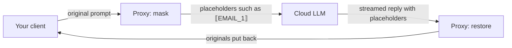
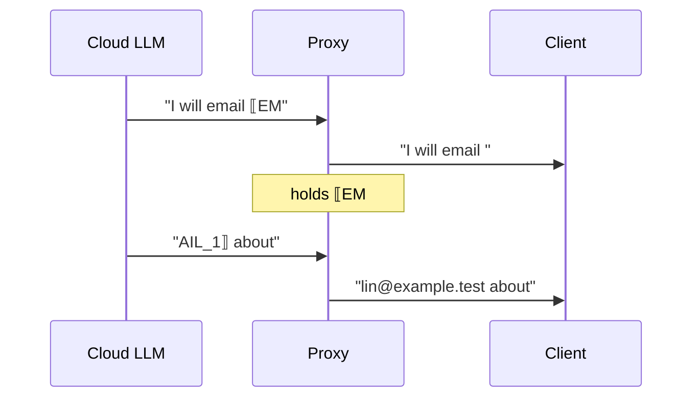

# redaction-proxy

[繁體中文](README.zh-TW.md) · [Technical details (zh-TW)](docs/DETAILS.md)

A small proxy that runs on your machine. Before your AI tool sends a prompt to a cloud LLM, it replaces email addresses, Taiwan national IDs, phone numbers, API keys, home-directory paths, and similar values with placeholders such as `⟦EMAIL_1⟧`; when the model's reply comes back, it puts the original values back, streamed replies included. It works with any OpenAI-compatible or Anthropic-compatible client and needs no local model. It **reduces** leakage of personal data and secrets; it does **not** make a conversation private.

> Status: private, pre-release, not published to npm. Tested against a local fake upstream only.

## ⚠️ Read first: what it does not protect

| Limitation | What it means |
| --- | --- |
| Hides entities, not meaning | The upstream still reads everything around the placeholders. `⟦PATH_1⟧/clients/acme-layoffs.md` still says a lot. |
| Names and addresses only if listed | By default there is no free-text name detection and no address rule. List names, companies, and code names in `terms` or `projectNames`, or turn on the [experimental name model](#-optional-name-model-experimental), which misses some names. Health conditions and salaries go through as written. |
| Some fields are not masked | Images, PDFs, audio, `metadata`, tool names, and signed thinking are forwarded unchanged. If a detected value appears in one of them, the whole request is refused with 422. |
| Cursor cannot use it | Cursor sends custom base-URL requests from Cursor's own servers, which cannot reach your `127.0.0.1`; and Cursor's backend sees the unmasked prompt before any proxy would. |
| Some split spellings are missed | Not detected: a private IP with spaces after the dots (`192. 168. 1. 2`); an API key split by a space or a line break (the high-entropy rule catches some halves); an email address written `name @ domain` with spaces (`wang.yichun @ example.tw`) or with a bare ` at ` (`wang.yichun at example.tw`) is not masked, because shell prompts (`root @ web01.example.com`), handles (`cc @ alice.me`), prose (`socket.io at github.com`), and matrix code (`a.b @ c.de`) look the same; the privacy classifier is the only guard for it. Detected: spaced or dashed terms, `＠`, `(at)`, `[at]`, `[dot]`, and IDs, business numbers, and mobile numbers with one separator inside. |
| Some encoded spellings are missed | Percent-encoded values (`lin.yating%40example.com`, `%E6%98%9F…` in a query string, `%2FUsers%2F…`) are decoded one level and masked as written, and the reply gets the encoded text back. A stray or truncated escape (`%FF`, a URL cut after `%E6`) does not stop the rest from decoding, decoded full-width or zero-width characters are folded as in plain text, and a stray escape right before a number or a token (`%E6%2B886…`, `%E609-1234-5678`, `%FFsk-…`) does not hide it. Not detected: a double-encoded value (`%2540`); a `+` meant as a space in a form-encoded query (`星河+計畫`); a value base64-encoded inside a URL (the privacy router decodes base64 only in tool output); an identification number right after a stray escape (`%E6A123456789`), because in Big5 and Shift-JIS the letter after a lead byte is part of the character (`%A4A` is 乙). For the same reason a Shift-JIS character whose trail byte is `A` can turn `%83AKIA…` into a masked key-shaped span. |
| One placeholder per term, first spelling restored | `星河計畫`, `星河 計畫`, and `NIMBUS-7` / `nimbus 7` each share one placeholder per configured term, and the reply gets the first spelling of the request back at every position. |
| Only the canonical placeholder | If the model rewrites `⟦EMAIL_1⟧` as `[EMAIL_1]`, you see it as written. |
| Model quality can drop | Tasks that operate on the masked value itself (turning an absolute path into a relative one, say) get worse. You see the placeholder; the failure is not silent. |
| Some characters are changed | By default control characters become visible stand-ins (`␛`), and a `⟦` or `⟧` already in the text becomes `⟪` or `⟫`. |
| A restart forgets continuations | Responses API `previous_response_id` relies on the last 256 responses held in memory; after a restart, placeholders from earlier turns are not restored. |
| No local authentication | It binds `127.0.0.1` only, but any process on your machine can use it. |
| Not tested against real services | Tests and the demo use a local fake upstream; nothing has been verified against OpenAI, Anthropic, DeepSeek, or real clients yet. |

## 🔄 How it works



- The same value gets the same placeholder throughout a request.
- The proxy keeps no conversation state. It renumbers from the full history on every request, so a conversation keeps the same numbering on every turn and upstream prompt caching keeps working.
- If any original can still be found in the request after masking, the proxy refuses to send it (422) instead of risking a leak.
- Your client sends its own key as usual; the proxy forwards it unchanged and never stores it.

When a placeholder is split across two streamed chunks, the proxy holds back only the part that could be a placeholder and sends everything else at once:



## 🔍 What gets masked

| Category | Example input | Upstream sees |
| --- | --- | --- |
| Email | `lin@example.test` | `⟦EMAIL_1⟧` |
| Home-directory path (prefix only) | `/Users/lin/notes.md` | `⟦PATH_1⟧/notes.md` |
| API keys and credentials | `sk-...`, `ghp_...`, `AKIA...`, JWT, `Bearer ...`, `password=...` | `⟦KEY_1⟧` (key names such as `password=` stay) |
| Taiwan national ID and resident certificate (**checksum verified**) | `A123456789` | `⟦TWID_1⟧` |
| Taiwan mobile | `0912-345-678`, `+886 912 345 678` | `⟦PHONE_1⟧` |
| Landline (after a keyword such as 電話 or tel) | `電話 02-2345-6789` | `電話 ⟦PHONE_1⟧` |
| Business number 統一編號 (after a keyword) | `統編 12345678` | `統編 ⟦TAXID_1⟧` |
| Card number (**Luhn verified**) | 13–19 digit card number | `⟦CARD_1⟧` |
| Private IP | `192.168.1.20` | `⟦IP_1⟧` |
| Internal host name | `nas.local`, `db.internal` | `⟦HOST_1⟧` |
| High-entropy string | hex or base64 of 32+ characters | `⟦ENTROPY_1⟧` |
| Words you list (`terms`) | `林小明` | `⟦TERM_1⟧` |
| Code names you list (`projectNames`) | `Nimbus` | `⟦PROJECT_1⟧` |

Full-width digits (`０９１２３４５６７８`), a full-width `＠`, and values split by zero-width characters are caught too. See the [technical details](docs/DETAILS.md#3-偵測規則) for every rule.

## 🚀 Quick start

Requires Node 22.19+ and pnpm.

```sh
pnpm install
pnpm demo          # keyless: fake upstream + proxy + one streamed request
pnpm build
node lib/cli.js    # starts on http://127.0.0.1:8787
```

`pnpm demo` prints:

```text
client sends:      請寄信給 lin.fictional@example.test，身分證 A123456789，檔案在 /Users/fictional-user/notes.md
[proxy log] POST /v1/chat/completions -> 200 masked 3 (EMAIL 1, TWID 1, PATH 1) restored 3 unknown 0 7ms
upstream received: 請寄信給 ⟦EMAIL_1⟧，身分證 ⟦TWID_1⟧，檔案在 ⟦PATH_1⟧/notes.md
client receives:   I will email lin.fictional@example.test about /Users/fictional-user/notes.md (ID A123456789).
```

## 🔌 Pointing clients at it

> **None of these has been verified with a real client yet.** Only `pnpm demo` and the tests against a fake upstream have actually run.

| Client | Setting | Status |
| --- | --- | --- |
| Claude Code | `ANTHROPIC_BASE_URL=http://127.0.0.1:8787 claude` | Untested |
| Anthropic SDK | `ANTHROPIC_BASE_URL=http://127.0.0.1:8787` (no `/v1`) | Untested |
| OpenAI SDK and most compatible tools | `OPENAI_BASE_URL=http://127.0.0.1:8787/v1` (with `/v1`) | Untested |
| curl | See below | Untested |
| Cursor | Not supported; see the limitations | — |

```sh
curl http://127.0.0.1:8787/v1/chat/completions \
  -H "authorization: Bearer $OPENAI_API_KEY" \
  -H "content-type: application/json" \
  -d '{"model":"gpt-4o-mini","messages":[{"role":"user","content":"email lin@example.test"}]}'
```

To use another compatible service, such as DeepSeek: `REDACTION_PROXY_OPENAI_UPSTREAM=https://api.deepseek.com node lib/cli.js`.

## ⚙️ Configuration

Pass a JSON file with `node lib/cli.js --config redaction.json`; environment variables override it. Keys never go in the file; an unknown key stops startup.

| Key | Default | Meaning |
| --- | --- | --- |
| `port` | `8787` | Binds `127.0.0.1` only. |
| `openaiUpstream` | `https://api.openai.com` | Upstream for Chat Completions and Responses. |
| `anthropicUpstream` | `https://api.anthropic.com` | Upstream for Anthropic Messages. |
| `redaction.terms` | none | Names and other words to mask, case-insensitive. |
| `redaction.projectNames` | none | Project code names to mask. |
| `redaction.allowlist` | `git@github.com`, `noreply@github.com` | Values never masked. |
| `redaction.rules` | all | Built-in rules to enable. |
| `nameModel` | none | Turns on the [experimental name model](#-optional-name-model-experimental). |
| `screen` | `replace` | On control characters, replace them with visible stand-ins (`replace`) or refuse the request (`refuse`). |
| `debugMasked` | `false` | Log each masked request body. |

```json
{
  "redaction": {
    "terms": ["林小明", "Denise Whitlock"],
    "projectNames": ["Nimbus"]
  }
}
```

See the [technical details](docs/DETAILS.md#12-完整設定) for the matching environment variables and the full reference. The log has one line per request with counts and duration only, never an original value or a header.

## 🧪 Optional name model (experimental)

Off by default. When configured, a small local model ([`Wismut/nym-pii-multilingual-small`](https://huggingface.co/Wismut/nym-pii-multilingual-small), MIT, edge-int8, 108 MB) also masks person names (`⟦NAME_1⟧`), companies (`⟦ORG_1⟧`), places (`⟦LOC_1⟧`), and addresses (`⟦ADDR_1⟧`) in what **you** write. It is experimental: it misses some names and masks some words that are not names. The numbers below are from synthetic data on an Apple M5 Max CPU.

What it reads, and what it does not:

- Only user messages: prose paragraphs of your own text. System prompts, assistant turns, tool results, code blocks, and code-, JSON-, YAML-, or log-shaped lines are not read, so a name inside pasted code or logs is not found there.
- A person name it finds is masked everywhere else in the request too, including system prompts and tool output, with the same placeholder (`許雅雯` and `許 雅 雯` share one). A single ASCII word (`Jordan`) is masked only where the model found it, because the same word elsewhere is too often a product or a setting. Companies, places, and addresses are masked only where found.
- Rules win: a span that overlaps an email, key, or other rule detection is dropped.
- Words such as `Kafka`, `Docker`, `Podman`, `Default`, `High`, and `Low` are on a default allowlist (`nameModel.allowlist`).
- A span can be too short or too long. A partly found Chinese name sends the rest as written (`林小明` → `⟦NAME_1⟧明`). A Japanese span can take the particle after the name (`佐藤美咲さんに`), so a reply that writes `⟦NAME_1⟧さん` is restored as `佐藤美咲さんにさん`.

Measured (one held-out run, numbers are recall unless noted):

| Item | Result | Note |
| --- | --- | --- |
| Names in prose, English / Japanese | 1.00 / 1.00 | |
| Names in prose, Traditional Chinese | **0.87** | Below the 0.90 target: about 1 name in 8 is missed. |
| Names in prose, Simplified Chinese | 1.00 held out, 0.75 dev | Small sample (16 names in dev). |
| Names in pasted code, logs, or JSON | 0.10–0.30 | Out of scope by design; list such names in `terms`. |
| Companies / places / addresses in prose | 0.71 / 0.88 / 0.82 | Addresses: Simplified Chinese 0.42, French 0.67. |
| Precision | 0.94 | Share of masked spans that were real names, companies, or places. |
| False positives in technical chat | 46 per 1,000 sentences (113 on the dev set) | Before the allowlist and the no-propagation rule for single words; mostly `Default` or tool names. |
| False positives in code | 0 | Code is not read. |
| Added memory | about +420 MB | With the 512-token window; +440 MB after a 16 KB message. |
| Added latency | p95 about 130 ms for 2 KB of Chinese prose, 80 ms for mixed prose | 16 KB of Chinese prose: about 1 s. Paragraphs already seen are cached. |

Setup:

```sh
pnpm install                                         # installs onnxruntime-node and tokenizers (optional, about 350 MB; rules-only: pnpm install --no-optional)
node scripts/fetch-name-model.mjs ~/models/nym       # about 125 MB from Hugging Face, sha256-checked
```

The script downloads `edge-int8/model_int8.onnx`, `edge-int8/config.json`, `edge-int8/tokenizer.json`, and `README.md` (the license notice) from `Wismut/nym-pii-multilingual-small` at revision `4348999cd3c2e20c49615e9af7c6bbb45b64cd85`, then writes `vocab.json`, `merges.txt`, and `added_tokens.json` beside them; the proxy loads those instead of the 12 MB `tokenizer.json`, which saves about 220 MB of memory. Then add to the config file:

```json
{ "nameModel": { "dir": "/Users/you/models/nym" } }
```

or set `REDACTION_PROXY_NAME_MODEL_DIR=/Users/you/models/nym`.

| Key | Default | Meaning |
| --- | --- | --- |
| `nameModel.dir` | required | Absolute path of the directory the script filled. |
| `nameModel.threshold` | `0.3` | Lower finds more and masks more non-names. |
| `nameModel.categories` | `NAME`, `ORG`, `LOC`, `ADDR` | Categories to mask. |
| `nameModel.windowTokens` / `windowOverlap` | `512` / `128` | Tokens per model pass and overlap; larger windows use more memory and found fewer names. |
| `nameModel.allowlist` | tools and setting words | Whole spans never masked; replaces the default list. |
| `nameModel.required` | `false` | If inference fails, `false` masks that request with the rules only and logs `nameModel failed`; `true` refuses it with 503. |

The model loads before the port opens; a missing file or package stops startup and names it. Turning the model on changes the policy digest, so a host that keeps a span index refuses to continue an older index under it.

## 📊 Measured numbers

| Item | Result | What it means |
| --- | --- | --- |
| Tests | 418, all passing | Rules, engine, adversarial inputs, and streamed and non-streamed requests for all three APIs against a fake upstream. |
| Credential false positives | **0.76** per 1,000 code lines | Measured on DeepSeek Harness source, which holds no real key (698k code lines): about one spot every 1,300 lines is mistaken for a key and masked. |
| Restore failures | 0 | Every file that was masked restores byte for byte. |
| Speed | about 850k lines in 5 s | Apple M5 Max. |

A false positive costs the model one unnecessary placeholder, which is restored in the reply. The corpus is English code; Chinese prose has not been measured. Reproduce with `pnpm test` and `pnpm bench`.

## 🆚 Compared with dsh-privacy-router

| | redaction-proxy (this repo) | [dsh-privacy-router](https://github.com/PersonalAssistanceHsin/dsh-privacy-router) |
| --- | --- | --- |
| Form | Standalone HTTP proxy | dsh plugin |
| Clients | Any OpenAI- or Anthropic-compatible client | dsh only |
| Routing | None: every request goes upstream, masked | Decides per turn between a local model and the cloud |
| Local model | Not needed | Needed |
| Masking core | Lives here (`src/core/`) | dsh-addons' redaction packages vendor this core as a git submodule |
| Streaming restore | `src/core/restore.ts` | Still has its own restorer; unification is planned |

## ❓ FAQ

**Does it make my conversation private?** No. It reduces leakage of detectable personal data and credentials, but the upstream still reads everything else.

**Why `⟦EMAIL_1⟧` and not a fake email?** In measurements, models kept placeholders verbatim 100% of the time against 75% for fake values, and fake values caused silent errors no restore can undo.

**Will my name be masked?** If you list it in `terms`, always. With the experimental name model, usually when you write it in a message, but not always: it finds about 7 of 8 Traditional Chinese names and does not read code or logs.

**Why was my request refused with 422?** A detected value also appears in a field the proxy does not rewrite (an image URL or metadata, for instance), or you set `screen: "refuse"`. The message names the field, never the value.

**Does the proxy store my key or my conversation?** Keys are forwarded and never stored. Conversations are not stored, except the inputs of the last 256 Responses API responses, kept in memory for continuations.

**Can I run it on a server for other people?** No. The bind address is fixed to `127.0.0.1`, and there is no authentication.

## 📚 More

[docs/DETAILS.md](docs/DETAILS.md) (Traditional Chinese) covers the architecture, core API, masking order and prompt caching, unmasked fields, 422 refusals, streaming restore internals, `previous_response_id`, logging, control-character screening, the threat model, the full configuration, tests, and the false-positive method.
