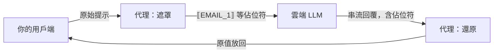
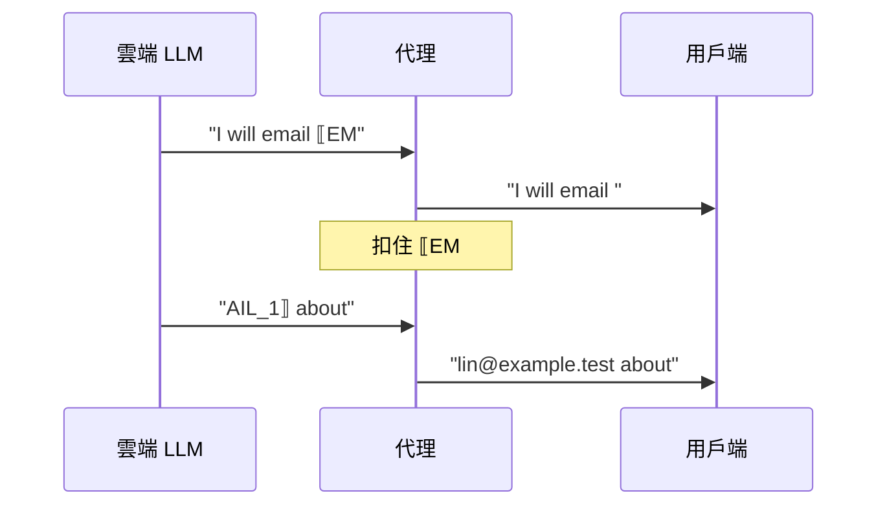

# redaction-proxy

[English](README.md) · [技術細節](docs/DETAILS.md)

在你電腦上執行的小型代理。你的 AI 工具把提示送往雲端 LLM 之前，它先把 email、身分證字號、手機、API 金鑰、家目錄路徑等換成 `⟦EMAIL_1⟧` 這類佔位符；模型回覆回來時，再把佔位符換回原值，串流回覆也一樣。它適用任何 OpenAI 相容或 Anthropic 相容的用戶端，不需要本機模型。它**減少**個資與機密外洩，但**不會**讓對話變成私密的。

> 狀態：私有、尚未發布，沒有發布到 npm。只對本機假上游測試過。

## ⚠️ 先讀：它不保護什麼

| 限制 | 意思 |
| --- | --- |
| 藏實體，不藏語意 | 上游仍讀得到佔位符周圍的一切。`⟦PATH_1⟧/clients/acme-layoffs.md` 依然透露很多。 |
| 人名、地址只有列出才遮 | 預設沒有自由文字的人名偵測，也沒有地址規則。人名、公司名、代號要列進 `terms` 或 `projectNames`，或開啟[實驗性的人名模型](#-選用的人名模型實驗性)，但它會漏掉一些人名。病況、薪資照原樣送出。 |
| 有些欄位不遮 | 圖片、PDF、音訊、`metadata`、工具名稱、帶簽章的 thinking 原樣轉送。若偵測到的值出現在這些欄位，整個請求以 422 拒絕。 |
| Cursor 不能用 | Cursor 的自訂 base URL 請求是從 Cursor 自己的伺服器發出，連不到你的 `127.0.0.1`；而且 Cursor 後端在任何代理之前就看到未遮罩的提示。 |
| 有些拆開的寫法抓不到 | 偵測不到：點後加空格的私有 IP（`192. 168. 1. 2`）；被空格或換行拆開的 API 金鑰（高熵規則只抓得到部分片段）；寫成 `name @ domain`（`@` 兩側有空白，`wang.yichun @ example.tw`）或單獨用 ` at `（`wang.yichun at example.tw`）的 email 不遮，因為 shell 提示字元（`root @ web01.example.com`）、帳號標記（`cc @ alice.me`）、英文散文（`socket.io at github.com`）與矩陣程式碼（`a.b @ c.de`）長得一樣；這類 email 只有隱私分類器把關。抓得到：加了空格或連字號的 terms、`＠`、`(at)`、`[at]`、`[dot]`，以及中間有一個分隔符的身分證字號、統編、手機號碼。 |
| 有些編碼寫法抓不到 | 百分比編碼（percent-encoding）的值（`lin.yating%40example.com`、查詢字串裡的 `%E6%98%9F…`、`%2FUsers%2F…`）會解碼一層後偵測，遮罩範圍是編碼原文，回覆還原時寫回編碼原文。夾雜無效或截斷的位元組（`%FF`、在 `%E6` 處被截斷的 URL）不會讓其餘部分不解碼，解碼後的全形字元與零寬字元也和一般文字一樣折疊，緊接在無效位元組後面的號碼或金鑰（`%E6%2B886…`、`%E609-1234-5678`、`%FFsk-…`）也抓得到。偵測不到：編碼兩次的值（`%2540`）；表單編碼查詢中代表空格的 `+`（`星河+計畫`）；URL 裡經 base64 編碼的值（隱私路由只在工具輸出中解碼 base64）；緊接在無效位元組後面的身分證字號（`%E6A123456789`），因為 Big5 與 Shift-JIS 中緊接在前導位元組後面的字母是該字的一部分（`%A4A` 是「乙」）。同理，尾位元組為 `A` 的 Shift-JIS 字元可能讓 `%83AKIA…` 被遮成形似金鑰的範圍。 |
| 一個 term 一個佔位符，還原成第一種寫法 | `星河計畫`、`星河 計畫` 與 `NIMBUS-7`、`nimbus 7` 都依所設定的 term 共用一個佔位符，回覆中每個位置都還原成請求裡第一次出現的寫法。 |
| 只認標準佔位符 | 模型若把 `⟦EMAIL_1⟧` 改寫成 `[EMAIL_1]`，你會原樣看到它。 |
| 模型品質可能下降 | 需要直接操作被遮值的任務（例如把絕對路徑改成相對路徑）會變差。你會看到佔位符，不是靜默出錯。 |
| 會改動一些字元 | 預設把控制字元換成可見字元（`␛`），把原文中的 `⟦` `⟧` 換成 `⟪` `⟫`。 |
| 重啟會忘記接續對話 | Responses API 的 `previous_response_id` 依賴記憶體中最近 256 個回應；重啟後舊輪次的佔位符無法還原。 |
| 本機沒有驗證 | 只綁定 `127.0.0.1`，但你電腦上的任何程式都能使用它。 |
| 尚未對真實服務測試 | 測試與示範都用本機假上游，尚未對 OpenAI、Anthropic、DeepSeek 或真實用戶端驗證。 |

## 🔄 運作方式



- 同一個值在同一個請求中一律用同一個佔位符。
- 代理不存對話狀態。每次請求都從完整歷史重新編號，所以同一段對話每一輪的編號一致，上游的提示快取照常生效。
- 遮罩後若在請求中仍找得到偵測到的值，代理會拒絕送出（422），而不是冒險外洩。規則偵測到的值在任何位置都算，連黏在較長字串裡也算（`tel0912345678`）。[人名模型](#-選用的人名模型實驗性)找到的值若是以空格分詞的文字，只算完整單字，所以 `Leeds` 裡的 `Lee` 不算外洩；中文、日文、韓文的值在任何位置都算。
- 金鑰照常由用戶端送出，代理原樣轉送，從不儲存。

佔位符被切在兩個串流片段之間時，代理只扣住可能是佔位符的那一小段，其餘立刻送出：



## 🔍 會遮哪些東西

| 類別 | 原文範例 | 上游看到 |
| --- | --- | --- |
| Email | `lin@example.test` | `⟦EMAIL_1⟧` |
| 家目錄路徑（只遮前綴） | `/Users/lin/notes.md` | `⟦PATH_1⟧/notes.md` |
| API 金鑰與憑證 | `sk-...`、`ghp_...`、`AKIA...`、JWT、`Bearer ...`、`password=...` | `⟦KEY_1⟧`（`password=` 這類鍵名保留） |
| 身分證、居留證（**驗證檢查碼**） | `A123456789` | `⟦TWID_1⟧` |
| 手機 | `0912-345-678`、`+886 912 345 678` | `⟦PHONE_1⟧` |
| 市話（需「電話」、tel 等關鍵詞） | `電話 02-2345-6789` | `電話 ⟦PHONE_1⟧` |
| 統一編號（需關鍵詞） | `統編 12345678` | `統編 ⟦TAXID_1⟧` |
| 信用卡號（**Luhn 驗證**） | 13–19 碼卡號 | `⟦CARD_1⟧` |
| 私有 IP | `192.168.1.20` | `⟦IP_1⟧` |
| 內部主機名 | `nas.local`、`db.internal` | `⟦HOST_1⟧` |
| 高熵字串 | 32 字元以上的 hex 或 base64 | `⟦ENTROPY_1⟧` |
| 你列出的字詞（`terms`） | `林小明` | `⟦TERM_1⟧` |
| 你列出的代號（`projectNames`） | `Nimbus` | `⟦PROJECT_1⟧` |

全形數字（`０９１２３４５６７８`）、全形 `＠`、夾零寬字元的值也抓得到。完整規則見[技術細節](docs/DETAILS.md#3-偵測規則)。

## 🚀 快速開始

需要 Node 22.19 以上與 pnpm。

```sh
pnpm install
pnpm demo          # 不需金鑰：假上游 + 代理 + 一次串流請求
pnpm build
node lib/cli.js    # 在 http://127.0.0.1:8787 啟動
```

`pnpm demo` 的輸出：

```text
client sends:      請寄信給 lin.fictional@example.test，身分證 A123456789，檔案在 /Users/fictional-user/notes.md
[proxy log] POST /v1/chat/completions -> 200 masked 3 (EMAIL 1, TWID 1, PATH 1) restored 3 unknown 0 7ms
upstream received: 請寄信給 ⟦EMAIL_1⟧，身分證 ⟦TWID_1⟧，檔案在 ⟦PATH_1⟧/notes.md
client receives:   I will email lin.fictional@example.test about /Users/fictional-user/notes.md (ID A123456789).
```

## 🔌 讓用戶端走代理

> 以下設定**都尚未在真實用戶端驗證**，只有 `pnpm demo` 與對假上游的測試實際跑過。

| 用戶端 | 設定 | 狀態 |
| --- | --- | --- |
| Claude Code | `ANTHROPIC_BASE_URL=http://127.0.0.1:8787 claude` | 未測試 |
| Anthropic SDK | `ANTHROPIC_BASE_URL=http://127.0.0.1:8787`（不加 `/v1`） | 未測試 |
| OpenAI SDK 與多數相容工具 | `OPENAI_BASE_URL=http://127.0.0.1:8787/v1`（要加 `/v1`） | 未測試 |
| curl | 見下方 | 未測試 |
| Cursor | 不支援，見限制 | — |

```sh
curl http://127.0.0.1:8787/v1/chat/completions \
  -H "authorization: Bearer $OPENAI_API_KEY" \
  -H "content-type: application/json" \
  -d '{"model":"gpt-4o-mini","messages":[{"role":"user","content":"寄信給 lin@example.test"}]}'
```

要改用其他相容服務，例如 DeepSeek：`REDACTION_PROXY_OPENAI_UPSTREAM=https://api.deepseek.com node lib/cli.js`。

## ⚙️ 設定

用 `node lib/cli.js --config redaction.json` 指定 JSON 檔，環境變數可覆寫。金鑰永遠不放在檔案裡；不認得的鍵會讓啟動失敗。

| 鍵 | 預設 | 說明 |
| --- | --- | --- |
| `port` | `8787` | 只綁定 `127.0.0.1`。 |
| `openaiUpstream` | `https://api.openai.com` | Chat Completions 與 Responses 的上游。 |
| `anthropicUpstream` | `https://api.anthropic.com` | Anthropic Messages 的上游。 |
| `redaction.terms` | 無 | 要遮的人名等字詞，不分大小寫。 |
| `redaction.projectNames` | 無 | 要遮的專案代號。 |
| `redaction.allowlist` | `git@github.com`、`noreply@github.com` | 永遠不遮的值。 |
| `redaction.rules` | 全部 | 要啟用的內建規則。 |
| `nameModel` | 無 | 開啟[實驗性的人名模型](#-選用的人名模型實驗性)。 |
| `screen` | `replace` | 遇到控制字元時改成可見字元（`replace`）或拒絕請求（`refuse`）。 |
| `debugMasked` | `false` | 在日誌中記錄遮罩後的請求本文。 |

```json
{
  "redaction": {
    "terms": ["林小明", "Denise Whitlock"],
    "projectNames": ["Nimbus"]
  }
}
```

對應的環境變數與完整說明見[技術細節](docs/DETAILS.md#12-完整設定)。日誌每個請求一行，只有計數與耗時，絕不含原始值或標頭。

## 🧪 選用的人名模型（實驗性）

預設關閉。設定後，一個小型本機模型（[`Wismut/nym-pii-multilingual-small`](https://huggingface.co/Wismut/nym-pii-multilingual-small)，MIT 授權，edge-int8，108 MB）會在**你**寫的文字中另外遮掉人名（`⟦NAME_1⟧`）、公司（`⟦ORG_1⟧`）、地名（`⟦LOC_1⟧`）與地址（`⟦ADDR_1⟧`）。它是實驗性功能：會漏掉一些人名，也會把一些不是人名的字遮掉。以下數字來自合成資料，在 Apple M5 Max CPU 上量測。

它讀什麼、不讀什麼：

- 只讀使用者訊息中你自己寫的散文段落。系統提示、助理回覆、工具結果、程式碼區塊，以及看起來像程式碼、JSON、YAML 或日誌的行都不讀，所以貼上的程式碼或日誌裡的人名在那裡不會被找到。
- 它找到的人名、公司、地名、地址，會在整個請求中用同一個佔位符遮掉：系統提示、助理回覆、工具結果、工具呼叫參數（`許雅雯` 與 `許 雅 雯` 共用一個，`Jordan` 與 `JORDAN` 也是）。以空格分詞的文字只比對完整單字（`Leeds` 裡的 `Lee` 不遮）；中文、日文、韓文在任何位置都比對。只有一個字的值只在找到的位置遮。
- 全名只會遮其他地方的全名：找到 `Lee Morgan` 後，單獨出現的 `Lee`、`Morgan`，或 `Lee "Lefty" Morgan`，都照原樣送出。編碼過的寫法（URL 中的 `Lee%20Morgan`）與黏在一起的寫法（`LeeMorgan`）既不遮也不拒絕。
- 模型誤認成人名的字也會在整個請求中被遮，靠允許清單擋下。
- 規則優先：與 email、金鑰等規則偵測重疊的範圍會被捨棄。
- `Kafka`、`Docker`、`Podman`、`Default`、`High`、`Low` 這類字在預設允許清單（`nameModel.allowlist`）中。
- 範圍可能太短或太長。中文人名只找到一部分時，其餘的字照原樣送出（`林小明` → `⟦NAME_1⟧明`）；中文範圍也可能多帶下一個字（`刘建国会`）。日文人名後的敬稱與助詞（`さん`、`様`、`に`、`は` 等）會從範圍中切掉，所以 `佐藤美咲さんに` 送出時是 `⟦NAME_1⟧さんに`。

實測（保留集只跑一次；未註明者為召回率）：

| 項目 | 結果 | 說明 |
| --- | --- | --- |
| 散文中的人名，英文／日文 | 1.00／1.00 | |
| 散文中的人名，繁體中文 | **0.87** | 未達 0.90 目標：大約每 8 個人名漏 1 個。 |
| 散文中的人名，簡體中文 | 保留集 1.00、開發集 0.75 | 樣本小（開發集 16 個人名）。 |
| 貼上的程式碼、日誌、JSON 中的人名 | 0.10–0.30 | 設計上不處理；這類人名請列進 `terms`。 |
| 散文中的公司／地名／地址 | 0.71／0.88／0.82 | 地址：簡體中文 0.42、法文 0.67。 |
| 精確率 | 0.94 | 被遮的範圍中確實是人名、公司或地名的比例。 |
| 技術對話中的誤遮 | 每千句 46 處（開發集 113 處） | 量測時尚未有允許清單；多半是 `Default` 或工具名稱。加上預設允許清單後，開發集每千句 4 處，但清單正是依這組資料建的。每一處都會在整個請求中被遮。 |
| 程式碼中的誤遮 | 0 | 程式碼不讀。 |
| 增加的記憶體 | 約 +420 MB | 512 token 視窗；處理過 16 KB 訊息後約 +440 MB。 |
| 增加的延遲 | 2 KB 中文散文 p95 約 130 ms，中英混合約 80 ms | 16 KB 中文散文約 1 秒。看過的段落會快取。 |

設定方式：

```sh
pnpm add -D onnxruntime-node@1.30.0 tokenizers@0.23.2  # 模型的執行環境，約 350 MB；只跑 pnpm install 不會安裝
node scripts/fetch-name-model.mjs ~/models/nym       # 從 Hugging Face 下載約 125 MB，並檢查 sha256
```

這個腳本從 `Wismut/nym-pii-multilingual-small` 的 `4348999cd3c2e20c49615e9af7c6bbb45b64cd85` 版本下載 `edge-int8/model_int8.onnx`、`edge-int8/config.json`、`edge-int8/tokenizer.json` 與 `README.md`（授權聲明），再在同一目錄寫出 `vocab.json`、`merges.txt`、`added_tokens.json`；代理載入這三個檔，不載入 12 MB 的 `tokenizer.json`，可省下約 220 MB 記憶體。接著在設定檔加上：

```json
{ "nameModel": { "dir": "/Users/you/models/nym" } }
```

或設定 `REDACTION_PROXY_NAME_MODEL_DIR=/Users/you/models/nym`。

| 鍵 | 預設 | 說明 |
| --- | --- | --- |
| `nameModel.dir` | 必填 | 腳本寫入的目錄，絕對路徑。 |
| `nameModel.threshold` | `0.3` | 越低找到越多，也越常遮到不是人名的字。 |
| `nameModel.categories` | `NAME`、`ORG`、`LOC`、`ADDR` | 要遮的類別。 |
| `nameModel.windowTokens`／`windowOverlap` | `512`／`128` | 每次模型推論的 token 數與重疊；視窗越大越耗記憶體，找到的人名也越少。 |
| `nameModel.allowlist` | 工具與設定值用字 | 整段完全相符就不遮；設定後取代預設清單。 |
| `nameModel.required` | `false` | 推論失敗時，`false` 讓該請求只用規則遮罩並在日誌記 `nameModel failed`；`true` 以 503 拒絕。 |

模型在開放連接埠之前載入；缺檔案或套件時啟動失敗並指出缺什麼。開啟模型會改變 policy digest，所以保存 span index 的宿主不會在新設定下接續舊的 index。

## 📊 實測數字

| 項目 | 結果 | 代表什麼 |
| --- | --- | --- |
| 測試 | 418 個全部通過 | 規則、引擎、對抗輸入、對假上游的三種 API 串流與非串流。 |
| 憑證誤遮 | 每千行程式碼 **0.76** 處 | 在不含真實金鑰的 DeepSeek Harness 原始碼上量測（69.8 萬行程式碼），平均約 1,300 行有一處被誤當成金鑰而遮掉。 |
| 還原失敗 | 0 | 遮罩成功的檔案全部都能逐位元組還原。 |
| 速度 | 約 85 萬行 / 5 秒 | Apple M5 Max。 |

誤遮的代價是模型看到一個不必要的佔位符，回覆時會被換回原值。語料是英文程式碼，中文散文的誤遮率尚未量測。以 `pnpm test` 與 `pnpm bench` 重現。

## 🆚 和 dsh-privacy-router 的差別

| | redaction-proxy（本倉庫） | [dsh-privacy-router](https://github.com/PersonalAssistanceHsin/dsh-privacy-router) |
| --- | --- | --- |
| 形式 | 獨立的 HTTP 代理 | dsh 的外掛 |
| 用戶端 | 任何 OpenAI 或 Anthropic 相容用戶端 | 只限 dsh |
| 路由 | 不路由：每個請求都遮罩後送往上游 | 每一輪決定送本機模型還是雲端 |
| 本機模型 | 不需要 | 需要 |
| 遮罩核心 | 在這裡（`src/core/`） | dsh-addons 的 redaction 套件以 git submodule 引用這份核心 |
| 串流還原 | `src/core/restore.ts` | 仍有自己的還原器，未來預計統一 |

## ❓ 常見問題

**用了它，對話就是私密的嗎？** 不是。它減少可偵測的個資與憑證外洩，但上游仍讀得到其餘內容。

**為什麼用 `⟦EMAIL_1⟧`，不用假的 email？** 實測時模型逐字保留佔位符的比例是 100%，假值只有 75%，而且假值造成了無法還原的靜默錯誤。

**我的名字會被遮嗎？** 列進 `terms` 就一定會。開啟實驗性人名模型時，你在訊息中寫到它通常會被遮，但不保證：繁體中文人名大約每 8 個漏 1 個，程式碼與日誌也不讀。

**為什麼請求被 422 拒絕？** 遮罩後的請求中仍有偵測到的值，通常是在代理不改寫的欄位（例如圖片 URL 或 metadata），或你設定了 `screen: "refuse"`。訊息會指出欄位，不含值。

**代理會存我的金鑰或對話嗎？** 金鑰原樣轉送，不儲存。對話不存，唯一例外是 Responses API 接續用的最近 256 份輸入，只在記憶體中。

**能放在伺服器上給別人用嗎？** 不能。綁定位址固定為 `127.0.0.1`，而且沒有身分驗證。

## 📚 更多

[docs/DETAILS.md](docs/DETAILS.md) 包含架構、核心 API、遮罩順序與提示快取、不遮的欄位、422 拒絕、串流還原內部、`previous_response_id`、日誌、控制字元篩檢、威脅模型、完整設定、測試與誤遮量測方法。
