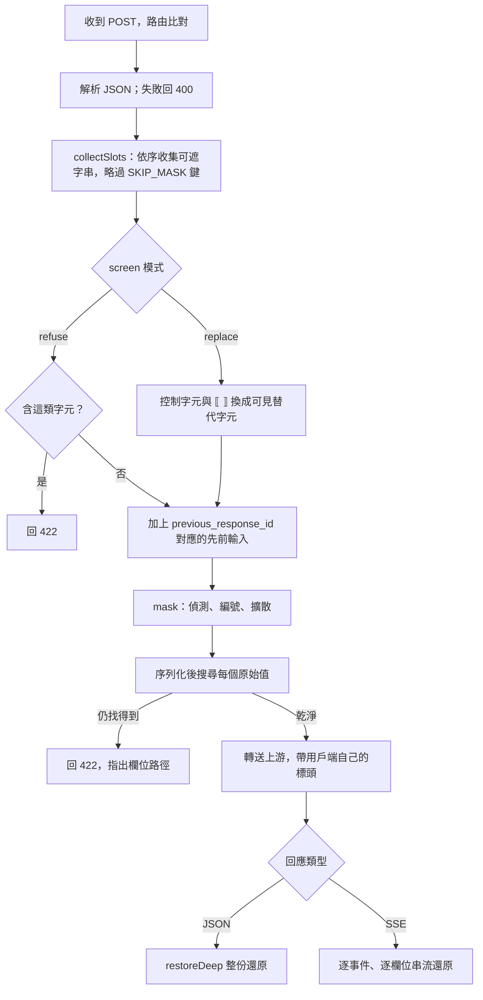
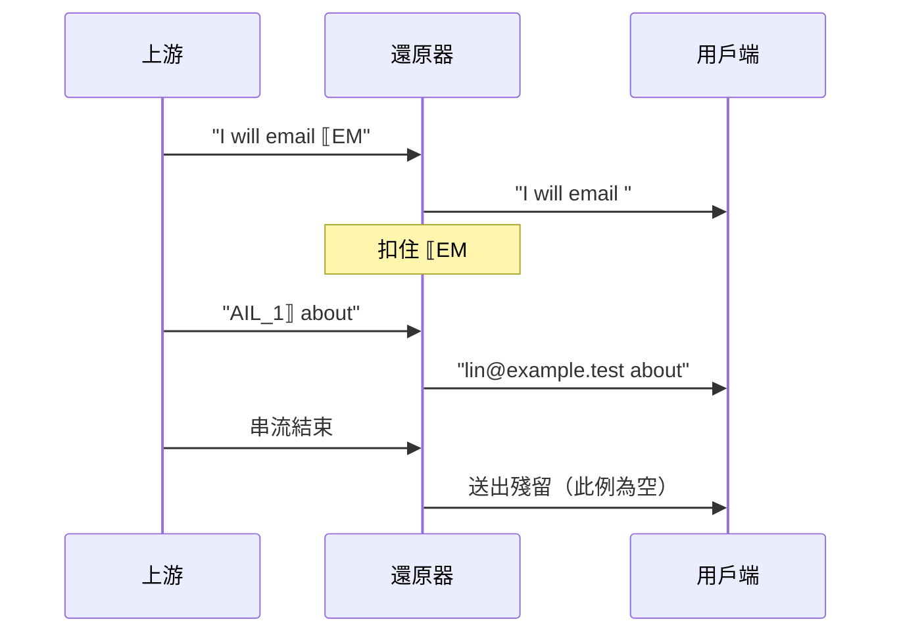

# redaction-proxy 技術細節

這份文件是給要修改、審查或整合 redaction-proxy 的人看的完整技術參考。一般使用請先讀 [README](../README.zh-TW.md)。

## 目錄

1. [架構](#1-架構)
2. [核心 API](#2-核心-api)
3. [偵測規則](#3-偵測規則)
4. [遮罩順序與提示快取](#4-遮罩順序與提示快取)
5. [不遮就轉送的欄位](#5-不遮就轉送的欄位)
6. [拒絕與錯誤狀態碼](#6-拒絕與錯誤狀態碼)
7. [串流還原](#7-串流還原)
8. [對話內編號與 previous_response_id](#8-對話內編號與-previous_response_id)
9. [控制字元篩檢](#9-控制字元篩檢)
10. [日誌](#10-日誌)
11. [威脅模型](#11-威脅模型)
12. [完整設定](#12-完整設定)
13. [測試](#13-測試)
14. [誤遮率量測方法](#14-誤遮率量測方法)
15. [公開前尚待完成](#15-公開前尚待完成)

## 1. 架構

| 目錄 | 內容 |
| --- | --- |
| `src/core/` | 遮罩核心：規則、佔位符引擎、嚴格與串流還原。只依賴 Node 標準函式庫，沒有宿主型別。 |
| `src/core/rules/` | 規則偵測器 `RulesDetector`：各規則、NFKC 投影、百分比解碼投影、同值擴散、輸入篩檢。 |
| `src/proxy/config.ts` | 設定檔載入與驗證。 |
| `src/proxy/server.ts` | HTTP 代理：收集可遮字串、遮罩、外洩檢查、轉送、JSON 與 SSE 還原。 |
| `src/cli.ts` | 命令列 `node lib/cli.js [--config path]`。 |
| `bench/` | 誤遮率量測（`pnpm bench`）與免金鑰示範（`pnpm demo`）。 |

DeepSeek Harness 透過 dsh-addons 的 redaction 套件以 git submodule（`dsh-addons/vendor/redaction-proxy`）使用這份核心；核心只在這個倉庫修改。[dsh-privacy-router](https://github.com/PersonalAssistanceHsin/dsh-privacy-router) 目前還有自己的串流還原器，未來預計統一到這裡的 `createStreamRestorer`。

一個請求的處理順序（`server.ts` 的 `forward`）：



## 2. 核心 API

`src/core/index.ts` 匯出：

| 名稱 | 用途 |
| --- | --- |
| `mask(detector, texts, index)` | 遮罩一組具位置的字串，回傳遮罩後字串、新的 span、已套用的 span、保留的 id，以及記憶體中的 `registry`。 |
| `restore(output, registry)` | 嚴格還原：未綁定的 id 或不成對的分隔符會讓整段失敗（`unknown-placeholder` 或 `malformed-placeholder`）。 |
| `createStreamRestorer(registry, { json })` | 寬鬆的串流還原器，永不失敗，詳見第 7 節。 |
| `restoreLenient` | 一次性的寬鬆還原。 |
| `RulesDetector`、`resolveRulesConfig`、`RULE_NAMES`、`DEFAULT_ALLOWLIST`、`DETECTOR_VERSION` | 規則偵測器與其設定。`DETECTOR_VERSION` 目前是 `rules-4`。 |
| `isTaiwanNationalId` | 身分證與居留證檢查碼驗證。 |
| `screenText` | 輸入篩檢，詳見第 9 節。 |
| `emptyRedactionIndex`、`foldRedactionScan` | 給需要持久化掃描結果的宿主使用的 span 索引。 |
| `placeholder`、`applySpans`、`PLACEHOLDER_OPEN`、`PLACEHOLDER_CLOSE`、`REDACTION_ID_PATTERN` | 佔位符格式工具。id 格式為 `^[A-Z][A-Z0-9]*_[1-9]\d*$`。 |
| `RedactionError` | 遮罩拒絕輸入時拋出，`code` 為 `unsupported`、`conflict` 或 `policy`。 |

`RedactionError` 的三種代碼：

| 代碼 | 意義 |
| --- | --- |
| `unsupported` | 文字中已含佔位符分隔符 `⟦` 或 `⟧`。 |
| `conflict` | 記錄的 span 對不上目前文字、兩個原始值共用一個 id，或已綁定 id 的字面形式出現在原文中。 |
| `policy` | 索引是在另一個偵測政策下記錄的，類別集合不能在 session 中途擴充。 |

錯誤訊息只含位置、id 與摘要值，絕不含原始值。`registry` 只存在記憶體，從不序列化；每次 `mask` 都從收到的文字重建。代理本身每次都傳入 `emptyRedactionIndex()`，不保存索引。

## 3. 偵測規則

| 規則 | 類別 | 細節 |
| --- | --- | --- |
| `email` | `EMAIL` | 以 `@` 為錨點、有上限地向兩側展開。也接受防爬寫法：`＠`、`(at)`、`[at]`，以及網域中的 `[dot]`、`(dot)`；這些寫法要求頂級網域是兩字母國碼或常見 gTLD（`com`、`org`、`dev`、`test` 等）。`@`、`＠` 必須緊貼前後兩段；`(at)`、`[at]` 兩側可有空白（不跨行），此時頂級網域須全小寫、本地部分須是以 `.`、`_`、`+` 連接的字（`wang.yichun`）且不以 `self.`、`this.` 等程式根開頭。`name @ domain`（`@` 兩側有空白）與單獨的 ` at ` **不遮**：shell 提示字元（`root @ web01.example.com`）、帳號標記（`cc @ alice.me`、`meet @ cafe.tw`）、英文散文（`socket.io at github.com`、`contact fly.io at community.fly.io`）與矩陣程式碼（`layer.weight @ state.dx`）在字面上與地址無法區分；頂級網域白名單與關鍵詞閘門都試過（WO-6 第 3、4 輪），前者擋不住誤遮、後者使召回掉到 41/54。這類 email 只有隱私分類器把關。 |
| `user-path` | `PATH` | 只遮家目錄前綴（`/Users/x`、`/home/x`、`C:\Users\x`、`~x/`），含 JSON 跳脫形式；路徑其餘部分保持可讀。 |
| `api-key` | `KEY` | PEM、AWS `AKIA`/`ASIA`、GitHub `ghp_` 系列、`sk-`、Slack `xox` 與 webhook、Google `AIza`、JWT、`Authorization`/`Bearer`、URL 中的帳密、`curl -u`、`--password x`，以及鍵名代表憑證的 `key=value` 指派（含中英文關鍵詞）。 |
| `tw-national-id` | `TWID` | 身分證字號（第二碼 1/2）與居留證號（第二碼 8/9），**驗證檢查碼**。也接受字母後（`A 123456789`）或第四字元後（`A123-456789`）的一個空白或連字號；其他位置的分隔不算。 |
| `phone` | `PHONE` | 手機 `09xx-xxx-xxx`、`09-xxxx-xxxx`、`09 xxxx xxxx`（同一種分隔符）與 `+886` 形式不需關鍵詞，前後緊鄰英文字母或數字時不遮（雜湊值 `…e5a0912345678dd…`、`abc0912345678`），中間四碼像年份（`09-2026-1005`）時視為日期不遮；市話（`02-2345-6789`、`(02)2345-6789`）需在「電話」、tel 等關鍵詞之後。 |
| `tax-id` | `TAXID` | 「統一編號」、「統編」、tax id、VAT 等關鍵詞後的 8 碼數字。中間有一個空白或連字號（`統編 3208-5109`）時須通過統編檢查碼。同一段數字也符合市話關鍵詞（`聯絡…統編：02086968`）時報為 `TAXID`。 |
| `card` | `CARD` | 13–19 碼、**Luhn 驗證**、檢查發卡機構前綴，並把視窗錨定在數字組邊界，避免遮到時間戳與 snowflake id。 |
| `ip` | `IP` | RFC 1918 私有位址，並檢查每段數值。 |
| `host` | `HOST` | `.local`、`.lan`、`.internal` 主機名。 |
| `entropy` | `ENTROPY` | 32 字元以上的高熵 hex，或大小寫與數字混合的 base64；`commit`、`sha`、`hash` 等字旁的雜湊放過。緊鄰憑證字眼的高熵字串改報為 `KEY`。 |
| `terms` | `TERM` | 你指定的字面值，在 NFKC 投影上不分大小寫比對，也比對 `\uXXXX` 跳脫形式。字面值在字母、數字、中日韓字元交界與每個中日韓字元之間可多或少一個分隔符（空白、`-`、`_`、`‧`、`・`、`·`），所以 `星河計畫` 也比對 `星河 計畫`、`星河-計畫`，`NIMBUS-7` 也比對 `NIMBUS 7`、`NIMBUS_7`、`nimbus7`。同一個 term 的各種寫法共用一個佔位符（`identityKey`），還原時寫回該次請求第一次綁定的寫法。 |
| `projectNames` | `PROJECT` | 同上，另一個類別。 |

- **NFKC 投影。** 每條規則也會在去除零寬字元後的 NFKC 投影上再跑一次，所以全形數字（`０９１２３４５６７８`）、全形 `＠`、`ali\u200bce@…` 都抓得到。
- **百分比解碼投影。** 每條規則（包括 `terms`）也會在百分比解碼後的文字上再跑一次。每一段連續的 `%XX` 以 UTF-8 解碼；不是合法 UTF-8 的一段（例如截斷的 `%E6`）保持原樣，`+` 不當成空格。偵測到的範圍對應回整段編碼原文，佔位符蓋住編碼原文，登錄表綁定的也是編碼原文，所以還原與工具參數都逐位元組寫回原樣（大小寫混用的 `%2f` 也一樣）。編碼過的 term 不與未編碼寫法共用佔位符，各自還原成自己的寫法。只解碼一層：`%2540` 不偵測。解碼投影與 NFKC 投影不疊加，所以百分比編碼的全形字元（`%EF%BC%A0`）不折疊。URL 裡經 base64 編碼的值不解碼；隱私路由只在工具輸出中解碼 base64。
- **同值擴散。** 一個值被偵測到之後，它在同一請求中的其他出現位置也會用同一個佔位符遮掉（`propagate`）。
- **允許清單。** `allowlist` 中的字面值不會被任何內建規則遮罩，預設是 `git@github.com` 與 `noreply@github.com`。設為空陣列就什麼都不放過。
- **未偵測的拆開寫法。** 點後加空格的私有 IP（`192. 168. 1. 2`）、被空格或換行拆開的金鑰（只有高熵規則可能抓到片段），以及寫成 `name @ domain`（有空白）或單獨用 ` at ` 的 email 不遮（只有分類器把關）。
- **保留 id。** 原文中若出現字面的 `EMAIL_3`（某個政策類別的 `CATEGORY_n`），這個 id 會被保留、不分配給偵測到的值。

## 4. 遮罩順序與提示快取

- **用佔位符，不用假值。** 每個不同的值得到一個 `⟦CATEGORY_n⟧`。以假值替換（「數位分身」）經過實測後被否決：模型逐字保留佔位符的比例是 100%，假值只有 75%；假值還造成無法還原的靜默錯誤（18 段對話中 5 段）。
- **編號依文字順序。** `collectSlots` 在請求最上層先收集 `tools`、`functions`、`system`、`instructions`，再依 JSON 鍵順序收集其餘欄位。
- **前綴逐位元組穩定。** 用戶端每次都重送完整歷史，所以只增不改的對話中，同一個值每一輪都得到同一個佔位符，遮罩後的前綴不變，上游的提示快取照常生效。
- **會打破穩定的情況。** 後面的訊息若含字面的 `EMAIL_3`，這個 id 會被保留，可能讓在它之後首次出現的值重新編號。用戶端若改寫了較早的歷史，前綴也會跟著改變。

## 5. 不遮就轉送的欄位

請求中以下鍵的字串值不會被遮（`SKIP_MASK`）：

| 類型 | 鍵 |
| --- | --- |
| 識別碼與列舉 | `model`、`role`、`type`、`id`、`call_id`、`tool_call_id`、`tool_use_id`、`previous_response_id`、`status`、`service_tier`、`reasoning_effort`、`tool_choice`、`stop`、`format`、`cache_control` |
| API 精確比對的名稱 | `name`（工具與參與者名稱） |
| 二進位與檔案 | `data`、`media_type`、`url`、`image_url`、`file_id`、`file_data` |
| 簽章或加密的模型狀態 | `signature`、`thinking`、`encrypted_content` |
| 其他 | `metadata` |

回應中 `signature`、`thinking`、`data`、`encrypted_content` 的字串照模型送出的原樣保留（`SKIP_RESTORE`），因為用戶端之後要逐位元組回送。因此 Anthropic 的 thinking 內容會帶著佔位符顯示。

`arguments` 與 `partial_json` 是 JSON 文字，還原時原始值會以 JSON 跳脫寫入（`JSON_TEXT`）。

## 6. 拒絕與錯誤狀態碼

| 狀態碼 | 何時 | 訊息內容 |
| --- | --- | --- |
| 400 | 遮罩路由的請求本文不是 JSON。 | `request body is not JSON` |
| 404 | POST 到代理不遮罩的路由（例如 `/v1/embeddings`），或 GET、POST 以外的方法。 | 方法與路徑 |
| 422 | `screen: "refuse"` 且某段文字含控制字元、U+FFFD、孤立 surrogate 或 `⟦`/`⟧`。 | JSON 路徑與字元類別 |
| 422 | **送出前外洩檢查**：遮罩後的序列化請求中，仍找得到某個偵測到的原始值（原樣或 JSON 跳脫形式）。 | 外洩數量與最多 5 個欄位路徑 |
| 422 | 與 `previous_response_id` 先前輸入合併後 `mask` 拋出 `RedactionError`。 | 錯誤代碼 |
| 502 | 連不上上游。 | 網路錯誤代碼 |

外洩檢查會在以下情況觸發：偵測到的值也出現在不遮的欄位（第 5 節），或該值出現在較長的詞中間而未被遮。拒絕訊息只指出欄位，絕不含值。拒絕時請求不會送出。

錯誤回應本文的格式：`{"error":{"type":"redaction_proxy_error","message":"..."}}`。

路由：

| 路由 | 處理 | 上游 |
| --- | --- | --- |
| `POST /v1/chat/completions` | 遮罩與還原 | OpenAI 上游 |
| `POST /v1/responses` | 遮罩與還原，記住回應 id | OpenAI 上游 |
| `POST /v1/messages` | 遮罩與還原 | Anthropic 上游 |
| `POST /v1/messages/count_tokens` | 遮罩（回應沒有佔位符可還原） | Anthropic 上游 |
| `GET` 任何路徑 | 原樣轉送 | 帶 `x-api-key` 或 `anthropic-version` 標頭時走 Anthropic，否則走 OpenAI |

上游 URL 為設定的 base 加上用戶端的原始路徑與查詢字串。用戶端的 `authorization`、`x-api-key`、`anthropic-*` 等標頭原樣轉送，代理從不儲存。`host`、`connection`、`content-length`、`content-encoding`、`accept-encoding` 等逐跳標頭不轉送，送往上游時固定 `accept-encoding: identity`。用戶端斷線時，代理會中止上游請求。

## 7. 串流還原

每個串流文字欄位各有一個 `StreamRestorer`：

- **只扣住可能的佔位符前綴。** 看到 `⟦` 之後，若後續文字仍可能長成 `CATEGORY_n⟧`，就先扣住；最多扣 64 個字元（`HELD_MAX`），超過就當一般文字放出。其餘文字立即送出。
- **跨塊只還原一次。** 佔位符被切成任意多段也只會還原一次。
- **永不失敗。** 未綁定的 id（模型編出來的）保留為字面佔位符並計入 `unknown`；不成佔位符的分隔符當作文字放出。
- **JSON 模式。** 工具呼叫參數是 JSON 文字，原始值以 JSON 字串內容的跳脫形式寫入，避免引號或換行破壞 JSON。

以 `I will email ⟦EMAIL_1⟧ about` 被切成兩塊為例：



各 API 的欄位與殘留送出方式：

| API | 各自還原的欄位 | 欄位結束時的殘留 |
| --- | --- | --- |
| Chat Completions | 每個 choice 的 `content`、`reasoning_content`、每個工具呼叫的 `arguments` | 附加到帶 `finish_reason` 的那個 chunk 上（它本身可能也帶文字） |
| Anthropic Messages | 每個 content block 的 `text_delta` 與 `input_json_delta` | 在 `content_block_stop` 之前插入一個合成的 `content_block_delta` |
| Responses | 依 `item_id`、`content_index` 或 `summary_index` 與事件類型區分的每個 `.delta` | 在對應的 `.done` 之前插入一個合成的 `.delta` |

其他事件（以及非串流的 JSON 回應）以 `restoreDeep` 整份還原。上游送回非 JSON 本文（例如 HTML 錯誤頁）時原樣轉送。SSE 解析會把 `\r\n` 正規化為 `\n`，無法解析的事件原樣轉送。

還原只認標準的 `⟦CATEGORY_n⟧`。模型若改寫成 `EMAIL_1`、`[EMAIL_1]`、`〚EMAIL_1〛`，用戶端會原樣看到。還原只填佔位符，從不把原始值送往上游。

## 8. 對話內編號與 previous_response_id

代理不保存對話狀態：每個請求都從整份請求重新推導編號。這是刻意的取捨：

| 做法 | 好處 | 代價 |
| --- | --- | --- |
| 每次從完整歷史重新編號（採用） | 不需持久化、重啟不影響、多個用戶端共用代理不互相干擾 | 同一個值在不同對話中可能拿到不同 id；用戶端改寫早期歷史會改變編號 |
| 在伺服器端保存每段對話的對照表 | 編號跨請求固定 | 需要辨識對話、需要儲存原始值、重啟或多行程時要同步 |

例外是 Responses API 的接續請求：帶 `previous_response_id` 的請求不重送歷史。代理在每個成功的 Responses 回應後，把該請求的**原始**輸入文字存在行程記憶體中、以回應 id 為鍵（先進先出，最多 256 個）。接續請求時，先把存下的先前輸入放在前面一起遮罩，所以編號與先前輪次一致；日誌的遮罩計數只算這次請求新送出的部分。

代價：

- 這些原始文字留在代理的記憶體中，直到被擠出。
- 代理重啟、或接續的 id 已被擠出後，先前輪次的佔位符就無法再還原（保留為字面佔位符）。

## 9. 控制字元篩檢

規則無法判讀控制字元、U+FFFD、孤立 surrogate；而 `⟦`、`⟧` 會與佔位符混淆。工具輸出（終端跳脫碼、二進位雜訊）與用戶端回送的未還原佔位符常含這些字元。`screen` 決定怎麼處理：

| 模式 | 行為 |
| --- | --- |
| `replace`（預設） | U+0000–U+001F（tab、換行、CR 除外）換成對應的 Control Pictures 字元（例如 ESC 變 `␛`），U+007F 變 `␡`；C1 控制字元、U+FFFD、孤立 surrogate 變 `␦`；`⟦`、`⟧` 變 `⟪`、`⟫`。上游收到的文字因此與原文不同。 |
| `refuse` | 以 `screenText` 檢查，並檢查 `⟦`、`⟧`；有任一就以 422 拒絕整個請求，訊息含 JSON 路徑與字元類別。 |

## 10. 日誌

日誌寫到 stderr，每個請求一行：方法、路徑（不含查詢字串）、狀態碼、各類別遮罩數、還原數、未知佔位符數與耗時。被拒絕的請求記錄狀態碼與拒絕原因。日誌絕不包含原始值或標頭。

```text
POST /v1/chat/completions -> 200 masked 3 (EMAIL 1, TWID 1, PATH 1) restored 3 unknown 0 7ms
```

`debugMasked`（或 `REDACTION_PROXY_DEBUG_MASKED=1`）會額外記錄每個遮罩後的請求本文。內容只有遮罩後的文字，但仍包含所有未被偵測到的內容，預設關閉。

## 11. 威脅模型

能防：經由代理、位於被改寫欄位中的可偵測識別資料與憑證，不小心洩漏給上游供應商，以及之後讀取其日誌或訓練資料的人。

不能防：

- 從上下文推論（佔位符周圍的語意），以及規則偵測不到的識別資料；
- 不遮就轉送的欄位內容（圖片、檔案、metadata、帶簽章的 thinking）；
- 繞過代理的用戶端，或用戶端直接連自家伺服器的功能（遙測、Cursor 後端）；
- 同一台電腦上的其他程式或使用者，他們可以呼叫代理（包括使用環境變數中的備援金鑰）或讀取其記憶體；
- 惡意上游誘導模型以非標準形式寫回值（還原只填佔位符，從不把原始值送往上游）；
- 輸入者刻意規避（例如用規則不會折疊的字元拆開一個值）。

代理只綁定 `127.0.0.1`，綁定位址不可設定；socket 沒有身分驗證。

品質影響：需要直接操作被遮值的任務（把絕對路徑改成相對路徑、對地點做推理）可能變差。這類失敗看得見（回覆中會出現佔位符或錯誤的推論），不是把錯誤的值靜默寫回。

## 12. 完整設定

以 `--config 路徑`（`-c`）或 `REDACTION_PROXY_CONFIG` 指定 JSON 檔，環境變數覆寫檔案。不認得的鍵會讓啟動失敗；鍵名含 key、token、secret 時，錯誤訊息會提醒金鑰應放環境變數。

```json
{
  "port": 8787,
  "openaiUpstream": "https://api.openai.com",
  "anthropicUpstream": "https://api.anthropic.com",
  "screen": "replace",
  "debugMasked": false,
  "redaction": {
    "terms": ["林小明", "Denise Whitlock"],
    "projectNames": ["Nimbus"],
    "allowlist": ["git@github.com", "noreply@github.com"],
    "rules": ["email", "user-path", "api-key", "tw-national-id", "phone", "tax-id", "card", "ip", "host", "entropy"]
  }
}
```

| 檔案鍵 | 環境變數 | 預設 | 說明 |
| --- | --- | --- | --- |
| `port` | `REDACTION_PROXY_PORT` | `8787` | 127.0.0.1 上的埠號，0–65535；0 代表隨機。 |
| `openaiUpstream` | `REDACTION_PROXY_OPENAI_UPSTREAM` | `https://api.openai.com` | Chat Completions、Responses 與 OpenAI 型 GET 的上游 base，必須是 http(s)。 |
| `anthropicUpstream` | `REDACTION_PROXY_ANTHROPIC_UPSTREAM` | `https://api.anthropic.com` | Messages 與 Anthropic 型 GET 的上游 base。 |
| `screen` | `REDACTION_PROXY_SCREEN` | `replace` | `replace` 或 `refuse`，見第 9 節。 |
| `debugMasked` | `REDACTION_PROXY_DEBUG_MASKED=1` | `false` | 記錄遮罩後的請求本文。 |
| `redaction.rules` | — | 全部 | 啟用的內建規則；空陣列停用所有內建偵測。 |
| `redaction.terms` | — | 無 | 以 `TERM` 遮罩的字面值，例如人名。 |
| `redaction.projectNames` | — | 無 | 以 `PROJECT` 遮罩的字面值，例如代號。 |
| `redaction.allowlist` | — | `git@github.com`、`noreply@github.com` | 內建規則一律放過的字面值。 |
| — | `REDACTION_PROXY_OPENAI_API_KEY` | 無 | OpenAI 型用戶端沒送 `authorization` 時才以 `Bearer` 補上。只存記憶體。 |
| — | `REDACTION_PROXY_ANTHROPIC_API_KEY` | 無 | Anthropic 型用戶端沒送 `x-api-key` 與 `authorization` 時才補上。只存記憶體。 |

上游 base 要設成讓 `<base>/v1/chat/completions`（或 `<base>/v1/messages`）是真正的端點，例如 `https://api.deepseek.com`。結尾斜線會被去掉。

## 13. 測試

`pnpm test`（vitest）執行 14 個檔案、640 個測試：

| 檔案 | 內容 |
| --- | --- |
| `rules-detection`、`rules-secrets`、`rules-normalization`、`rules-propagation`、`rules-config`、`rules-synthetic-corpus` | 與 DeepSeek Harness 轉接層共用的規則測試：各規則、憑證樣式、NFKC 與零寬字元、同值擴散、設定驗證、合成語料。 |
| `rules-regroup`、`rules-regroup-review*`、`rules-percent` | 拆開寫法（WO-6）、百分比編碼的值與逐位元組還原、手機號碼的字母邊界（WO-7）。 |
| `engine` | 遮罩引擎：編號、保留 id、索引重用、嚴格還原。 |
| `adversarial` | 洩漏與往返、失敗即關閉的篩檢、54 種 200 KB 病態輸入各須在 2 秒 CPU 時間內（量測 worker 行程的 CPU 時間而非經過時間，平行執行的其他測試不計入）、串流回覆的所有 2 段與 3 段切法、100 KB 串流以 4 字元為單位。 |
| `proxy` | 對本機假上游的端對端測試：Chat Completions、Responses、Anthropic Messages 的 JSON 與 SSE，佔位符跨越分塊邊界並出現在工具呼叫 JSON 中。 |

`pnpm typecheck` 做型別檢查。所有端對端測試與 `pnpm demo` 都只用本機假上游，尚未對真實 API 或真實用戶端驗證。

## 14. 誤遮率量測方法

`pnpm bench`（`bench/false-positives.mjs`）：

1. 以 `git archive` 匯出語料倉庫指定 commit 的 `packages`、`docs`、`scripts`（預設 `/path/to/deepseek-harness` 的 `master`；以 `CORPUS_REPO`、`CORPUS_REF` 覆寫）到 `.corpus-work`，結束後刪除。
2. 選取 `.ts .md .yml .yaml .json .sh .py`、小於 512 KB 的檔案，排除 snapshot、session、fixture、`node_modules`、`lib`、`dist`、`coverage`。
3. 每個檔案以預設規則整份 `mask`，再以嚴格 `restore` 確認逐位元組還原。
4. 主要指標：程式碼檔（`.md`、`.yml`、`.yaml` 以外）中的 `KEY` 數量除以程式碼行數。原始碼不含可用的憑證，所以每一個都是誤遮。其他類別以全部行數與程式碼行數各計一次，是誤遮的上限，因為文件裡確實有應被遮的範例路徑與地址。預設設定不含 `terms`，所以 `TERM`、`PROJECT` 不出現。

最近一次結果（`rules-4`；DeepSeek Harness `6d3b7608bf`，4,789 個檔案、848,546 行，其中程式碼檔 697,669 行，Apple M5 Max 約 6 秒；與 `rules-3`、`rules-2` 每一類數量相同，`TAXID` 為 0）：

| 類別 | 數量 | 每千行 |
| --- | --- | --- |
| `KEY`（程式碼檔，全為誤遮） | 527 | **0.76**（以程式碼行數計） |
| `ENTROPY` | 873 | 1.03 |
| `KEY`（全部檔案） | 580 | 0.68 |
| `PATH` | 201 | 0.24 |
| `HOST` | 157 | 0.19 |
| `IP` | 42 | 0.05 |
| `EMAIL` | 16 | 0.02 |
| `CARD` / `PHONE` / `TWID` | 3 / 1 / 1 | <0.01 |

29 個檔案因含 `⟦`/`⟧` 被拒絕（`unsupported`），還原失敗 0。語料是英文程式碼；以中文為主的散文語料尚未量測。

## 15. 公開前尚待完成

- 對真實 OpenAI、Anthropic、DeepSeek API 與真實用戶端（Claude Code、OpenAI SDK）做端對端驗證。
- 量測中文散文語料的誤遮率。
- 決定授權條款（目前 `package.json` 為 `UNLICENSED`）並發布到 npm（目前未發布，也沒有 `bin` 入口）。
- 將 dsh-privacy-router 的串流還原器統一到這份核心。

## 來源聲明

部分遮蔽規則與引擎源自 [LYiHub/pub-dsh-privacy-router](https://github.com/LYiHub/pub-dsh-privacy-router)（MIT），經由 dsh-privacy-router fork 與 dsh-addons 移植。公開前選擇授權時，必須保留 [NOTICE](../NOTICE) 裡的原作者版權聲明。
